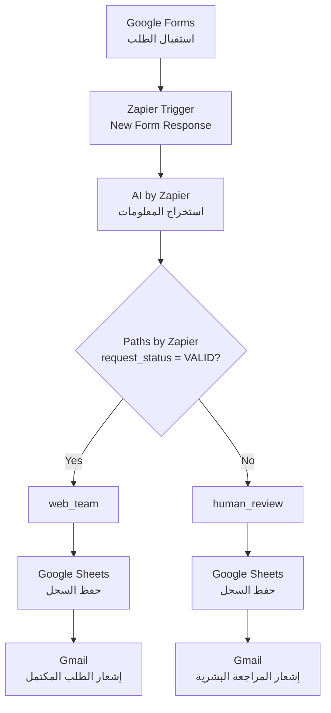

# رحيق | RAHEEQ

### AI-Powered Client Request Management

**نظام ذكي لاستقبال طلبات العملاء وتحليلها وتوجيهها تلقائيًا**

[](https://docs.google.com/forms/d/e/1FAIpQLSf1A8j58o7fnQ3gECBpCiFoPK5jgw3GHozOWuQgpYb_4uuPbQ/viewform?usp=header)


**من وصف العميل إلى طلب منظّم قابل للمتابعة — دون افتراض المعلومات الناقصة.**

</div>


## 🎯 Problem

### The Context

تستقبل الشركات الخدمية والمستقلون طلبات العملاء، لكن وصف الطلب قد يكون غير مكتمل أو يحتوي على عبارات عامة. ويحتاج كل طلب إلى قراءة وفهم واستخراج للمعلومات الأساسية قبل تحديد الخطوة التالية.

### The Problem

المعالجة اليدوية المتكررة تستغرق الوقت وتجعل متابعة الطلبات أقل تنظيمًا، خصوصًا عندما تكون الميزانية أو الموعد المطلوب غير مذكورين بوضوح.

### Why It Matters

يساعد الفرز المنظم على تمييز الطلبات المكتملة عن الطلبات التي تحتاج إلى مراجعة، مع حفظ سجل واضح وإرسال إشعار مناسب لكل حالة.

---

## 💡 Solution

**رحيق | RAHEEQ** هو سير عمل مؤتمت يربط بين Google Forms وZapier والذكاء الاصطناعي وGoogle Sheets وGmail.

يحلل النظام وصف الطلب، ويستخرج المعلومات المذكورة صراحةً، ثم يحدد حالة الطلب ويوجهه إلى المسار المناسب.

| الحالة | المسار | المعنى |
|:---:|:---:|---|
| ✅ `VALID` | `web_team` | طلب مكتمل وفق قواعد التحقق |
| 🟠 `NEEDS_REVIEW` | `human_review` | طلب يحتاج إلى مراجعة بشرية |

### What does the system do?

- يستقبل طلب الخدمة من Google Forms.
- يحلل نص وصف الطلب باستخدام AI by Zapier.
- يستخرج المعلومات الواضحة ويحدد المعلومات الناقصة.
- يوجّه الطلب وفق حالته.
- يحفظ البيانات والنتائج في Google Sheets.
- يرسل إشعارًا بالبريد الإلكتروني حسب المسار.

---

## 👥 Users

### Primary Users

- المستقلون وأصحاب المهارات الذين يستقبلون طلبات خدمات.
- الشركات الناشئة والمشاريع الصغيرة.
- فرق الخدمات التي تحتاج إلى تنظيم الطلبات وفرزها.
- الموظفون المسؤولون عن مراجعة الطلبات ومتابعتها.

### User Need

الحصول على سجل منظم للطلبات، ومعرفة ما يمكن متابعته مباشرةً وما يحتاج إلى معلومات إضافية.

---

## ⚙️ How It Works

### Workflow Steps

| Step | Component | Responsibility |
|:---:|---|---|
| 1 | **Google Forms** | استقبال طلب العميل |
| 2 | **Zapier Trigger** | بدء سير العمل عند وصول استجابة جديدة |
| 3 | **AI by Zapier** | تحليل وصف الطلب واستخراج الحقول |
| 4 | **Paths by Zapier** | تحديد مسار الطلب حسب حالته |
| 5 | **Google Sheets** | حفظ البيانات ونتائج التحليل |
| 6 | **Gmail** | إرسال إشعار مناسب لمسار الطلب |

### Routing Rules

- **إذا كانت الحالة `VALID`:** يُوجَّه الطلب إلى `web_team`، ويُسجّل `needs_human_review = false`.
- **إذا كانت الحالة `NEEDS_REVIEW`:** يُوجَّه الطلب إلى `human_review`، ويُسجّل `needs_human_review = true`.

تظل مراجعة الطلبات الناقصة واستكمال معلوماتها من مسؤولية الفريق البشري.

---

## 🤖 Role of AI

### What does AI do in this solution?

يتلقى AI by Zapier نص وصف الطلب (`request_text`) فقط، ويُنتج الحقول التالية:

| Output Field | Meaning |
|---|---|
| `service_type` | نوع الخدمة المستخرج من الوصف |
| `timeline` | الموعد المذكور بوضوح |
| `budget` | الميزانية إذا ذكرها العميل صراحةً |
| `request_summary` | ملخص الطلب |
| `missing_information` | المعلومات المطلوبة غير المذكورة |
| `request_status` | `VALID` أو `NEEDS_REVIEW` |
| `routing` | `web_team` أو `human_review` |

### What AI Should NOT Do

- **لا يخمّن الميزانية:** لا تُستخرج إلا إذا وردت صراحةً في وصف العميل.
- **لا يحوّل الموعد الغامض إلى موعد محدد:** مثل `soon` أو «قريبًا».
- **لا يحتاج إلى بيانات التواصل للتحليل:** اسم العميل وبريده الإلكتروني ليسا جزءًا من مدخل الذكاء الاصطناعي.
- **لا يستبدل المراجعة البشرية:** الطلبات الناقصة تُوجَّه إلى مسار المراجعة.

---

## 🗂️ Data Design

### Input

يحتوي نموذج Google Forms على الحقول التالية:

- `Client Name`
- `Email`
- `What service do you need`
- `When do you need the service completed`
- `Please describe your request and the result you want to achieve`

> **كيف تُعالج الميزانية؟** لا يوجد حقل مستقل للميزانية في النموذج. إذا ذكرها العميل داخل وصف الطلب، يستخرجها الذكاء الاصطناعي؛ وإذا لم يذكرها، فلا يفترض النظام قيمة من عنده.

يُستخدم نص وصف الطلب (`request_text`) وحده مدخلًا لخطوة الذكاء الاصطناعي. وتبقى الخدمة والمدة اللتان يختارهما العميل في النموذج محفوظتين كبيانات منفصلة.

### Output

يحفظ Google Sheets البيانات في 15 عمودًا:

| # | Field | Purpose |
|:---:|---|---|
| 1 | `submitted_at` | وقت إرسال النموذج |
| 2 | `client_name` | اسم العميل |
| 3 | `email` | البريد الإلكتروني |
| 4 | `service_selected` | الخدمة المختارة في النموذج |
| 5 | `deadline_selected` | المدة المختارة في النموذج |
| 6 | `request_text` | وصف الطلب |
| 7 | `service_type` | نوع الخدمة المستخرج |
| 8 | `timeline` | الموعد المستخرج من الوصف |
| 9 | `budget` | الميزانية المذكورة في الوصف |
| 10 | `request_summary` | ملخص الطلب |
| 11 | `missing_information` | المعلومات الناقصة |
| 12 | `request_status` | حالة الطلب |
| 13 | `routing` | مسار التوجيه |
| 14 | `needs_human_review` | هل يحتاج الطلب إلى مراجعة بشرية؟ |
| 15 | `processed_at` | الحقل المستخدم حاليًا لتسجيل وقت الإرسال |


---

## 🛠️ Tools & Technologies

| Tool | Role |
|---|---|
| **Google Forms** | استقبال الطلبات |
| **Zapier** | ربط الخطوات وتشغيل سير العمل |
| **AI by Zapier** | استخراج المعلومات من وصف الطلب |
| **Paths by Zapier** | توجيه الطلبات |
| **Google Sheets** | تخزين الطلبات والنتائج |
| **Gmail** | إرسال الإشعارات |
| **GitHub** | توثيق المشروع ومشاركة ملفاته |

---

## 🔑 Key Design Decisions

### 1. Limit the AI Input

**Decision:** إرسال نص وصف الطلب فقط إلى الذكاء الاصطناعي.

**Why:** إبقاء التحليل مركّزًا على النص غير المنظم وعدم إرسال بيانات التواصل إلى خطوة الاستخراج.

### 2. Use Explicit Routing Rules

**Decision:** توجيه `VALID` إلى `web_team`، واستخدام `human_review` للطلبات الأخرى.

**Why:** جعل قرار التوجيه واضحًا وقابلًا للاختبار.

### 3. Do Not Assume Missing Information

**Decision:** لا تُفترض الميزانية أو المواعيد غير المحددة.

**Why:** الحفاظ على دقة البيانات وإظهار ما يحتاج إلى استكمال.

### 4. Separate Extraction from Routing

**Decision:** الذكاء الاصطناعي يستخرج الحقول، وPaths by Zapier يطبق قاعدة التوجيه.

**Why:** فصل المسؤوليات يجعل اختبار السلوك ومراجعته أسهل.

---

## 🧪 Testing

**نتيجة الاختبارات:** تم تنفيذ أربع حالات اختبار من إرسال النموذج حتى حفظ السجل وإرسال البريد الإلكتروني، ونجحت الحالات الأربع في إكمال سير العمل.

### Test 1 — Complete Request

**Input**

```text
We need a website for our company. Our budget is $5000. We need it next month.
```

**Expected Result**

| Field | Expected |
|---|---|
| `service_type` | `website` |
| `timeline` | `next month` |
| `budget` | `$5000` |
| `missing_information` | `NONE` |
| `request_status` | `VALID` |
| `routing` | `web_team` |

**Actual Result:** أعاد التحليل القيم المتوقعة، وكان الملخص أطول من المثال المختصر. اكتمل الاختبار حتى حفظ السجل وإرسال البريد.

**Status:** ✅ Passed

### Test 2 — Budget Not Mentioned

**Input**

```text
We need a website for our company. We need it next month.
```

**Expected Result:** عدم افتراض الميزانية، وتحديدها ضمن المعلومات الناقصة، ثم التوجيه إلى `human_review`.

**Actual Result:** `NEEDS_REVIEW`، والمعلومة الناقصة `budget`، والتوجيه `human_review`. اكتمل سير العمل حتى حفظ السجل وإرسال البريد.

**Status:** ✅ Passed

### Test 3 — Vague Timeline

**Input**

```text
We need a website soon. Our budget is $5000.
```

**Expected Result:** عدم اعتبار `soon` موعدًا محددًا، وتوجيه الطلب إلى المراجعة البشرية.

**Actual Result:** جاء حقل الموعد فارغًا، وكانت المعلومة الناقصة `timeline`، والحالة `NEEDS_REVIEW`، والتوجيه `human_review`. اكتمل سير العمل حتى حفظ السجل وإرسال البريد.

**Status:** ✅ Passed

### Test 4 — Timeline and Budget Not Mentioned

**Input**

```text
We need a website for our company.
```

**Expected Result:** عدم افتراض موعد أو ميزانية، وتحديدهما ضمن المعلومات الناقصة.

**Actual Result:** كانت المعلومات الناقصة `timeline, budget`، والحالة `NEEDS_REVIEW`، والتوجيه `human_review`. اكتمل سير العمل حتى حفظ السجل وإرسال البريد.

**Status:** ✅ Passed

---

## 🧭 Workflow Diagram



### Evidence

تم التحقق من حالات الاختبار الأربع من بداية النموذج إلى حفظ البيانات وإرسال البريد.


---

## ⚠️ Challenges & Failures

### What didn't work as expected?

خلال مرحلة البناء والاختبار، احتاجت بعض الخطوات إلى ضبط قبل نجاح سير العمل كاملًا:

- احتاج إعداد Prompt إلى تحديث وربط نص وصف الطلب بمدخل الذكاء الاصطناعي.
- لم تظهر بعض الحقول في قوائم الربط عند استخدام سجل اختبار لا يحتوي على قيم لها.
- ظهرت قيم ديناميكية كنص حرفي في رسالة بريد خلال إحدى مراحل البناء.
- حُذف أحد المسارات بالخطأ أثناء الإعداد، ثم أُعيد بناؤه.
- ظهر في أحد الاختبارات اختلاف بين الموعد المذكور في وصف الطلب والموعد المختار في النموذج؛ وتحتاج أولوية المصدر في هذه الحالة إلى تحديد أوضح.

### How did I solve it?

- تحديث Prompt وربط نص وصف الطلب بمدخل الذكاء الاصطناعي.
- استخدام سجل اختبار يحتوي على قيم لإظهار الحقول المتاحة.
- اختيار القيم الديناميكية من قوائم Zapier بدل إدراجها كنص ثابت.
- إعادة بناء المسار والتحقق من شرط `request_status = VALID`.
- تنفيذ أربعة اختبارات شاملة للتحقق من المسارين.

---

## 📚 What I Learned

### Technical Lesson

تؤثر بيانات الاختبار في الحقول التي تظهر ضمن قوائم الربط؛ لذلك يساعد استخدام سجل اختبار مكتمل على التحقق من الحقول قبل ربطها بالخطوات التالية.

### Problem-Solving Lesson

مقارنة النتائج المتوقعة بالفعلية في كل حالة تساعد على اكتشاف الأخطاء والتحقق من سلوك سير العمل كاملًا.

### AI Lesson

يتطلب استخراج المعلومات قواعد واضحة للبيانات الناقصة والعبارات الغامضة، مع منع النموذج من تخمين معلومات لم يذكرها العميل.

---

## 🚀 Future Improvements

- تحديد قاعدة واضحة عند اختلاف الموعد المذكور في وصف الطلب عن الموعد المختار في النموذج.
- تسجيل وقت المعالجة الفعلي في `processed_at` بدل وقت إرسال النموذج.
- توجيه إشعارات المراجعة إلى بريد مشترك للفريق عند تهيئة النظام للاستخدام التشغيلي.
- توسيع الاختبارات لتشمل الأوصاف غير الواضحة والطلبات التي تتضمن معلومات متعارضة.

---

## 🔗 Project Links

- **Request Form:** [نموذج استقبال طلبات رحيق](https://docs.google.com/forms/d/e/1FAIpQLSf1A8j58o7fnQ3gECBpCiFoPK5jgw3GHozOWuQgpYb_4uuPbQ/viewform?usp=header)
- **Zapier Template:** [قالب رحيق على Zapier](https://zapier.com/templates/details/raheeq-ai-powered-client-request-management-c5b92a)
- **GitHub Repository:** ( https://github.com/doaasami9/RAHEEQ ).

---

## 👩‍💻 Author

<div align="center">

### DOAA SAMI AL-BATNIJI

**Computer Engineer | Data, AI & Automation**

[LinkedIn](https://www.linkedin.com/in/doaa-sami-984426271/) · [GitHub](https://github.com/doaasami9)

</div>

---

<div align="center">

*RAHEEQ — Organize requests. Validate information. Route with clarity.*

</div>
