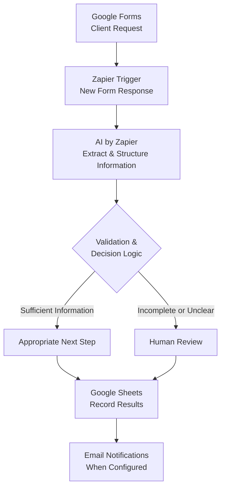

# AI Client Intake & Request Routing System

> **نظام ذكي لأتمتة استقبال طلبات العملاء وتحليلها وتوجيهها وفق قواعد واضحة، مع إحالة الطلبات غير المكتملة أو غير الواضحة إلى المراجعة البشرية.**

## 🎯 Problem

### The Context

تستقبل شركات الخدمات طلبات من عملاء محتملين عبر النماذج الإلكترونية. وقد تتضمن الطلبات أوصافًا تفصيلية للاحتياجات، أو رسائل قصيرة، أو معلومات ناقصة وغير واضحة.

تحتاج الشركة إلى فهم كل طلب، واستخراج المعلومات المهمة، والتحقق من اكتمالها، ثم تحديد الإجراء المناسب قبل متابعة العمل.

### The Problem

تعتمد المعالجة التقليدية على قراءة الموظفين لكل طلب يدويًا، وتنظيم بياناته، والتحقق من المعلومات، وتحديد الخطوة التالية. ومع تزايد الطلبات، تصبح هذه العملية متكررة وتستهلك الوقت والجهد، وقد تؤدي إلى تأخر المتابعة أو إغفال تفاصيل مهمة.

### Why It Matters

يساعد تنظيم عملية استقبال الطلبات ومعالجتها على تقليل المهام اليدوية المتكررة، وتوحيد آلية اتخاذ القرار، وتحسين إمكانية تتبع الطلبات، وتحديد الحالات التي تحتاج إلى معلومات إضافية أو مراجعة بشرية.

---

## 💡 Solution

يهدف **AI Client Intake & Request Routing System** إلى أتمتة المعالجة الأولية لطلبات العملاء باستخدام الذكاء الاصطناعي وWorkflow Automation.

يجمع النظام بين استخراج المعلومات من نصوص العملاء، وتطبيق قواعد واضحة لتحديد مسار الطلب، وتسجيل النتائج، وإرسال الإشعارات المناسبة.

### What does the system do?

- يستقبل طلبات العملاء من خلال `Google Forms`.
- يستخرج المعلومات ذات الصلة وينظمها باستخدام `AI by Zapier`.
- يساعد على تحديد المعلومات الناقصة أو غير الواضحة.
- يوجّه الطلبات وفق قواعد محددة مسبقًا.
- يسجل بيانات الطلب ونتيجة معالجته في `Google Sheets`.
- يتيح إحالة الحالات التي تحتاج إلى توضيح أو حكم بشري إلى المراجعة البشرية.
- يدعم إرسال الإشعارات المرتبطة بنتيجة المعالجة وفق إعدادات الـ Workflow.

---

## 👤 Users

### Primary Users

- شركات الخدمات.
- فرق المبيعات وخدمة العملاء.
- الموظفون المسؤولون عن استقبال طلبات العملاء ومراجعتها.
- الشركات الصغيرة التي تحتاج إلى تنظيم عملية استقبال الطلبات.

### User Need

الحاجة إلى آلية موحدة تساعد على جمع طلبات العملاء وفهمها وتنظيمها وتحديد الخطوة التالية، دون تكرار جميع خطوات المعالجة الأولية يدويًا لكل طلب.

---

## 🧠 How I Designed the Solution

اعتمد التصميم على **Process-First Engineering**؛ أي فهم العملية قبل البدء في بناء الأتمتة.

بدأت العملية بتحديد المشكلة والنتيجة المطلوبة، ثم تقسيم العمل إلى خطوات مترابطة، وتحديد البيانات اللازمة، وتصميم قواعد القرار والحالات الاستثنائية.

بعد ذلك، جرى تحويل التحليل إلى Workflow يجمع بين قدرات الذكاء الاصطناعي في فهم النصوص وتنظيم المعلومات، وRule-Based Logic في تحديد المسار المناسب، مع الاحتفاظ بالمراجعة البشرية للحالات التي لا ينبغي حسمها دون تحقق إضافي.

### Engineering Documentation

| File | Purpose |
|---|---|
| `01-business-analysis.md` | تحليل العمل والمشكلة والنتيجة المطلوبة. |
| `02-workflow-decomposition.md` | تفكيك العملية إلى خطوات ومهام. |
| `03-data-design.md` | تحديد البيانات المطلوبة وتنظيمها. |
| `04-decision-and-exception-design.md` | تصميم قواعد القرار والتعامل مع الحالات الاستثنائية. |
| `05-automation-design.md` | تصميم Workflow اعتمادًا على التحليل السابق. |
| `06-zapier-implementation.md` | توثيق التنفيذ والاختبارات باستخدام Zapier. |

> **ملاحظة:** هذه هي بنية التوثيق المقترحة للمشروع. تُراجع أسماء الملفات النهائية ومحتوياتها قبل اعتماد المستودع.

---

## ⚙️ How It Works

### Workflow Overview

### Process Steps

1. **Input:** يرسل العميل طلبه عبر `Google Forms`.
2. **Trigger:** يستقبل `Zapier` الرد الجديد ويبدأ الـ Workflow.
3. **AI Processing:** يستخرج `AI by Zapier` المعلومات ذات الصلة وينظمها.
4. **Validation:** تُراجع المعلومات وفق متطلبات العملية وقواعد القرار المحددة.
5. **Routing:** يُوجّه الطلب إلى الخطوة المناسبة بناءً على نتيجة التحقق.
6. **Output:** تُسجل البيانات والنتائج في `Google Sheets`، وتُرسل الإشعارات وفق الإعدادات المعتمدة.

---

## 🤖 Role of AI

### What does AI do in this solution?

- تحليل نصوص طلبات العملاء المكتوبة بصيغ مختلفة.
- استخراج المعلومات ذات الصلة من النصوص غير المنظمة.
- تنظيم المعلومات في حقول محددة مسبقًا.
- المساعدة في تحديد المعلومات الناقصة أو غير الواضحة.
- توفير مخرجات منظمة يمكن استخدامها ضمن خطوات الأتمتة.

### What AI Should NOT Do

- اختراع معلومات لم يذكرها العميل.
- اعتبار المعلومات الناقصة حقائق مؤكدة.
- اتخاذ قرارات غير مدعومة بالبيانات أو قواعد العمل.
- حسم الحالات الغامضة دون مراجعة مناسبة.
- استبدال الحكم البشري عندما يحتاج الطلب إلى توضيح أو قرار إضافي.

---

## 🔄 Automation

### What parts of the process are automated?

- بدء الـ Workflow عند استقبال رد جديد من النموذج.
- تمرير بيانات الطلب إلى خطوة معالجة الذكاء الاصطناعي.
- استخراج المعلومات وتنظيمها.
- تطبيق قواعد التوجيه المحددة مسبقًا.
- تسجيل بيانات الطلب ونتائج المعالجة في `Google Sheets`.
- إحالة الحالات التي تستدعي مراجعة بشرية إلى المسار المناسب.
- إرسال الإشعارات المرتبطة بنتيجة المعالجة، عند إعداد خطوات الإرسال.

---

## 🗂️ Data

### Input

تتضمن البيانات المدخلة المعلومات التي يجمعها النموذج الإلكتروني، مثل:

- بيانات العميل التي يطلبها النموذج.
- نوع الخدمة المطلوبة، إذا كان الحقل موجودًا.
- وصف الطلب واحتياجات العميل.
- أي معلومات إضافية يقدمها العميل عبر النموذج.

تعتمد الحقول الفعلية على تصميم النموذج المستخدم في التنفيذ.

### Output

تشمل المخرجات المتوقعة من تصميم النظام:

- بيانات طلب منظمة.
- المعلومات المستخرجة من وصف العميل.
- نتيجة التحقق من اكتمال المعلومات.
- قرار التوجيه أو الإجراء التالي.
- حالة المراجعة البشرية، عند الحاجة.
- سجل لبيانات الطلب ونتائج المعالجة في `Google Sheets`.
- إشعارات مرتبطة بنتيجة المعالجة، وفق إعدادات الـ Workflow.

---

## 🛠️ Tools & Technologies

| Tool | Purpose |
|---|---|
| **Google Forms** | استقبال طلبات العملاء من خلال نموذج إلكتروني. |
| **Google Sheets** | تخزين بيانات الطلبات ونتائج معالجتها. |
| **Zapier** | ربط الأدوات وبناء Workflow للأتمتة. |
| **AI by Zapier** | استخراج المعلومات من نصوص العملاء وتنظيمها. |
| **GitHub** | توثيق المشروع وحفظ ملفات التحليل والتصميم والتنفيذ. |

> قد تختلف الإمكانات المتاحة بحسب الخطة المستخدمة في الأدوات.

---

## 🔑 Key Design Decisions

### Decision 1 — Understand the Process Before Automating

**Decision:** تحليل العملية الحالية وتحديد خطواتها ومتطلباتها قبل بناء الأتمتة.

**Why:** لضمان أن يعالج النظام المشكلة الفعلية، بدلًا من تحويل عملية غير واضحة إلى خطوات آلية.

### Decision 2 — Combine AI with Rule-Based Logic

**Decision:** استخدام الذكاء الاصطناعي لفهم النصوص وتنظيم المعلومات، مع الاعتماد على قواعد محددة لتوجيه الطلبات.

**Why:** يتيح ذلك الاستفادة من مرونة AI في التعامل مع اللغة، مع جعل قرارات التوجيه أكثر وضوحًا وقابلية للاختبار.

### Decision 3 — Include Human Review

**Decision:** تخصيص مسار للحالات الناقصة أو غير الواضحة التي تحتاج إلى مراجعة بشرية.

**Why:** ليست كل الطلبات قابلة للمعالجة الموثوقة دون توضيح إضافي، والمراجعة البشرية تحد من القرارات غير المدعومة بالمعلومات.

### Decision 4 — Maintain Structured Records

**Decision:** تسجيل بيانات الطلبات ونتائج معالجتها في `Google Sheets`.

**Why:** توفير سجل منظم يسهل الرجوع إليه ومتابعة الطلبات ومراجعة نتائج المعالجة.

---

## 🧪 Testing

يُستخدم هذا القسم لتوثيق الاختبارات الفعلية ومقارنة النتائج المتوقعة بالنتائج التي ظهرت أثناء التنفيذ.

> الحالات التالية سيناريوهات اختبار مقترحة، وليست ادعاءً بأنها نُفذت أو نجحت بالفعل.

### Test 1 — Complete Client Request

**Input:**  
طلب واضح لخدمة تصميم موقع إلكتروني، يتضمن المعلومات المطلوبة للمتابعة.

**Expected Result:**  
استخراج المعلومات المتاحة، والتحقق من استيفاء المتطلبات، وتوجيه الطلب وفق القواعد المحددة، مع تسجيل النتيجة.

**Actual Result:** (أضيفي النتيجة الفعلية بعد الاختبار.)

**Status:** ⏳ (لم تُحدد بعد.)

### Test 2 — Incomplete Client Request

**Input:**  
طلب لا يتضمن إحدى المعلومات المطلوبة، مثل تفاصيل الهدف من المشروع.

**Expected Result:**  
تحديد المعلومات الناقصة وإحالة الطلب إلى المسار المناسب للمراجعة أو الاستيضاح، بدلًا من اعتباره مكتملًا.

**Actual Result:** (أضيفي النتيجة الفعلية بعد الاختبار.)

**Status:** ⏳ (لم تُحدد بعد.)

### Test 3 — Unclear Client Request

**Input:**  
رسالة عامة مثل: `I need help with my business website.`

**Expected Result:**  
استخراج المعلومات المدعومة بالنص فقط، وإحالة الطلب إلى المراجعة إذا لم تكن المعلومات كافية للخطوة التالية.

**Actual Result:** (أضيفي النتيجة الفعلية بعد الاختبار.)

**Status:** ⏳ (لم تُحدد بعد.)

### Test 4 — Record and Routing Verification

**Input:**  
إرسال طلب جديد من `Google Forms` عبر الـ Workflow.

**Expected Result:**  
تسجيل البيانات ونتيجة المعالجة بصورة صحيحة، والتحقق من تنفيذ المسار والإشعارات المرتبطة به وفق الإعدادات.

**Actual Result:** (أضيفي النتيجة الفعلية بعد الاختبار.)

**Status:** ⏳ (لم تُحدد بعد.)

---

## 📸 Evidence

تُضاف الصور هنا لتوضيح التنفيذ العملي وربط التصميم بالنتائج الفعلية.

### 1. Final Result

**ما توضحه الصورة:** مثال فعلي على الطلب بعد معالجته، مع ظهور البيانات المنظمة ونتيجة التوجيه في السجل.

**Screenshot:** (أضيفي صورة من `Google Sheets` بعد التحقق من النتيجة.)

### 2. Workflow

**ما توضحه الصورة:** تسلسل خطوات الأتمتة من استقبال الطلب إلى معالجة AI وتحديد المسار وتسجيل البيانات وإرسال الإشعارات.

**Screenshot:** (أضيفي صورة واضحة للـ Workflow في Zapier.)

### 3. AI Processing

**ما توضحه الصورة:** إعداد خطوة `AI by Zapier` ومثال على المعلومات التي تستخرجها من طلب العميل.

**Screenshot:** (أضيفي صورة لخطوة AI ونتيجة اختبار فعلية، مع إخفاء بيانات العملاء الحقيقية.)

### 4. Routing and Notifications

**ما توضحه الصورة:** قواعد التوجيه والإجراءات المرتبطة بكل مسار.

**Screenshot:** (أضيفي صورة للـ Paths والإجراءات المرتبطة بها، إذا كانت موجودة في التنفيذ.)

---

## ⚠️ Challenges & Failures

### What didn't work as expected?

(وثّقي هنا التحديات التي واجهتِها فعلًا أثناء بناء المشروع أو اختباره، إن وُجدت.)

### How did I solve it?

(وضّحي المشكلة، والخطوة التي اتخذتِها لمعالجتها، والنتيجة التي تحققت منها. إذا لم تواجهي مشكلة فعلية، يمكن توضيح ذلك بدل اختراع تحديات.)

---

## 📚 What I Learned

### Technical Lesson

فهم كيفية ربط أدوات جمع البيانات ومعالجتها وتخزينها ضمن Workflow واحد، وكيفية تحويل المخرجات إلى بيانات منظمة يمكن استخدامها في الخطوات اللاحقة.

### Problem-Solving Lesson

أهمية فهم المشكلة وتحليل العملية وتحديد البيانات وقواعد القرار قبل البدء في تنفيذ الأتمتة.

### AI Lesson

يمكن للذكاء الاصطناعي المساعدة في تفسير النصوص غير المنظمة واستخراج المعلومات منها، لكن يجب تحديد نطاق عمله والتحقق من مخرجاته وتوفير مسار آمن للحالات غير الواضحة.

---

## 🔮 Future Improvements

إذا استمر تطوير المشروع، يمكن دراسة التحسينات التالية بحسب الحاجة:

- إضافة تحقق أقوى من الحقول الناقصة أو غير الصحيحة.
- تحسين معالجة الأخطاء وتسجيل حالات فشل خطوات الأتمتة.
- إضافة تتبع لحالة الطلب وتذكيرات للمتابعة.
- تطوير آلية لمراجعة مخرجات AI غير المؤكدة.
- قياس دقة استخراج المعلومات ودقة التوجيه وزمن المعالجة.
- توسيع قواعد التوجيه لتناسب خدمات ومتطلبات إضافية.

> هذه أفكار تطوير مستقبلية، وليست وظائف يُفترض أنها موجودة في النسخة الحالية.

---

## 🔗 Project Links

| Resource | Link |
|---|---|
| **Zapier Template** | [AI Client Intake & Request Routing System](https://zapier.com/templates/details/ai-client-intake-request-routing-e485e6) |
| **Live Demo** | (أضيفي رابطًا إذا كان هناك نموذج تجريبي مناسب للمشاركة.) |
| **Workflow** | (أضيفي رابط الـ Workflow الفعلي إذا كان متاحًا للمشاركة.) |
| **Repository** | (أضيفي رابط مستودع GitHub بعد إنشائه ورفع الملفات.) |

---

## 👩‍💻 Author

**Doaa Sami Al-Batniji**  
Computer Engineer | Data, AI & Automation

[GitHub](https://github.com/doaasami9) · [LinkedIn](https://www.linkedin.com/in/doaa-sami-984426271/)

---

  <strong>Think First. Build Later.</strong> 
  فهم المشكلة أولًا، ثم تصميم الحل، وبعدها بناء الأتمتة واختبارها.

