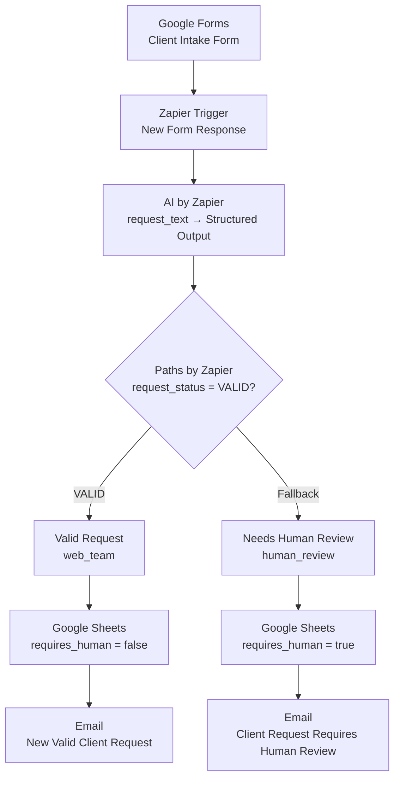

# AI Client Intake & Request Routing System

### U1 — Process & Data Thinking

نظام أتمتة يستقبل طلبات العملاء من Google Forms، ويستخدم AI by Zapier لتحويل نص الطلب غير المنظم إلى بيانات منظمة، ثم يوجّه الطلب عبر قواعد واضحة إلى مسار المتابعة أو إلى المراجعة البشرية، ويسجّل النتيجة في Google Sheets ويرسل الإشعار المناسب.

> **AI → Understand · Rule / Logic → Control · Human → Judge**

---

## 🎯 Problem

### The Context

تستقبل شركة خدمات (تصميم مواقع، تسويق رقمي، تطوير تطبيقات) طلبات من عملاء محتملين عبر النماذج الإلكترونية. يرسل كل عميل طلبه بطريقته: قد يشرح احتياجه بالتفصيل، أو يرسل رسالة قصيرة، أو ينسى ذكر معلومات مهمة.

### The Problem

يحتاج الموظف إلى قراءة كل طلب وفهمه وتنظيم معلوماته والتحقق من اكتمالها ثم تحديد الخطوة التالية. ومع زيادة الطلبات تصبح هذه العملية عبئًا متكررًا يستهلك الوقت وقد يؤدي إلى تأخر المتابعة أو فقدان تفاصيل مهمة.

### Why It Matters

المشكلة ليست في استقبال الرسائل، بل في كيفية معالجة الطلبات وتنظيمها وتحديد الإجراء المناسب لكل طلب، مع إبقاء الحالات غير المكتملة تحت مراجعة إنسان.

## 💡 Solution

سير عمل مؤتمت يوزّع المسؤوليات بوضوح: الذكاء الاصطناعي يفهم الطلب ويستخرج المعلومات، والمنطق (Paths) يتحكم في المسار، والإنسان يحكم في الحالات الناقصة أو الغامضة.

### What does the system do?

- يستقبل طلب العميل من Google Forms.
- يرسل نص الطلب (`request_text`) إلى AI by Zapier.
- يستخرج `service_type` و`timeline` و`budget` دون تخمين.
- يحدد `request_status`: `VALID` أو `NEEDS_REVIEW`.
- يوجّه الطلب المكتمل إلى `web_team` والناقص إلى `human_review`.
- يسجّل الطلب ونتائج التحليل في Google Sheets.
- يرسل بريدًا مناسبًا لكل مسار.

## 👤 Users

### Primary Users:

- موظفو استقبال الطلبات ومراجعتها.
- فريق الويب المسؤول عن متابعة الطلبات المكتملة.
- شركات الخدمات التي تستقبل طلبات عملاء عبر النماذج.

### User Need:

معرفة الطلبات الجاهزة للمتابعة، وتحديد المعلومات الناقصة في الطلبات الأخرى، والاحتفاظ بسجل منظم لكل طلب.

## 🧠 How I Designed the Solution

اتبع التصميم الرحلة الهندسية: **Understand → Design → Build → Test → Refine**. بدأ بفهم العمل وتقسيمه إلى خطوات، ثم تحديد البيانات والقرارات والاستثناءات، ثم تصميم الأتمتة وبنائها.

يعتمد القرار على إشارة واضحة واحدة هي `request_status` بدل أن يفسّر الـ Path عدة حقول (`budget` و`timeline`...). وتُعامل الحالات غير المكتملة كـ **Business Exception** تُوجَّه إلى إنسان، لا كخطأ تقني.

## ⚙️ How It Works

### Input

يُدخل العميل الاسم والبريد والشركة ونص الطلب في Google Forms. نص الطلب هو البيانات غير المنظمة.

↓

### Step 1 — Trigger

يبدأ Zapier عند وصول استجابة جديدة إلى النموذج (New Form Response).

↓

### AI / Logic

يحلل AI by Zapier نص الطلب ويرجع حقولًا منظمة وحالة الطلب.

↓

### Step 2 — Routing

- `request_status` Exactly matches `VALID` → **Valid Request** (`web_team`).
- أي حالة أخرى → **Needs Human Review** (`human_review`)، وهو مسار افتراضي بلا شرط.

↓

### Output

صف في Google Sheets وإشعار بريدي مختلف لكل مسار.

## 🤖 Role of AI

### What does AI do in this solution?

- يقرأ نص الطلب فقط (`request_text`).
- يستخرج `service_type` و`timeline` و`budget` كما وردت صراحةً.
- يلخص الطلب دون افتراضات.
- يحدد `missing_information` (`service_type` / `timeline` / `budget` أو `NONE`).
- يعيد `request_status` و`routing` وفق قواعد الـ Prompt.

### What AI Should NOT Do

- اختراع أو تقدير أو استنتاج أي معلومة غير مذكورة.
- تحويل موعد غامض (`soon`، `urgently`، `as soon as possible`...) إلى موعد محدد.
- استلام باقي بيانات العميل كمدخل.
- إدارة العملية كاملة؛ فقرار المسار يعتمد على قاعدة واضحة وقابلة للاختبار.

## 🔄 Automation

### What parts of the process are automated?

- استقبال استجابات النموذج.
- استخراج المعلومات وتنظيمها.
- تحديد حالة الطلب والمسار.
- تسجيل الطلب في Google Sheets.
- إرسال الإشعار المناسب.

تبقى مراجعة الطلبات غير المكتملة واتخاذ قرار المتابعة مسؤولية بشرية.

## 🗂️ Data

### Input

حقول Google Forms (نموذج **Client Intake Form**):

| Field | Type |
|---|---|
| `Client Name` | Short answer |
| `Email` | Email |
| `Company` | Short answer |
| `Request` | Paragraph |

يرسل سير العمل إلى AI الحقل `Request` فقط عبر المدخل `request_text`.

### Output

| Field | Purpose |
|---|---|
| `service_type` | الخدمة المستخرجة |
| `timeline` | الموعد المذكور بوضوح |
| `budget` | الميزانية المذكورة صراحةً |
| `request_summary` | ملخص الطلب |
| `missing_information` | المعلومات الناقصة أو `NONE` |
| `request_status` | `VALID` أو `NEEDS_REVIEW` |

يُسجَّل الطلب في Google Sheets (**AI Client Intake Records**) بـ 13 عمودًا:

```text
client_name, email, company, request_text, service_type, request_summary,
timeline, budget, missing_information, request_status, requires_human,
routing, processed_at
```

القيم الثابتة حسب المسار: `requires_human = false` و`routing = web_team` في مسار Valid، و`requires_human = true` و`routing = human_review` في مسار المراجعة.

## 🛠️ Tools & Technologies

| Tool | Purpose |
|---|---|
| Google Forms | استقبال طلبات العملاء |
| Zapier | تشغيل سير العمل وربط الخطوات |
| AI by Zapier | استخراج المعلومات المنظمة من نص الطلب |
| Paths by Zapier | توجيه الطلب حسب حالته |
| Google Sheets | سجل الطلبات ونتائج المعالجة |
| Email | إشعار الفريق حسب المسار |
| GitHub | توثيق المشروع |

## 🔑 Key Design Decisions

### Decision 1

**Decision:**

استخدام `request_status` كإشارة وحيدة للتوجيه.

**Why:**

يجعل منطق القرار أبسط وأوضح وأسهل في الاختبار والتصحيح من تفسير عدة حقول داخل الـ Path.

### Decision 2

**Decision:**

جعل مسار Needs Human Review هو المسار الافتراضي (Fallback) وعدم استخدام Filter by Zapier.

**Why:**

الهدف ليس إيقاف الحالات الاستثنائية بل توجيهها (Route the exception)، فأي طلب لا يحقق شرط `VALID` يذهب إلى إنسان.

### Decision 3

**Decision:**

تمرير نص الطلب فقط إلى AI.

**Why:**

تركيز المهمة على النص غير المنظم دون حاجة لإرسال كل بيانات العميل.

### Decision 4

**Decision:**

اختبار خطوة AI قبل بناء الـ Paths.

**Why:**

إذا كان الناتج المنظم خاطئًا فلن تتخذ الأتمتة قرارًا صحيحًا (Garbage In → Garbage Out).

### Decision 5

**Decision:**

التمييز بين الاستثناء التجاري (طلب ناقص) والخطأ التقني (فشل خطوة).

**Why:**

الأول يُوجَّه إلى المراجعة البشرية، والثاني يحتاج إلى تصحيح (Debugging).

## 🧪 Testing

تم اختبار أربع حالات من إرسال النموذج حتى السجل والبريد، ووفق تأكيد صاحبة المشروع نجحت جميعها. ويُجرى كل اختبار بتغيير مدخل النموذج فقط دون إعادة بناء الـ Zap.

### Test 1 — Complete Request

**Input:**

```text
We need a website for our company. Our budget is $5000. We need it next month.
```

**Expected Result:**

`website` / `next month` / `$5000` / `NONE` / `VALID`. مسار Valid Request. الشيت: `requires_human = false`, `routing = web_team`. البريد: New Valid Client Request.

**Actual Result:**

نجح الاختبار وفق تأكيد صاحبة المشروع.

**Status:** ✅

### Test 2 — Missing Budget

**Input:**

```text
We need a website for our company. We need it next month.
```

**Expected Result:**

`website` / `next month` / `null` / `budget` / `NEEDS_REVIEW`. مسار Needs Human Review. الشيت: `requires_human = true`, `routing = human_review`. البريد: Client Request Requires Human Review.

**Actual Result:**

نجح الاختبار وفق تأكيد صاحبة المشروع.

**Status:** ✅

### Test 3 — Ambiguous Timeline

**Input:**

```text
We need a website soon. Our budget is $5000.
```

**Expected Result:**

`website` / `null` / `$5000` / `timeline` / `NEEDS_REVIEW`. مسار Needs Human Review.

**Actual Result:**

نجح الاختبار وفق تأكيد صاحبة المشروع.

**Status:** ✅

### Test 4 — Multiple Missing Fields

**Input:**

```text
We need a website for our company.
```

**Expected Result:**

`website` / `null` / `null` / `timeline, budget` / `NEEDS_REVIEW`. مسار Needs Human Review.

**Actual Result:**

نجح الاختبار وفق تأكيد صاحبة المشروع.

**Status:** ✅

## 📸 Evidence

### Final Result

```text
Unstructured Request
        ↓
        AI
        ↓
Structured Data → request_status
        ↓
┌───────────────┬──────────────────┐
│     VALID     │   NEEDS_REVIEW   │
│   web_team    │   human_review   │
└───────────────┴──────────────────┘
        ↓                ↓
  Google Sheets    Google Sheets
        ↓                ↓
  Valid Email      Review Email
```

### Workflow



### Test Matrix

| Test | Scenario | Expected Status | Expected Path | Result |
|---|---|---|---|---|
| 01 | Complete request | `VALID` | Valid Request | ✅ |
| 02 | Missing budget | `NEEDS_REVIEW` | Human Review | ✅ |
| 03 | Ambiguous timeline | `NEEDS_REVIEW` | Human Review | ✅ |
| 04 | Multiple missing fields | `NEEDS_REVIEW` | Human Review | ✅ |

> يمكن إضافة صور فعلية من Zapier وGoogle Sheets والبريد هنا، مع إخفاء أي بيانات شخصية.

## ⚠️ Challenges & Failures

### What didn't work as expected?

(أضيفي هنا ما واجهتِه فعليًا أثناء البناء والاختبار.)

### How did I solve it?

(أضيفي هنا كيف عالجتِه.)

## 📚 What I Learned

### Technical Lesson

الفرق بين الـ Trigger (الحدث الذي يبدأ الأتمتة) والـ Input (البيانات التي وصلت معه)، وكيف تتحول البيانات غير المنظمة إلى حقول منظمة عبر AI.

### Problem-Solving Lesson

اختبار كل طبقة بالترتيب (Trigger ← AI ← Status ← Path ← Sheets ← Email) ومقارنة المتوقع بالفعلي لتحديد أول نقطة فشل بدل تغيير كل شيء عشوائيًا.

### AI Lesson

توزيع المسؤوليات: AI يفهم، والمنطق يتحكم، والإنسان يحكم؛ فلا نجعل AI يدير العملية كاملة.

## 🔮 Future Improvements

### If I continued developing this project, I would:

- إضافة حالات اختبار أخرى، مثل طلب يذكر أكثر من خدمة أو معلومات متعارضة.
- تسجيل وقت المعالجة الفعلي في `processed_at`.
- توجيه بريد المراجعة إلى بريد مشترك للفريق.
- إضافة طريقة لتتبع الأخطاء التقنية (فشل خطوة) بصورة منفصلة عن حالات المراجعة.

## 📁 Repository Structure

```text
AI-Client-Intake-Request-Routing/
├── README.md
├── 01-business-analysis.md
├── 02-workflow-decomposition.md
├── 03-data-design.md
├── 04-decision-and-exception-design.md
├── 05-automation-design.md
└── 06-zapier-implementation.md
```

## 🔗 Project Links

**Request Form:** [Client Intake Form](https://docs.google.com/forms/d/e/1FAIpQLScz3w8sWc5KHbgJeUR3C7tu2xmZm2nipk5W8OCJMdUVRUeyRQ/viewform?usp=header)

**Zapier Template:** [AI Client Intake & Request Routing](https://zapier.com/templates/details/ai-client-intake-request-routing-e485e6)

**Repository:** (أضيفي رابط المستودع الفعلي من GitHub هنا.)

## 👩‍💻 Author

دعاء سامي البطنيجي

Computer Engineer | Data, AI & Automation

[LinkedIn](https://www.linkedin.com/in/doaa-sami-984426271/) · [GitHub](https://github.com/doaasami9)
