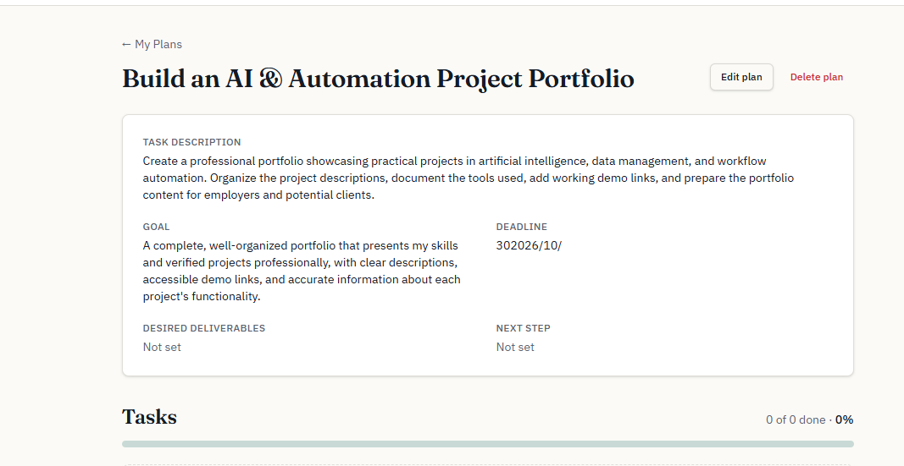
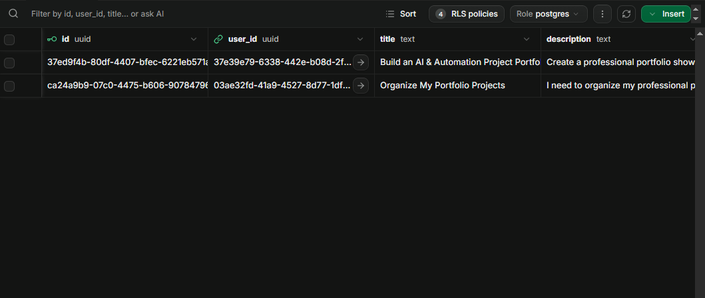
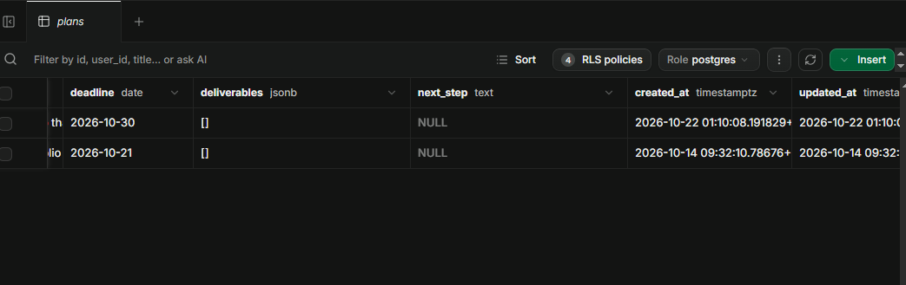

 

# TaskBridge

### Turn Unclear Requests Into Clear, Actionable Plans.

**منصة ذكية لتنظيم طلبات العمل وتحويلها إلى خطط واضحة ومهام قابلة للتنفيذ.**

[Live Demo](https://screenshot-magic-4807.lovable.app/) · [Screenshots](https://github.com/doaasami9/doaa-S-AlBatniji-ai-automationportfolio/tree/main/03-Evaluation%20%26%20Diagnostic%20Thinking/Course-Project/Screenshots) · [GitHub Profile](https://github.com/doaasami9)

---

## 📌 Project Overview | نبذة عن المشروع

**TaskBridge** هو تطبيق ويب تفاعلي يساعد المستقلين والمهنيين في بداية مسيرتهم على تنظيم طلبات العمل وتحويلها من أفكار عامة أو متطلبات غير واضحة إلى **خطط عمل منظمة، ومهام محددة، وأولويات واضحة، ومؤشرات قابلة للمتابعة**.

يوفّر التطبيق مساحة عمل مركزية لإنشاء الخطط وحفظها، وإدارة المهام المرتبطة بها، ومتابعة الإنجاز، وتعديل تفاصيل العمل عند الحاجة.

يهدف المشروع إلى تبسيط الانتقال من فهم المطلوب إلى تنظيم خطوات التنفيذ، مع الحفاظ على وضوح الأهداف وسهولة متابعة التقدم.

## 🎯 Problem Statement | المشكلة

قد تبدأ المشاريع والطلبات المهنية بوصف عام للنتيجة المطلوبة، دون تقسيم واضح للعمل أو تحديد الأولويات والخطوات اللازمة لإنجازه.

ينتج عن ذلك صعوبة في تنظيم المهام، ومتابعة التقدم، والعودة إلى تفاصيل العمل بصورة منهجية.

يعالج TaskBridge هذه المشكلة من خلال توفير بيئة منظمة تساعد المستخدم على:

- توضيح الهدف والنتيجة النهائية المطلوبة.
- تقسيم العمل إلى مهام مستقلة وقابلة للإدارة.
- تحديد أولوية كل مهمة.
- متابعة حالة التنفيذ ونسبة الإنجاز.
- حفظ الخطط والعودة إليها لإدارة العمل باستمرار.

## 💡 Proposed Solution | الحل المقترح

يحوّل TaskBridge متطلبات العمل إلى **Work Plans** تحتوي على وصف واضح ونتيجة مستهدفة ومهام مرتبطة بها، مع إمكانية تحديد موعد نهائي اختياري.

ومن خلال تحديث حالة المهام، يستطيع المستخدم متابعة تقدم الخطة اعتمادًا على المهام المكتملة مقارنة بإجمالي المهام.

وبذلك يجمع التطبيق بين **Work Planning وTask Management وProgress Tracking** ضمن تجربة استخدام واحدة.

## ✨ Core Features | المميزات الرئيسية

### 🔐 Authentication & Account Management
- إنشاء حساب وتسجيل الدخول.
- دعم تأكيد البريد الإلكتروني.
- إدارة جلسة المستخدم وتسجيل الخروج.
- حماية الصفحات التي تتطلب تسجيل الدخول.

### 📋 Work Plan Management
- إنشاء خطط عمل بعنوان ووصف ونتيجة مستهدفة.
- تحديد موعد نهائي اختياري.
- عرض الخطط المحفوظة والعودة إليها.
- تعديل الخطط وحذفها.
- عرض عدد المهام المكتملة والإجمالي ونسبة الإنجاز.

### ✅ Task Management
- إضافة المهام المرتبطة بكل خطة.
- تعديل المهام وحذفها.
- تحديد الأولوية: **High / Medium / Low**.
- تحديث حالة المهمة: **To Do / In Progress / Done**.

### 📊 Progress Tracking
- حساب نسبة الإنجاز بناءً على المهام المكتملة.
- تحديث مؤشرات التقدم عند تغيير حالة المهام.
- عرض تقدم كل خطة بطريقة واضحة.
- تسهيل متابعة العمل وتحديد المهام المتبقية.

### 📱 Responsive Design
- واجهة مناسبة للاستخدام على الحاسوب والهاتف.
- تنظيم واضح للمعلومات والمهام.
- تجربة استخدام تركّز على سهولة الوصول إلى الخطط وإدارتها.

## 🛠️ Technology Stack | التقنيات المستخدمة

| Technology | الاستخدام |
|---|---|
| **Lovable** | بناء التطبيق وتطوير واجهته وتدفقاته |
| **Supabase Auth** | المصادقة وإدارة حسابات المستخدمين والجلسات |
| **Supabase PostgreSQL** | تخزين بيانات الخطط والمهام بصورة مستمرة |
| **Row-Level Security (RLS)** | تطبيق سياسات الوصول إلى البيانات بحسب المستخدم |

## 🔒 Data Security & Access Control | أمن البيانات

يعتمد التطبيق على المصادقة وسياسات الوصول إلى البيانات للمساعدة في حماية خصوصية المستخدمين.

تُستخدم **Row-Level Security (RLS)** لتقييد الوصول إلى السجلات وفق سياسات المستخدم، بحيث يتمكن كل مستخدم من إدارة بياناته الخاصة دون الوصول إلى خطط مستخدم آخر.

يركّز هذا الجانب على **User-Specific Data Isolation**، إلى جانب حماية الصفحات والعمليات التي تتطلب جلسة مصادقة.

## 🔄 User Workflow | آلية الاستخدام

1. **Sign Up** — إنشاء حساب جديد.
2. **Email Confirmation** — تأكيد البريد الإلكتروني عند طلب ذلك.
3. **Sign In** — الدخول إلى مساحة العمل الشخصية.
4. **Create a Plan** — تحديد عنوان الخطة ووصفها والنتيجة المطلوبة.
5. **Organize Tasks** — إضافة المهام وتحديد أولوياتها.
6. **Update Task Status** — تحديث حالة المهام أثناء التنفيذ.
7. **Track Progress** — متابعة نسبة الإنجاز المحسوبة تلقائيًا.
8. **Manage Plans** — تعديل الخطط والمهام أو حذفها عند الحاجة.

## 📸 Application Screenshots | لقطات من التطبيق

تعرض اللقطات التالية واجهة TaskBridge وتدفقات الاستخدام الأساسية.

<table>
  <tr>
    <td align="center" width="50%">
      
       <strong>Application Interface 01</strong>
    </td>
    <td align="center" width="50%">
      
       <strong>Application Interface 02</strong>
    </td>
  </tr>
  <tr>
    <td align="center" width="50%">
      
       <strong>Application Interface 03</strong>
    </td>
    <td align="center" width="50%">
      
       <strong>Application Interface 04</strong>
    </td>
  </tr>
  <tr>
    <td align="center" width="50%">
      
       <strong>Application Interface 05</strong>
    </td>
    <td align="center" width="50%">
      
       <strong>Application Interface 06</strong>
    </td>
  </tr>
  <tr>
    <td align="center" width="50%">
      
       <strong>Application Interface 07</strong>
    </td>
    <td align="center" width="50%">
      
       <strong>Application Interface 08</strong>
    </td>
  </tr>
</table>

[**View All Screenshots →**](https://github.com/doaasami9/doaa-S-AlBatniji-ai-automationportfolio/tree/main/03-Evaluation%20%26%20Diagnostic%20Thinking/Course-Project/Screenshots)

## 🧪 Testing & Validation | الاختبار والتحقق

تم التحقق من عمل الوظائف الأساسية للتطبيق، بما يشمل:

- إنشاء الحساب وتسجيل الدخول.
- إنشاء الخطط وحفظها واسترجاعها.
- إضافة المهام وتعديلها وحذفها.
- تغيير الأولويات وحالات المهام.
- احتساب نسبة الإنجاز وتحديثها.
- تعديل الخطط وحذفها.
- الفصل بين بيانات المستخدمين.

**Project Status:** مكتمل ويعمل وفق الوظائف الأساسية التي تم اختبارها.

## 📐 Project Scope | نطاق المشروع

يركّز الإصدار الحالي على **Structured Work Planning & Manual Task Management**؛ أي تنظيم الخطط وإدارة المهام يدويًا ومتابعة تقدمها.

لا يتضمن الإصدار الحالي توليد خطط أو مهام بالذكاء الاصطناعي. وقد تم الحفاظ على هذا النطاق لتوثيق الوظائف الموجودة فعليًا دون الإيحاء بوجود قدرات غير منفّذة.

## 🚀 Live Demo | تجربة التطبيق

يمكن تجربة التطبيق من خلال الرابط التالي:

**[Open TaskBridge](https://screenshot-magic-4807.lovable.app/)**

أنشئ حسابًا، وأكّد البريد الإلكتروني إذا طُلب منك ذلك،  سجّل الدخول للوصول إلى مساحة العمل وإدارة الخطط والمهام.

## 👩‍💻 Developer | المطوّرة

**Doaa Sami Al-Batniji**

*Computer Engineer | Data, AI & Automation*

- [GitHub](https://github.com/doaasami9)
- [LinkedIn](https://www.linkedin.com/in/doaa-sami-984426271/)
- [Live Application](https://screenshot-magic-4807.lovable.app/)

---

**TaskBridge**  
*From unclear requests to organized execution.*

