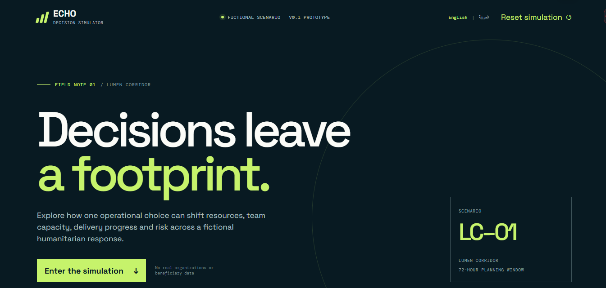
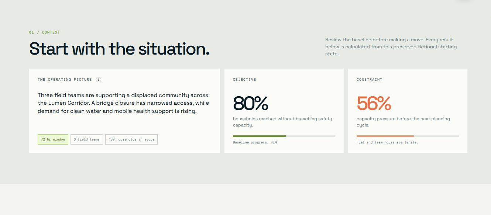
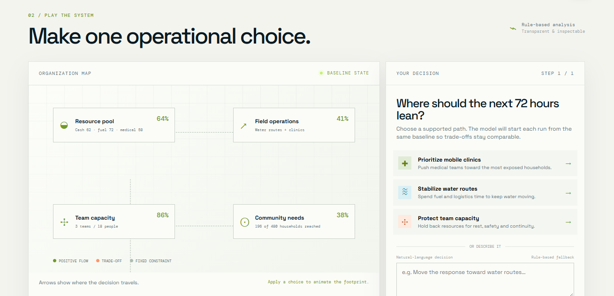
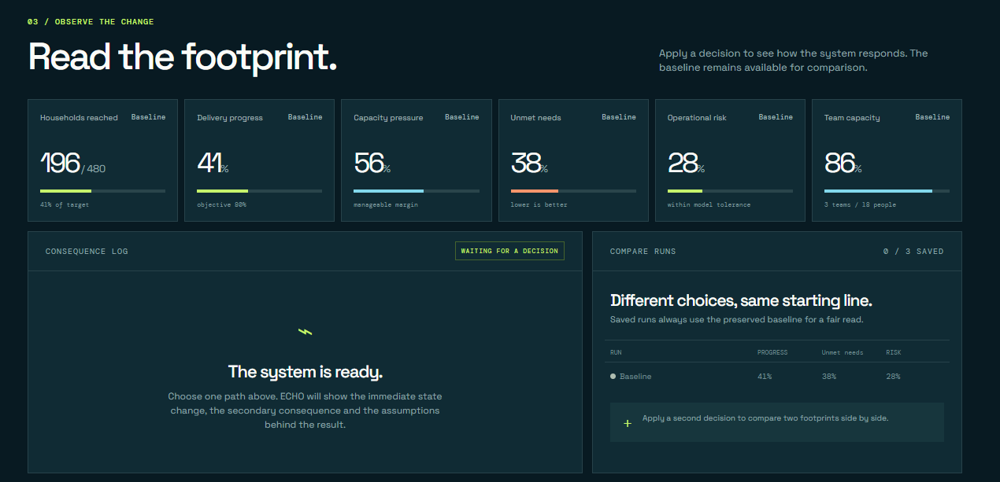
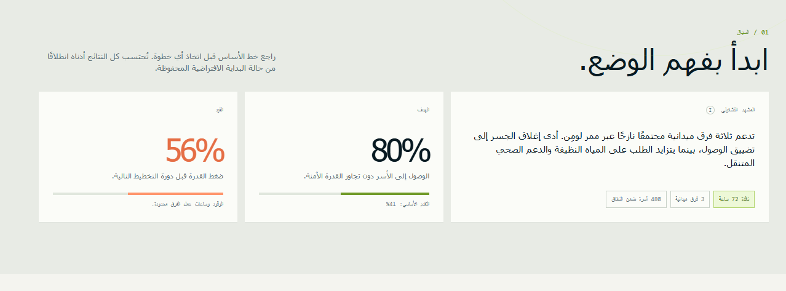
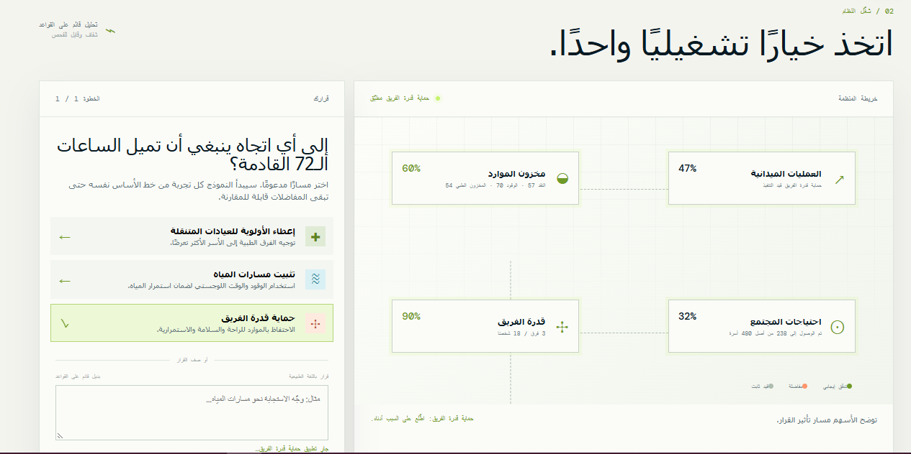
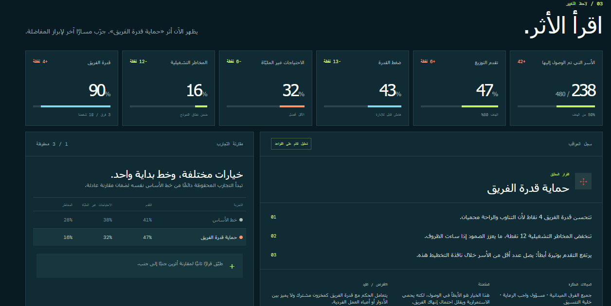

# ECHO | Decisions Leave a Footprint

  <strong>An Interactive Humanitarian Decision-Making Simulation</strong>
   
  Unit 3 · Research Pairs · Tool Exploration
    
  <a href="https://echo-em8lnp4h.manus.space/">
    <strong>↗ EXPLORE ECHO</strong>
  </a>

---

## 📌 Project Overview

**ECHO — Decisions Leave a Footprint** هو مشروع تفاعلي يستكشف أثر القرارات في سياق يحاكي العمليات الإنسانية، حيث تتداخل الخيارات والظروف والموارد لتشكّل نتائج محتملة.

تم تطوير الفكرة ضمن نشاط **Unit 3 — Research Pairs** لاستكشاف أداة مدعومة بالذكاء الاصطناعي وتطبيقها عمليًا في بناء تجربة رقمية.

يركّز المشروع على فكرة أساسية: **كل قرار يترك أثرًا، وفهم هذا الأثر يساعد على تقييم الخيارات بصورة أكثر وعيًا.**

## 🔎 Tool Exploration

### Manus — AI-Powered Application Creation

**ما هي Manus؟**

Manus أداة مدعومة بالذكاء الاصطناعي تساعد على تحويل التعليمات والأفكار إلى مخرجات رقمية. استُخدمت في هذا النشاط لبناء تجربة ECHO وتحويل الفكرة إلى تطبيق يمكن للمستخدم استكشافه.

### Key Features

- **AI-Assisted Creation:** الاستعانة بالذكاء الاصطناعي في تطوير الفكرة وتحويلها إلى مخرج عملي.
- **Interactive Prototyping:** تقديم الفكرة ضمن تجربة رقمية قابلة للاستكشاف.
- **Rapid Development:** تسهيل الانتقال من التصور الأولي إلى نموذج تطبيقي.

## 🎯 Problem & Purpose

### The Challenge

قد تتطلب العمليات الإنسانية اتخاذ قرارات في ظروف متغيرة، مع محدودية الموارد وتعدد الأولويات. لذلك، فإن التفكير في النتائج المحتملة للقرارات يُعد جانبًا مهمًا من فهم هذه التحديات.

### The Purpose

يهدف ECHO إلى تقديم سيناريو تفاعلي يتيح للمستخدم استكشاف العلاقة بين القرارات وآثارها، والتفكير في الخيارات ضمن سياق افتراضي مستوحى من العمليات الإنسانية.

## ⚙️ How It Works

تقوم فكرة التجربة على استكشاف سيناريو تفاعلي والتفكير في القرارات والنتائج التي تعرضها المحاكاة.

| Stage | Description |
|:---:|---|
| **01 · Explore** | التعرّف على السيناريو والظروف المحيطة به. |
| **02 · Decide** | التفكير في الخيارات المتاحة واتخاذ القرار. |
| **03 · Observe** | ملاحظة النتائج التي تعرضها التجربة. |
| **04 · Reflect** | التأمل في آثار القرارات والعلاقة بينها وبين النتائج. |

## 🖼️ Application Screenshots

فيما يلي لقطات شاشة توثّق واجهات وتجربة تطبيق ECHO.

### ECHO — Application Preview

  

  معاينة لتطبيق ECHO.

### Interactive Experience

<table>
  <tr>
    <td width="50%" align="center">
      
       
      <strong>Application View 02</strong>
    </td>
    <td width="50%" align="center">
      
       
      <strong>Application View 03</strong>
    </td>
  </tr>
  <tr>
    <td width="50%" align="center">
      
       
      <strong>Application View 04</strong>
    </td>
    <td width="50%" align="center">
      
       
      <strong>Application View 05</strong>
    </td>
  </tr>
  <tr>
    <td width="50%" align="center">
      
       
      <strong>Application View 06</strong>
    </td>
    <td width="50%" align="center">
      
       
      <strong>Application View 07</strong>
    </td>
  </tr>
</table>

## 🌍 Humanitarian Relevance

تمنح المحاكاة فرصة لاستكشاف بعض الأفكار المرتبطة بالتفكير في القرارات ضمن سياق إنساني، ومنها:

- **Resource Constraints:** التفكير في الخيارات عند محدودية الموارد.
- **Changing Conditions:** مراعاة أثر تغيّر الظروف.
- **Decision Evaluation:** التأمل في النتائج المحتملة للقرارات.
- **Critical Thinking:** تحليل الموقف بدلًا من النظر إلى القرار بمعزل عن سياقه.

> **Scope:** ECHO تجربة محاكاة تعليمية، وليس نظامًا فعليًا لإدارة العمليات الإنسانية أو لاتخاذ القرارات التشغيلية في الميدان.

## 🧠 Learning Outcomes

يرتبط هذا النشاط بعدد من جوانب التعلم والتطبيق العملي:

- استكشاف إمكانات أداة مدعومة بالذكاء الاصطناعي.
- تحويل فكرة إلى تجربة رقمية قابلة للاستكشاف.
- تنظيم مفهوم المشروع وعرضه بطريقة واضحة.
- توظيف المحاكاة في استكشاف القرارات والتفكير في نتائجها.

## 🗂️ Project Details

| Category | Details |
|---|---|
| **Program** | Unit 3 |
| **Activity** | Research Pairs |
| **Tool Explored** | Manus |
| **Project** | ECHO — Decisions Leave a Footprint |
| **Application Type** | Interactive Simulation |
| **Domain** | Humanitarian Operations |
| **Core Focus** | Decision-Making & Critical Thinking |

## 🏷️ Keywords

`Manus` · `Artificial Intelligence` · `Interactive Simulation` · `Humanitarian Operations` · `Decision-Making` · `Critical Thinking` · `AI-Powered Applications`

---

## 👩‍💻 Project Author

**Doaa Sami Al-Batniji **

  <a href="https://github.com/doaasami9">GitHub</a>
  &nbsp;·&nbsp;
  <a href="https://www.linkedin.com/in/doaa-sami-984426271/">LinkedIn</a>

---

  <strong>DECISIONS LEAVE A FOOTPRINT.</strong>
   
  لكل قرار أثر، ولكل اختيار نتيجة تستحق التأمل.

