 

# 𝙁𝙊𝙍𝙀𝙓𝙔

### AI-POWERED MARKET INTELLIGENCE

**منصة مالية عربية تجمع متابعة الأسواق، والمساعدة الذكية، والتعلّم، وتنظيم الاستراتيجيات في مساحة عمل واحدة.**

*ANALYZE · LEARN · ORGANIZE*

---

## 01. Project Overview | نظرة عامة

**FOREXY** هو تطبيق ويب مالي يهدف إلى توفير مساحة موحّدة لمتابعة الأسواق، واستكشاف الرسوم البيانية، والتعلّم المالي، وتنظيم الاستراتيجيات والملاحظات الشخصية.

يركّز المشروع على تقديم تجربة استخدام عربية تجمع أدوات متعددة ضمن واجهة منظمة، وتساعد المستخدم على الانتقال من استكشاف بيانات السوق إلى فهم المعلومات وتنظيم أفكاره.

يجمع التطبيق بين واجهة الاستخدام، وخدمات المصادقة والتخزين، ومصدر بيانات سوقية للأجزاء المتصلة به، مع الحفاظ على سيطرة المستخدم على قراراته المالية.

> **Core Vision:** Build a structured financial workspace that brings market information, learning, and personal organization together.

## 02. Problem Statement | المشكلة

### The Context
يحتاج المهتمون بالأسواق المالية إلى التعامل مع الأسعار والرسوم البيانية والمفاهيم التعليمية والاستراتيجيات والملاحظات بصورة مستمرة.

### The Problem
قد يؤدي توزيع هذه الأدوات والمعلومات بين منصات مختلفة إلى صعوبة تنظيم المعرفة، ومتابعة البيانات، والاحتفاظ بسجل واضح للأفكار والخطط.

### Why It Matters
تساعد البيئة المنظمة على جعل المعلومات أسهل في الوصول والمراجعة، وتدعم التعلّم المنهجي والتعامل الأكثر وعيًا مع قرارات التداول.

## 03. Users & Needs | المستخدمون واحتياجاتهم

| User Group | User Need |
|---|---|
| **Beginner Traders** | فهم أساسيات الأسواق والمفاهيم المالية |
| **Market Enthusiasts** | متابعة بيانات الأصول والرسوم البيانية المتاحة |
| **Strategy-Oriented Users** | تنظيم أفكار الاستراتيجيات ومراجعتها |
| **Financial Learners** | الوصول إلى محتوى تعليمي منظم |
| **Personal Trading Journal Users** | حفظ الملاحظات والسجلات التي تدعمها المنصة |

**Primary Goal:** توفير مساحة عمل واضحة تجمع المعلومات والتعلّم والتنظيم دون تقديم الأرباح أو نتائج التحليل باعتبارها مضمونة.

## 04. Proposed Solution | الحل

تجمع FOREXY مجموعة من الأقسام ضمن تجربة واحدة، بحيث يستطيع المستخدم الوصول إلى الأدوات المتاحة من مساحة عمل مركزية.

### Core Features

| Feature | Purpose |
|---|---|
| **Markets** | استكشاف معلومات الأسواق والأصول المدعومة |
| **Market Charts** | عرض الرسوم البيانية وبيانات الأسعار المتاحة |
| **AI Assistant** | واجهة للمساعدة الذكية وفق الوظائف المفعّلة |
| **Strategy Lab** | تنظيم أفكار الاستراتيجيات ودراستها |
| **Academy** | دعم التعلّم والتثقيف المالي |
| **Trading Journal** | تنظيم الملاحظات والسجلات الشخصية |
| **Finance** | الوصول إلى الأدوات المالية المتاحة |
| **Alerts** | الوصول إلى وظائف التنبيهات المفعّلة |

*يعكس هذا الجدول نطاق الأقسام المستهدف في المشروع؛ ولا يعني أن كل قسم يوفر جميع الوظائف المتقدمة الممكنة.*

## 05. System Workflow | آلية عمل النظام

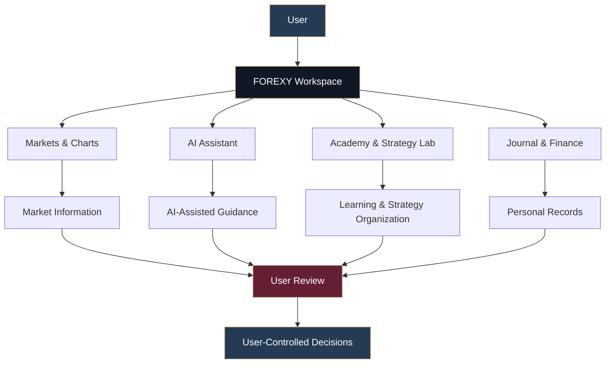

يوضح المخطط التدفق العام للتطبيق: يختار المستخدم القسم المناسب، ويستكشف المعلومات أو ينظم أفكاره، ثم يراجع النتائج بنفسه. لا يعني وجود أدوات التحليل أو المساعدة الذكية أن النظام يتخذ القرار المالي نيابةً عنه.

## 06. Role of AI | دور الذكاء الاصطناعي

تتضمن FOREXY قسمًا للمساعد الذكي ضمن واجهة المنصة.

### Intended Role
- توفير واجهة للمساعدة في استكشاف المعلومات وفهمها.
- دعم التعلّم وتنظيم الأفكار بحسب الإمكانات المفعّلة.
- تسهيل الوصول إلى المساعدة ضمن مساحة العمل المالية.

### What AI Should NOT Do
- ضمان الأرباح أو تقديم التوقعات باعتبارها حقائق مؤكدة.
- إخفاء عدم اليقين أو استبدال التحقق من المعلومات.
- تنفيذ صفقات مالية تلقائيًا نيابةً عن المستخدم.

**Human-in-Control Principle:** يظل المستخدم مسؤولًا عن مراجعة المعلومات واتخاذ قراراته المالية.

## 07. Automation & Data Flow | الأتمتة وتدفق البيانات

تعتمد المنصة على تكامل الواجهة مع خدمات البيانات والخدمات الخلفية المستخدمة في التطبيق.

| Component | Role |
|---|---|
| **Market Data Integration** | جلب بيانات السوق للأجزاء المتصلة بمصدر البيانات |
| **Scheduled Data Refresh** | تحديث البيانات وفق إعدادات المكوّن المعني |
| **Authentication Flow** | إدارة تسجيل الدخول والجلسات |
| **Persistent Storage** | حفظ البيانات التي تدعمها وظائف التطبيق |
| **Access Policies** | تقييد الوصول إلى بيانات المستخدمين وفق السياسات |

يستخدم الرسم البياني للذهب إعدادًا لعرض بيانات تاريخية تقارب 90 يومًا، مع تحديث دوري مضبوط على 30 دقيقة وفق الإعداد الذي تم اختباره. ولا يعني ذلك أن جميع الأصول تُحدّث بالتوقيت نفسه أو أن جميع البيانات لحظية.

## 08. Data Architecture | بنية البيانات

| Data Category | Description |
|---|---|
| **Authentication Data** | معلومات المصادقة والجلسات |
| **Market Data** | بيانات السوق المقدمة من المصدر المتصل |
| **User Records** | السجلات الشخصية التي تدعمها المنصة |
| **Educational Content** | المواد التعليمية المتاحة |
| **Journal & Strategy Data** | الملاحظات والاستراتيجيات التي يدعم التطبيق حفظها |

يجب التمييز بين بيانات السوق المسترجعة من مصدر فعلي، والمحتوى التعليمي، وأي بيانات تجريبية قد تُستخدم أثناء التطوير. ولا تُعدّ جميع العناصر الظاهرة في الواجهة مصدرًا واحدًا للبيانات.

## 09. Technology Stack | التقنيات المستخدمة

| Technology | Purpose |
|---|---|
| **Lovable** | بناء التطبيق وتطوير واجهته وتدفقاته الوظيفية |
| **Supabase Auth** | المصادقة وإدارة جلسات المستخدمين |
| **Supabase PostgreSQL** | تخزين بيانات التطبيق المدعومة |
| **Supabase Row-Level Security (RLS)** | تطبيق سياسات الوصول إلى السجلات |
| **Twelve Data** | توفير بيانات السوق للأجزاء المتصلة بالمصدر |

## 10. Key Design Decisions | قرارات التصميم

### Decision 01 — Arabic-First Experience

**Decision:** اعتماد تجربة عربية واضحة.

**Why:** تسهيل استخدام أدوات المنصة والوصول إلى أقسامها بالنسبة للمستخدم العربي.

### Decision 02 — Unified Financial Workspace

**Decision:** جمع أدوات السوق والتعلّم وتنظيم الاستراتيجيات في واجهة واحدة.

**Why:** تسهيل الانتقال بين الوظائف وتقليل تشتت المعلومات بين الأدوات.

### Decision 03 — Human-Controlled Trading

**Decision:** عدم تنفيذ الصفقات تلقائيًا نيابةً عن المستخدم.

**Why:** الحفاظ على سيطرة المستخدم على قراراته وتجنب الإيحاء بأن التحليل يضمن النتائج.

### Decision 04 — Persistent Data & Access Control

**Decision:** استخدام خدمات المصادقة والتخزين وسياسات الوصول المناسبة.

**Why:** دعم حفظ البيانات واسترجاعها والفصل بين سجلات المستخدمين وفق السياسات المطبّقة.

## 11. Testing & Validation | الاختبار والتحقق

تم تسجيل نتائج اختبارات للوظائف الأساسية وسلوك التطبيق في الحالات المختلفة.

| Test ID | Test Type | Scenario | Actual Result | Status |
|---|---|---|---|---|
| **T01** | Positive Test | اختبار وظيفة أساسية في التطبيق | اجتازت الوظيفة الأساسية المختبرة التحقق | ✅ PASS |
| **T02** | Edge Case | اختبار حالة غير معتادة | لم يحدث تعطل في الاختبار المسجّل | ✅ PASS |
| **T03** | Data / Access Test | اختبار الوصول باستخدام حسابين مختلفين | اجتاز اختبار عزل بيانات الحسابين | ✅ PASS |
| **T04** | Negative Test | محاولة الحفظ في حالة نقص البيانات المطلوبة | ظهرت رسالة تعذّر تحميل البيانات أو حفظها | ⚠️ REVIEW |

### Test Interpretation

- **T01:** يدعم نجاح الوظيفة الأساسية التي تم اختبارها.
- **T02:** يشير إلى أن التطبيق لم يتعطل في الحالة المحددة التي تم اختبارها.
- **T03:** يدعم نتيجة اختبار عزل بيانات المستخدمين في السيناريو المسجّل.
- **T04:** توثيق رسالة الخطأ لا يثبت وحده نجاح الحفظ أو نجاح معالجة الحالة بالكامل؛ يجب التحقق من السجل في قاعدة البيانات عند إعادة الاختبار.

لا تعني هذه الاختبارات أن كل وظائف التطبيق خضعت لاختبارات شاملة.

## 12. Bugs, Fixes & Retesting | المشكلات والإصلاحات

### Observed Issue — Data Handling

أثناء اختبار الحفظ في حالة نقص البيانات، ظهرت رسالة تفيد بتعذّر تحميل البيانات أو حفظها.

**Expected Behavior**
- التحقق من المدخلات قبل تنفيذ عملية الحفظ.
- إظهار رسالة مفهومة عند عدم اكتمال العملية.
- عدم إظهار نجاح غير صحيح للمستخدم.

**Observed Behavior**
- ظهرت رسالة خطأ عند تعذّر إتمام العملية.

**Verification Needed**
- التحقق من سبب الحالة.
- التأكد من عدم حفظ بيانات غير صحيحة.
- إعادة اختبار السيناريو بعد أي إصلاح والتحقق من النتيجة الفعلية.

هذه الحالة موثّقة بوصفها ملاحظة اختبار، ولا يُدّعى اكتمال إصلاحها دون نتيجة إعادة اختبار تؤكد ذلك.

## 13. Testing Evidence | أدلة الاختبار

تدعم لقطات الشاشة توثيق الواجهة والوظائف التي تم اختبارها، وتساعد على ربط وصف المشروع بالأدلة المرئية.

ينبغي أن تتضمن أدلة U3، بحسب الوظائف التي تم تصويرها فعليًا:

- **Application Interface:** الواجهة والأقسام الرئيسية.
- **Market Data:** الأسعار والرسوم البيانية.
- **Core Features:** الوظائف الأساسية في التطبيق.
- **Validation:** رسائل التحقق والأخطاء عند الحاجة.
- **Access Control:** أدلة اختبار عزل البيانات مع إخفاء المعلومات الحساسة.

## 14. Application Screenshots | معرض صور التطبيق

فيما يلي اللقطات المرفوعة إلى مجلد `Screenshots`. حُفظت التسميات وفق أسماء الملفات الفعلية، دون افتراض محتوى كل صورة.

<table>
  <tr>
    <td align="center" width="50%">

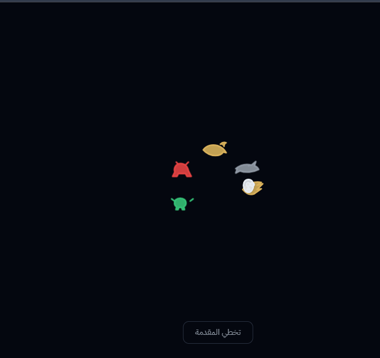

**FOREXY — View 01**

</td>
    <td align="center" width="50%">

**FOREXY — View 02**

</td>
  </tr>
  <tr>
    <td align="center" width="50%">

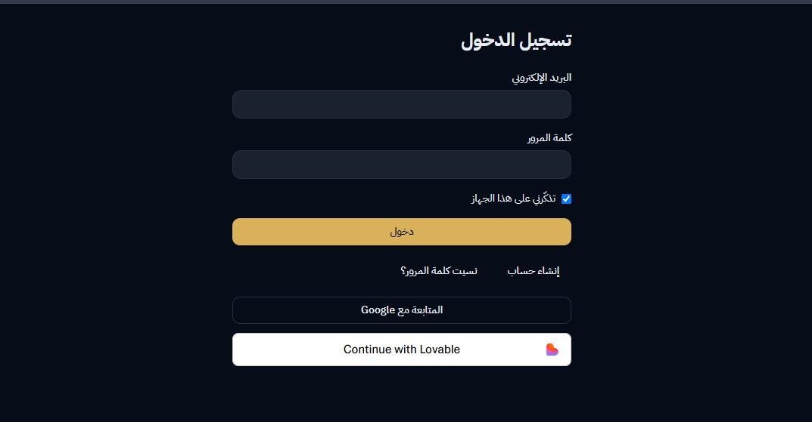

**FOREXY — View 03**

</td>
    <td align="center" width="50%">

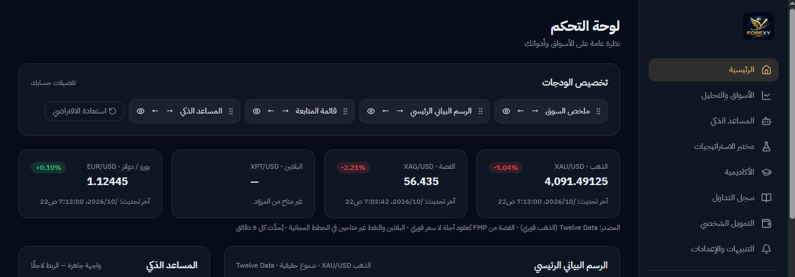

**FOREXY — View 04**

</td>
  </tr>
  <tr>
    <td align="center" width="50%">

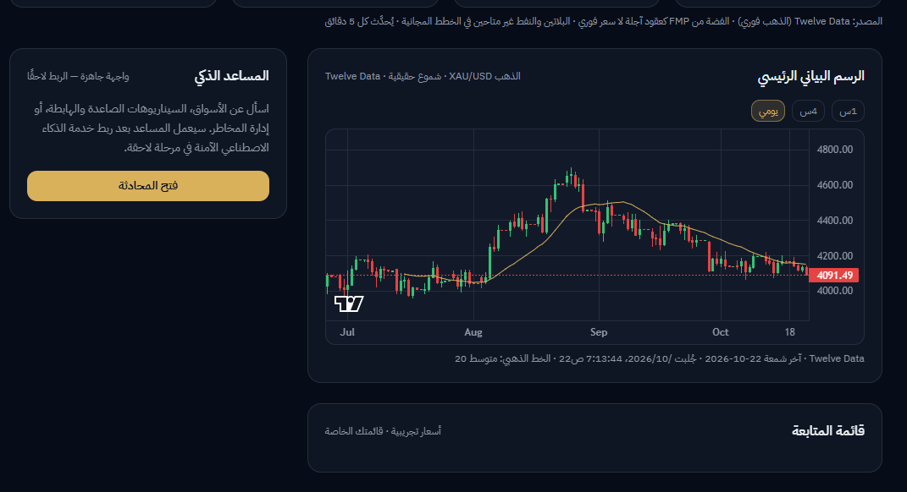

**FOREXY — View 05**

</td>
    <td align="center" width="50%">

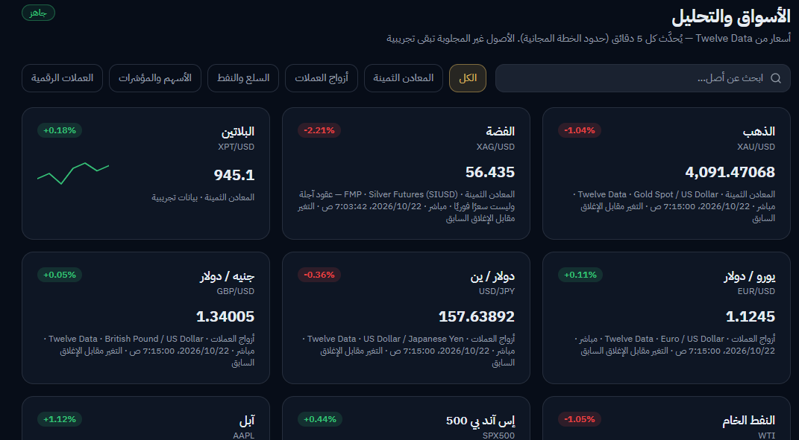

**FOREXY — View 06**

</td>
  </tr>
  <tr>
    <td align="center" width="50%">

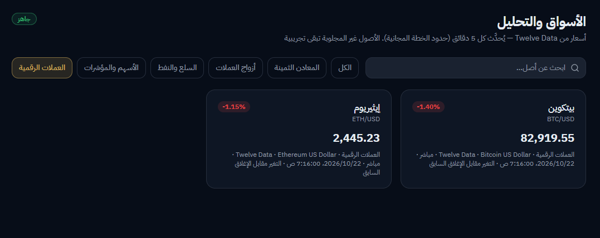

**FOREXY — View 07**

</td>
    <td align="center" width="50%">

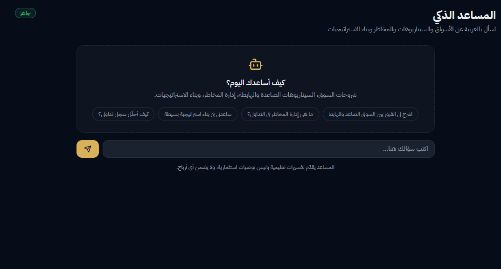

**FOREXY — View 08**

</td>
  </tr>
  <tr>
    <td align="center" width="50%">

**FOREXY — View 09**

</td>
    <td align="center" width="50%">

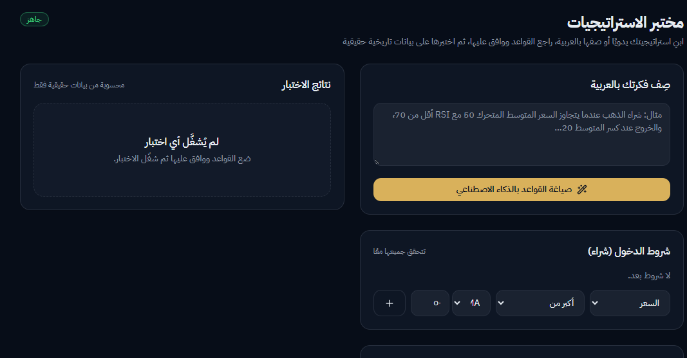

**FOREXY — View 10**

</td>
  </tr>
  <tr>
    <td align="center" width="50%">

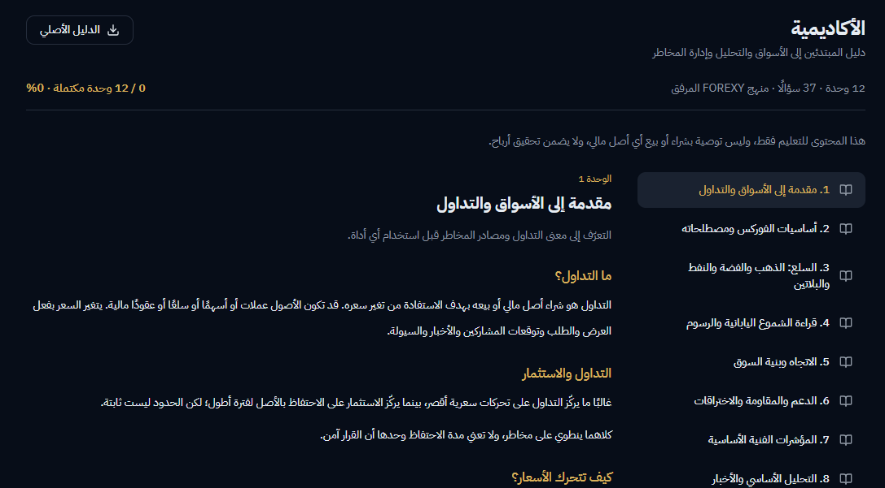

**FOREXY — View 11**

</td>
    <td align="center" width="50%">

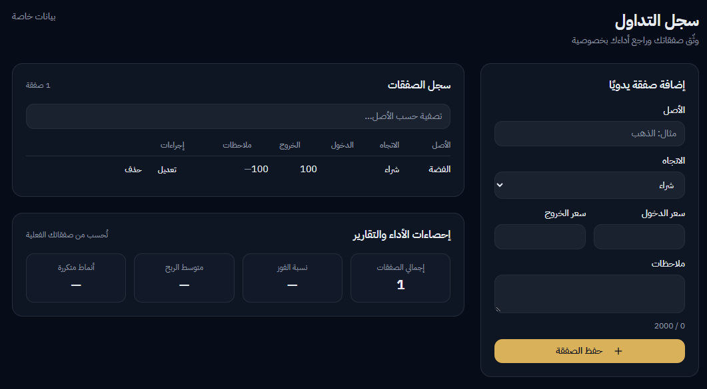

**FOREXY — View 12**

</td>
  </tr>
  <tr>
    <td align="center" width="50%">

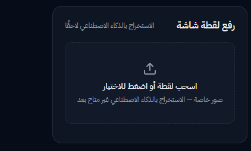

**FOREXY — View 13**

</td>
    <td align="center" width="50%">

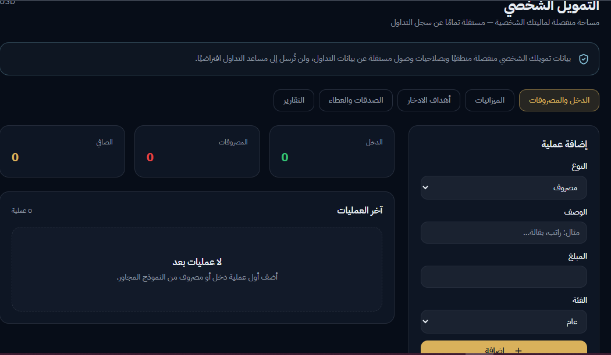

**FOREXY — View 14**

</td>
  </tr>
  <tr>
    <td align="center" width="50%">

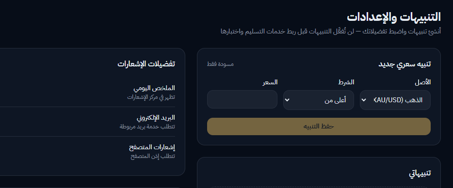

**FOREXY — View 15**

</td>
    <td align="center">

**Explore the Application**

[Open the Live Demo](https://forexy.lovable.app)

</td>
  </tr>
</table>

[**Browse All Screenshots →**](https://github.com/doaasami9/doaa-S-AlBatniji-ai-automationportfolio/tree/main/03-Evaluation%20%26%20Diagnostic%20Thinking/Independent-Project/Screenshots)

## 15. Challenges & Lessons Learned | التحديات والدروس المستفادة

### Technical Lesson
نجاح الواجهة لا يكفي لإثبات نجاح التطبيق؛ يجب التحقق من عمليات الحفظ والاسترجاع، ومصدر البيانات، وسلوك الوظائف عند حدوث خطأ.

### Testing Lesson
تساعد اختبارات الحالات الصحيحة والسلبية والحدّية على كشف الفروق بين السلوك المتوقع والنتيجة الفعلية.

### Data Security Lesson
يجب اختبار سياسات الوصول باستخدام حسابات منفصلة، وعدم الاكتفاء بوجود صفحة تسجيل دخول لإثبات عزل البيانات.

### Financial Product Design Lesson
ينبغي تقديم بيانات السوق والمساعدة الذكية بوضوح، مع عدم ضمان النتائج المالية أو الإيحاء بأن التحليل يغني عن التحقق والمراجعة.

## 16. Future Improvements | التحسينات المستقبلية

- توسيع اختبارات الوظائف والحالات السلبية.
- إضافة أدلة موثّقة لإعادة اختبار الحالات التي ظهرت فيها أخطاء.
- تحسين عرض توقيت تحديث البيانات ومصدرها.
- توسيع المحتوى التعليمي المنظم.
- تحسين توثيق وظائف المساعد الذكي وحدودها.
- تعزيز توثيق سياسات الوصول إلى البيانات.

## 17. Project Links | روابط المشروع

| Resource | Link |
|---|---|
| **Live Application** | [forexy.lovable.app](https://forexy.lovable.app) |
| **Screenshots** | [View Screenshot Folder](https://github.com/doaasami9/doaa-S-AlBatniji-ai-automationportfolio/tree/main/03-Evaluation%20%26%20Diagnostic%20Thinking/Independent-Project/Screenshots) |
| **GitHub Profile** | [doaasami9](https://github.com/doaasami9) |
| **LinkedIn** | [Doaa Sami Al-Batniji](https://www.linkedin.com/in/doaa-sami-984426271/) |

## 👩‍💻 Author

**Doaa Sami Al-Batniji**

*Computer Engineer | Data, AI & Automation*

---

### FOREXY

**ANALYZE · LEARN · ORGANIZE**

*Understand the market. Organize your strategy. Keep decisions in your hands.*

[**Launch FOREXY →**](https://forexy.lovable.app)

