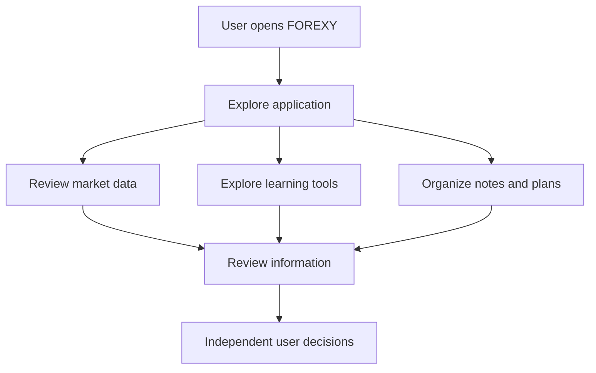

 

  

  
  
  

<h3 align="center">ANALYZE · LEARN · ORGANIZE</h3>

  منصة عربية تجمع متابعة الأسواق المالية والتعلّم والتخطيط وتنظيم المعلومات في تجربة رقمية واحدة.

---

## 01 — Project Overview

**FOREXY** هو تطبيق ويب يهدف إلى تنظيم تجربة المستخدم في متابعة الأسواق المالية والتعلّم والتخطيط، من خلال واجهة تجمع عدة أقسام ضمن مساحة عمل موحّدة.

تم تطوير المشروع ضمن مهمة **U3 — Build, Test & Prove Your Web App**، مع التركيز على بناء التطبيق، والتحقق من سلوكه، واختبار وظائفه الأساسية.

> **Scope:** FOREXY منصة للمعلومات والتعلّم والتنظيم، ولا تنفّذ صفقات تداول تلقائيًا.

## 02 — Problem Statement

### The Context
قد يحتاج المستخدم إلى التنقل بين أدوات متعددة لمتابعة بيانات السوق، وتنظيم الملاحظات، والتعلّم، وإدارة الخطط الشخصية.

### The Problem
تشتّت هذه الأنشطة بين أدوات منفصلة قد يجعل متابعة المعلومات وتنظيمها أقل سهولة.

### Why It Matters
يساعد جمع الأدوات المرتبطة في واجهة واحدة على تنظيم سير العمل وتسهيل الوصول إلى الأقسام المختلفة.

## 03 — Target Users

صُممت فكرة FOREXY لتناسب المستخدمين الذين يرغبون في:

- متابعة بيانات الأسواق المالية المتاحة.
- تنظيم أفكارهم وخططهم وملاحظاتهم.
- الوصول إلى محتوى تعليمي متعلق بالأسواق.
- استخدام مساحة موحّدة للتخطيط ومراجعة المعلومات.

## 04 — Core Features

| Feature | Description |
|---|---|
| **Markets** | متابعة بيانات السوق والرسوم المتاحة داخل التطبيق. |
| **AI Assistant** | قسم المساعد الذكي ضمن تجربة التطبيق. |
| **Strategy Lab** | مساحة لتنظيم أفكار واستراتيجيات المستخدم. |
| **Academy** | قسم مخصص للتعلّم التدريجي. |
| **Journal** | تنظيم الملاحظات والسجل الشخصي. |
| **Finance** | قسم لتنظيم المعلومات المالية داخل التطبيق. |
| **Alerts** | قسم التنبيهات ضمن تجربة المستخدم. |

## 05 — Application Screenshots

فيما يلي أربع لقطات مختارة لتقديم نظرة مختصرة على التطبيق، بدلًا من عرض جميع الصور.

<table>
  <tr>
    <td width="50%" align="center">
      
       <strong>01 · Main Interface</strong>
    </td>
    <td width="50%" align="center">
      
       <strong>02 · Market Experience</strong>
    </td>
  </tr>
  <tr>
    <td width="50%" align="center">
      
       <strong>03 · Application Features</strong>
    </td>
    <td width="50%" align="center">
      
       <strong>04 · User Workflow</strong>
    </td>
  </tr>
</table>

## 06 — Technology Stack

| Technology | Role |
|---|---|
| **Lovable** | بناء واجهة التطبيق وتطوير تجربة الويب. |
| **Supabase** | خدمات الخلفية والبيانات والمصادقة بحسب إعدادات المشروع. |
| **Twelve Data** | مصدر بيانات مخطط الذهب المستخدم في التطبيق. |

## 07 — Market Data Integration

يستخدم التطبيق **Twelve Data** لعرض مخطط الذهب.

وفق الإعدادات التي تم العمل عليها، يغطي المخطط فترة زمنية قدرها **90 يومًا**، مع تحديث كل **30 دقيقة**.

تعتمد حداثة البيانات على استجابة مزوّد الخدمة وإعدادات الاتصال المتاحة. ولا تمثل بيانات السوق وحدها توصية استثمارية أو ضمانًا للنتائج.

## 08 — System Workflow

## 09 — Testing & Validation

تم تنفيذ الاختبارات الأساسية للمشروع، وبحسب نتائج الاختبار التي أكّدتها صاحبة المشروع، **نجحت الاختبارات الأربعة جميعها**.

| Test ID | Test Type | Objective | Result |
|---|---|---|---|
| T01 | Positive Test | التحقق من السلوك الأساسي للتطبيق عند الاستخدام المعتاد. | **PASS** |
| T02 | Edge Case | التحقق من تعامل التطبيق مع حالة طرفية دون انهياره. | **PASS** |
| T03 | Data & Access | التحقق من عزل بيانات حسابين مختلفين. | **PASS** |
| T04 | Negative Test | التحقق من التعامل مع حالة إدخال أو بيانات غير مكتملة. | **PASS** |

### Testing Summary

  

- **4/4 tests passed** وفق نتائج الاختبارات المنفذة.
- تم التحقق من سلوك التطبيق في الحالات المختبرة.
- اجتاز اختبار عزل البيانات بين حسابين مختلفين.
- تم التحقق من التعامل مع الحالة الطرفية التي شملها الاختبار.

> نتائج الاختبارات توثّق الحالات التي تم اختبارها، ولا تعني إجراء تدقيق أمني شامل أو ضمان خلو التطبيق من جميع الأخطاء.

## 10 — Key Design Decisions

- **Arabic-First Experience:** جعل العربية محورًا أساسيًا في تجربة الاستخدام.
- **Unified Workspace:** جمع الأقسام المرتبطة في تطبيق واحد.
- **Responsible Trading Scope:** عدم تنفيذ صفقات تداول تلقائيًا.
- **Market Data Integration:** ربط مخطط الذهب بمصدر بيانات خارجي.
- **Testing Before Documentation:** التحقق من سلوك التطبيق قبل توثيق نتائج الاختبارات.

## 11 — Challenges & Lessons Learned

أبرز ما تعلمته خلال بناء المشروع هو أهمية اختبار التطبيق عمليًا، وعدم الاكتفاء بالتأكد من ظهور الواجهة.

كما أظهر اختبار عزل البيانات أهمية التحقق من الفصل بين حسابات المستخدمين في التطبيقات التي تتعامل مع بيانات محفوظة.

## 12 — Future Improvements

- توسيع تغطية الاختبارات الآلية.
- إضافة اختبارات أكثر لحالات إدخال البيانات غير المكتملة.
- تحسين توثيق مصادر بيانات الأسواق وحدود تحديثها.
- تطوير تجربة الاستخدام على مختلف أحجام الشاشات.
- مواصلة تحسين رسائل الخطأ وحالات التحميل والحفظ.

## 13 — Project Links

- **Live Demo:** [Open FOREXY](https://forexy.lovable.app/)
- **Screenshots Repository:** [View all screenshots](https://github.com/doaasami9/doaa-S-AlBatniji-ai-automationportfolio/tree/main/03-Evaluation%20%26%20Diagnostic%20Thinking/Independent-Project/Screenshots)

## 14 — Project Information

| Field | Details |
|---|---|
| **Project** | FOREXY |
| **Assignment** | U3 — Build, Test & Prove Your Web App |
| **Project Type** | Independent Web Application |
| **Focus** | Web Development, Data Integration, Testing & Validation |

---

  <strong>FOREXY</strong> 
  ANALYZE · LEARN · ORGANIZE

