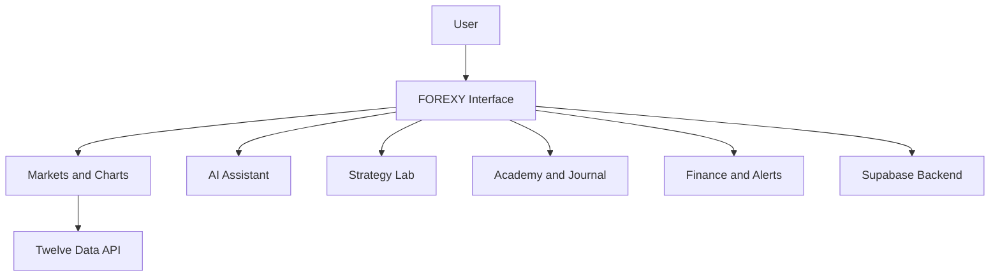

# FOREXY | AI-Powered Financial & Trading Platform

  

  <strong>منصة مالية ذكية تجمع بين متابعة الأسواق، والتحليل، والتعلّم، وإدارة القرارات المالية في تجربة عربية متكاملة.</strong>

  
  
  

---

## 📌 Project Overview

**FOREXY** هو مشروع منصة مالية وتقنية مصممة لمساعدة المستخدمين على متابعة الأسواق المالية، واستكشاف أدوات التحليل، وتطوير معرفتهم بالتداول، وتنظيم سجلاتهم المالية.

يجمع المشروع بين واجهة عربية، وبيانات السوق، وأدوات مساعدة ذكية، وتجربة استخدام متكاملة ضمن منصة واحدة.

🔗 **Live Application:** [forexy.lovable.app](https://forexy.lovable.app/)

## 🎯 Problem Statement

تتوزع أدوات متابعة الأسواق والتعلّم والتحليل وتسجيل القرارات المالية غالبًا بين منصات متعددة، مما يجعل تنظيم المعلومات ومتابعة الأداء أكثر صعوبة.

يسعى FOREXY إلى جمع هذه الوظائف في مساحة موحدة تساعد المستخدم على الوصول إلى المعلومات وتنظيمها بصورة أوضح.

## 👥 Target Users

- المبتدئون الراغبون في تعلّم أساسيات الأسواق المالية.
- المستخدمون الذين يتابعون أسعار الأصول والأسواق.
- المهتمون بتنظيم استراتيجياتهم وملاحظاتهم المالية.
- المتعلمون الذين يريدون الجمع بين متابعة السوق والتطوير المعرفي.

## ✨ Core Features

| Feature | Description |
|---|---|
| 📊 Markets | متابعة بيانات الأسواق وعرض الرسوم البيانية. |
| 🤖 AI Assistant | مساحة للمساعدة الذكية في فهم المعلومات المالية. |
| 🧠 Strategy Lab | تنظيم الأفكار والاستراتيجيات وتحليلها. |
| 🎓 Academy | محتوى تعليمي يساعد على فهم أساسيات التداول. |
| 📓 Trading Journal | تسجيل الملاحظات والقرارات ومراجعتها. |
| 💰 Finance | مساحة لتنظيم المعلومات والسجلات المالية. |
| 🔔 Alerts | قسم مخصص للتنبيهات ومتابعة المستجدات. |

## 🖥️ Application Screenshots

### 1. Platform Interface

  

### 2. Market Monitoring

  

### 3. Platform Features

  

### 4. Additional Interface View

  

## 🛠️ Technology Stack

| Technology | Role |
|---|---|
| Lovable | Building and developing the application interface. |
| Supabase | Backend services and data management. |
| Twelve Data API | Providing market data for supported charts. |

## 📈 Market Data Integration

يعتمد المشروع على **Twelve Data API** لعرض بيانات السوق في الرسم البياني المدعوم.

- Chart history: up to 90 days.
- Refresh interval: 30 minutes.
- Market data availability depends on the connected API and its plan limitations.

## 🔄 System Workflow

## 🧪 Testing & Validation

تم اختبار الوظائف والحالات المحددة للمشروع، وكانت نتائج الاختبارات ناجحة وفقًا لنتائج الاختبار المسجلة.

| Test ID | Test Scenario | Result |
|---|---|---|
| T01 | Positive / Standard Usage | ✅ PASS |
| T02 | Edge Cases and Error Handling | ✅ PASS |
| T03 | Data Access and Account Isolation | ✅ PASS |
| T04 | Negative / Missing-Data Scenarios | ✅ PASS |

**Overall Result: 4/4 Tests Passed**

## 🔐 Safety & Design Decisions

- المنصة مخصصة لمتابعة المعلومات وتنظيمها والتعلّم والتحليل.
- لا تنفّذ المنصة صفقات تداول تلقائيًا.
- تعتمد البيانات المعروضة على الخدمات الخارجية المتصلة وتوافرها.
- يهدف التصميم إلى تقديم تجربة مالية عربية واضحة ومنظمة.

## 📚 Challenges & Lessons Learned

من خلال تطوير FOREXY، يتيح المشروع تطبيق مجموعة من المهارات العملية، منها:

- بناء واجهة لتطبيق مالي متعدد الأقسام.
- دمج مصدر خارجي لبيانات السوق.
- تنظيم خدمات الواجهة والخلفية.
- اختبار سيناريوهات الاستخدام ومعالجة الحالات الطرفية.
- التحقق من فصل البيانات بين الحسابات.
- تحسين تجربة الاستخدام في تطبيق عربي.

## 🚀 Future Improvements

- توسيع مصادر بيانات الأسواق المدعومة.
- تطوير أدوات التحليل وعرض المؤشرات.
- إثراء المحتوى التعليمي.
- تحسين التنبيهات وإعداداتها.
- توسيع اختبارات التكامل والأمان.

## 🔗 Project Links

- **Live Application:** [Open FOREXY](https://forexy.lovable.app/)
- **Screenshots:** [View Project Screenshots](https://github.com/doaasami9/doaa-S-AlBatniji-ai-automationportfolio/tree/main/03-Evaluation%20%26%20Diagnostic%20Thinking/Independent-Project/Screenshots)

## 📋 Project Information

- **Project Name:** FOREXY
- **Project Type:** Independent Project
- **Focus Areas:** Financial Technology, AI, Market Data, Application Development
- **Status:** Developed and tested

---

  <strong>FOREXY — Understand the Market. Organize Your Strategy. Learn with Confidence.</strong>

