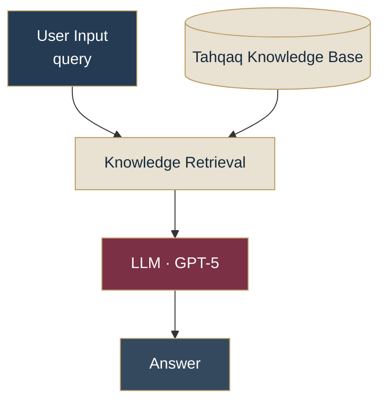

 

# 🛡️ TAHQAQ | تَحَقَّق

### Knowledge-Grounded Verification Assistant

**Evidence Before Assumptions · التحقّق قبل الاستنتاج**

An AI-powered assistant designed to assess claims about scholarships, international opportunities, and potentially misleading offers using a knowledge-grounded approach.

مساعد ذكي صُمّم لمساعدة المستخدمين على تقييم المعلومات المتعلقة بالمنح والفرص الدولية والعروض المشبوهة، بالاستناد إلى الأدلة المتاحة، مع توضيح ما هو موثّق وما يحتاج إلى تحقق إضافي.

 

---

## 01. Project Overview

يقدّم **Tahqaq** نموذجًا لمساعد ذكاء اصطناعي يركّز على التحقق المسؤول من المعلومات المتعلقة بالفرص والمنح، بدلًا من إصدار أحكام غير مدعومة بالأدلة.

يعتمد المشروع على سير عمل مبني باستخدام **Dify Chatflow**، حيث تُسترجع المعلومات من قاعدة معرفة مهيّأة مسبقًا، ثم تُمرّر إلى نموذج اللغة لتحليل الطلب وصياغة إجابة واضحة.

لا يساوي غياب المعلومة من قاعدة المعرفة إثبات أن الادعاء كاذب؛ لذلك يميّز المساعد بين المعلومات المدعومة، والمعلومات غير المحسومة، والحالات التي تتطلب مراجعة مصدر رسمي حديث.

## 02. The Problem

تنتشر إعلانات المنح والفرص التدريبية عبر مواقع التواصل والمجموعات والرسائل الخاصة، وقد تتضمن معلومات ناقصة أو ادعاءات غير موثقة حول التمويل والأهلية والمواعيد النهائية.

تتمثل المشكلة في صعوبة التمييز بين:

- المعلومات المدعومة بمصدر واضح.
- الادعاءات التي لم تتوفر أدلة كافية لتأكيدها.
- التفاصيل التي تحتاج إلى مراجعة المصدر الرسمي الحالي.
- المؤشرات التي تستدعي الحذر دون القفز إلى اتهامات غير مثبتة.

## 03. The Solution

يعالج Tahqaq هذه المشكلة من خلال نهج يجمع بين استرجاع المعرفة، وتعليمات موجّهة للأدلة، وإجابات منظّمة تساعد المستخدم على اتخاذ الخطوة التالية.

تشمل منهجية المساعد:

- تحليل الادعاء أو الفرصة التي يقدّمها المستخدم.
- استخدام المعلومات المسترجعة من قاعدة المعرفة مرجعًا للإجابة.
- تجنّب اختلاق الشروط أو المواعيد أو التغطية المالية.
- التصريح بنقص الأدلة عندما لا تدعم المصادر المتاحة استنتاجًا واضحًا.
- توجيه المستخدم إلى المصدر الرسمي عند الحاجة إلى تحقق حديث.
- تقديم إرشادات عامة للتعامل الحذر مع العروض والروابط المشبوهة.

## 04. Target Users

صُمّم المشروع ليدعم احتياجات:

| المستخدمون | القيمة المقدّمة |
|---|---|
| Students | فهم معلومات المنح والفرص الدولية |
| Early-Career Applicants | مراجعة الادعاءات المتعلقة بالتدريب والزمالات |
| Opportunity Seekers | تحديد المعلومات الناقصة قبل التقديم |
| Digital Safety Learners | التعرّف على مؤشرات التحذير في العروض غير الموثقة |

## 05. System Architecture

يمثّل المخطط التالي بنية سير العمل في Dify:

### Workflow Components

**01 — User Input**

استقبال استفسار المستخدم حول فرصة أو ادعاء يحتاج إلى مراجعة.

**02 — Knowledge Retrieval**

استرجاع المعلومات ذات الصلة من قاعدة المعرفة المحددة في التطبيق.

**03 — LLM · GPT-5**

تحليل الاستفسار في ضوء السياق المسترجع، مع الالتزام بالتعليمات التي تحدّ من التخمين وتفرض توضيح نقص الأدلة.

**04 — Answer**

إنتاج إجابة منظّمة توضّح ما يمكن استنتاجه، وما لا يمكن تأكيده، وما ينبغي مراجعته من المصادر الرسمية.

## 06. Evidence & Verification Framework

يرتكز تصميم Tahqaq على الفصل بين وجود الادعاء وصحة الادعاء.

| Assessment | Meaning |
|---|---|
| Verified Fact | معلومة تدعمها الأدلة المتاحة ضمن نطاق التحقق الفعلي |
| General Guidance | إرشادات عامة لا تُعرض باعتبارها حقائق موثقة عن فرصة محددة |
| Uncertain | معلومات لا تكفي الأدلة المتاحة لحسمها |
| Needs Current Official Check | تفاصيل تستلزم مراجعة مصدر رسمي حديث |

عند تقييم العروض المشبوهة، يراعي المساعد مستويات الأدلة، من التأييد الرسمي الجزئي إلى مؤشرات التحذير القوية، دون وصف عرض بأنه احتيالي بشكل قاطع ما لم تتوفر أدلة موثوقة تدعم هذا الاستنتاج.

**Important distinction:** وجود المعلومة داخل قاعدة المعرفة لا يضمن وحده حداثتها أو صحتها؛ يجب مراعاة مصدرها وتاريخ التحقق منها.

## 07. Technology Stack

| Technology | Role |
|---|---|
| Dify Chatflow | بناء سير عمل المساعد |
| GPT-5 | تحليل الطلب وصياغة الإجابة |
| Knowledge Retrieval | استرجاع المعلومات ذات الصلة |
| Markdown | تنظيم ملفات قاعدة المعرفة وتوثيق المشروع |
| GitHub | إدارة ملفات المشروع وتوثيقه |

## 08. Testing & Quality Assurance

تم اعتماد المشروع باعتباره اجتاز الاختبارات المطلوبة ضمن مرحلة الاختبار.

من الحالات الأساسية التي يغطيها تقييم سلوك المساعد:

| Test Scenario | Expected Behavior |
|---|---|
| Unverified Scholarship | عدم اختلاق معلومات عن المنحة |
| Missing Eligibility Details | توضيح الشروط التي لا يمكن حسمها |
| Unconfirmed Funding | عدم ادعاء التمويل الكامل دون دليل |
| Uncertain Deadline | عدم تخمين الموعد النهائي |
| Suspicious Offer | توضيح مؤشرات التحذير دون حكم غير مدعوم |
| Insufficient Retrieved Evidence | التصريح بحدود المعلومات المتاحة |

### Example Test Case

**Input:** إعلان عن منحة باسم *Global Future Scholarship* يدّعي أنها ممولة بالكامل وأن الموعد النهائي بعد ثلاثة أيام، دون تقديم مصدر رسمي.

**Expected Result:** يوضح المساعد أنه لا يستطيع إثبات صحة تفاصيل المنحة من المصادر المتاحة، ولا يؤكد التمويل أو الموعد، ويوجّه المستخدم إلى المصدر الرسمي.

> Test scope: يعتمد هذا السيناريو على سلوك المساعد تجاه نقص الأدلة، ولا يُعد إثباتًا مستقلًا لوجود المنحة أو عدم وجودها.

## 09. Screenshots & Demonstration

ستُضاف هنا لقطات فعلية من المشروع لتوضيح بنيته وسلوكه.

| Screenshot | Description |
|---|---|
| `Screenshots/01-workflow.png` | مخطط Chatflow الكامل في Dify |
| `Screenshots/02-knowledge-base.png` | قاعدة المعرفة والملفات المضافة |
| `Screenshots/03-llm-configuration.png` | إعدادات النموذج وتعليمات SYSTEM |
| `Screenshots/04-test-result.png` | نتيجة اختبار التحقق من المعلومات |

تُستخدم الصور لتوثيق التنفيذ الفعلي، مع إخفاء أي مفاتيح سرية أو بيانات شخصية أو معرفات غير مخصصة للنشر.

## 10. Limitations & Responsible Use

صُمّم Tahqaq ليكون مساعدًا للتحقق الأولي، وليس جهة رسمية لإثبات صحة جميع الادعاءات.

- تعتمد الإجابات على جودة قاعدة المعرفة ومدى صلتها بالسؤال.
- لا يضمن استرجاع المعرفة وحده حداثة المعلومات أو صحتها.
- لا ينبغي اعتبار غياب المعلومة دليلًا على الاحتيال.
- لا يدّعي المشروع إجراء فحص مباشر للروابط أو تحقق حي من المواقع الرسمية ما لم تُضف هذه الإمكانية ويُختبر تنفيذها.
- يجب مراجعة صفحات الجهات المانحة الرسمية للتأكد من الأهلية والتمويل والمواعيد النهائية.
- لا ينبغي مشاركة كلمات المرور أو بيانات الدفع أو الوثائق الحساسة مع المساعد.

## 11. Key Engineering Takeaway

يجسّد Tahqaq تطبيقًا عمليًا لمبدأ **Grounding** في أنظمة الذكاء الاصطناعي: تحسين موثوقية الإجابة عبر ربطها بمعلومات مرجعية، ووضع حدود واضحة للاستنتاج عند غياب الأدلة.

القيمة الأساسية ليست في تقديم إجابة لكل سؤال، بل في معرفة متى تكون الأدلة كافية، ومتى يجب التصريح بعدم اليقين.

## 12. Project Information

| Field | Details |
|---|---|
| Project Name | Tahqaq — تحقّق |
| Project Type | Independent Project |
| Category | AI Automation · Knowledge Grounding |
| Platform | Dify |
| Language | Arabic-first, with English support |
| Researcher & Developer | Doaa Sami Al-Batniji |

---

**Designed around evidence. Built to avoid assumptions.**

*تحقّق من الأدلة، ووضّح حدود المعرفة، ولا تفترض ما لا تعرفه.*

---

**Connect**

[GitHub](https://github.com/doaasami9) · [LinkedIn](https://www.linkedin.com/)

