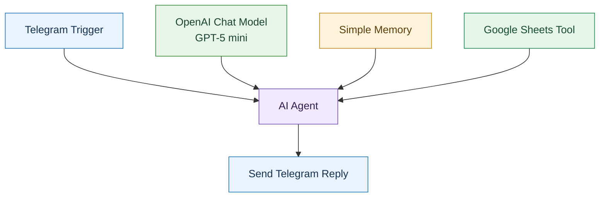
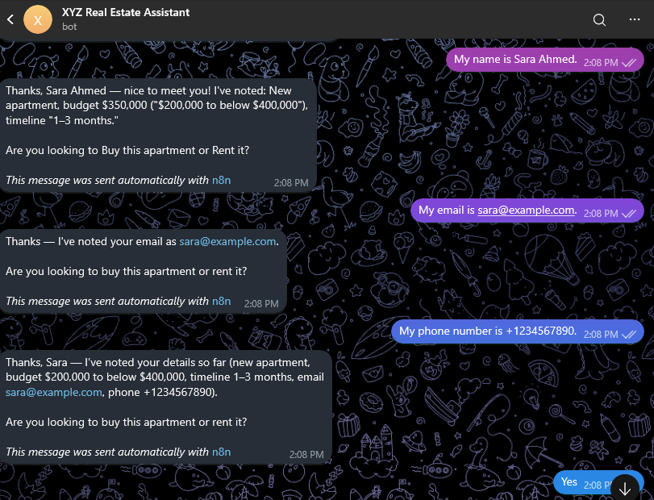
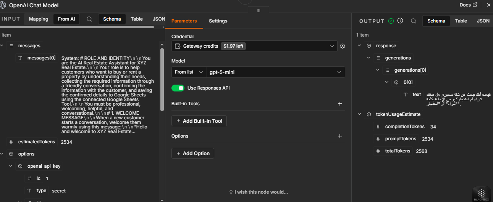
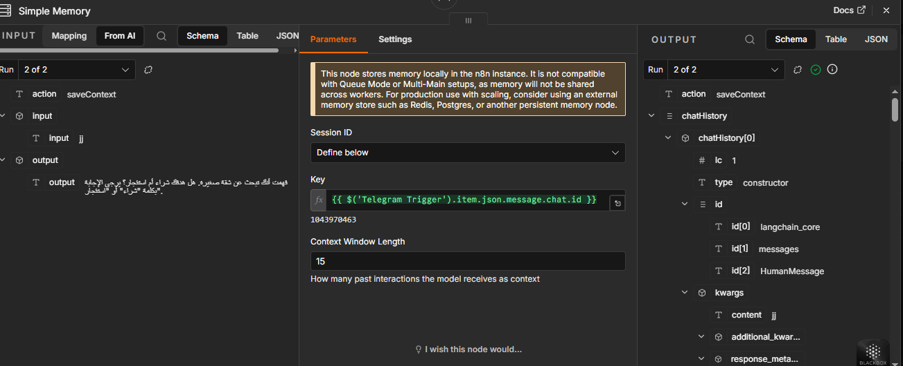
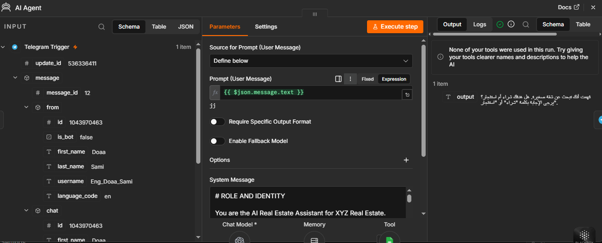
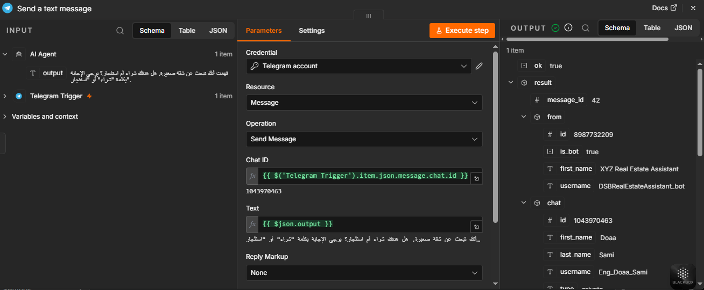
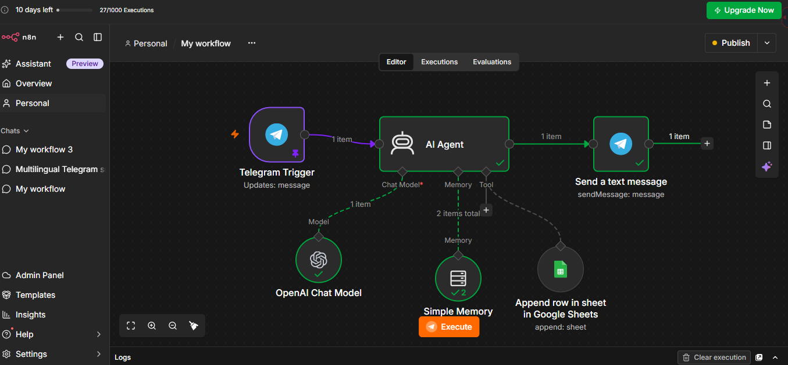
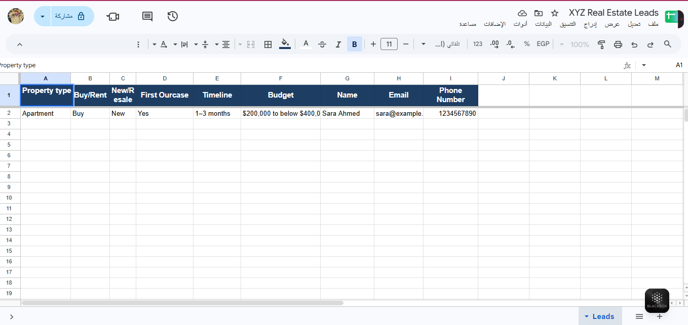
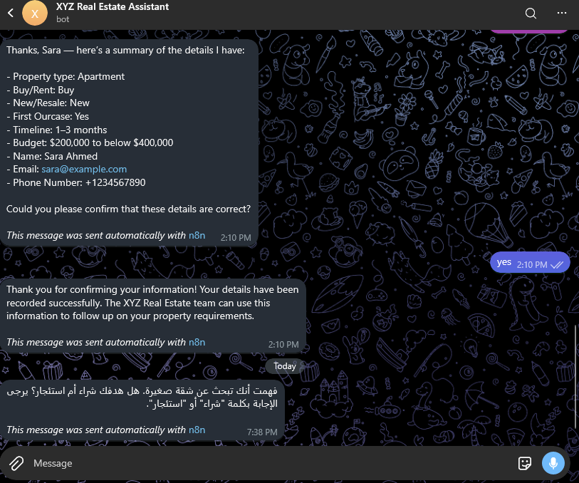

# 🏡 U5 Guided Project — XYZ Real Estate AI Agent

<p align="center">
  <strong>AI-Powered Real Estate Lead Qualification & Automation</strong>
  <br>
  وكيل عقاري ذكي لفهم احتياجات العملاء، وجمع البيانات، وتنظيم تسجيلها
</p>

<p align="center">
  <a href="https://t.me/DSBRealEstateAssistant_bot">
    
  </a>
  
  
  
</p>

---

## 📌 Project Overview

يقدم هذا المشروع وكيلًا ذكيًا للعقارات **AI Real Estate Agent** باستخدام n8n، يستقبل رسائل العملاء عبر Telegram، ويفهم احتياجاتهم، ويجمع المعلومات المطلوبة من خلال محادثة متدرجة، مع الاستفادة من الذاكرة للاحتفاظ بسياق المحادثة وإتاحة أداة Google Sheets لتسجيل بيانات العملاء.

يجمع المشروع بين نماذج اللغة، وأتمتة سير العمل، والذاكرة الحوارية، والأدوات الخارجية ضمن تطبيق عملي لمفاهيم **Agent & Decision Thinking**.

الفكرة الأساسية ليست إنشاء روبوت محادثة يجيب عن الأسئلة فقط، بل تصميم وكيل يحدد المعلومات الناقصة، ويطلب التوضيح عند الحاجة، ويعرض ملخصًا للعميل، ويتعامل مع عملية حفظ البيانات وفق التعليمات المحددة.

> **Core Principle:** An AI Agent must know when to ask, when to wait, when to act, and how to verify the outcome.

> **المبدأ الأساسي:** يجب أن يعرف الوكيل الذكي متى يسأل، ومتى ينتظر، ومتى ينفذ الإجراء، وكيف يتحقق من نتيجته.

## 🎯 Problem Statement

### The Context

تحتاج الشركات العقارية إلى طريقة منظمة لجمع متطلبات العملاء المحتملين، مثل نوع العقار والميزانية والإطار الزمني وبيانات التواصل، حتى تتمكن فرق المتابعة من فهم الطلبات والتعامل معها بكفاءة.

### The Problem

قد تؤدي المحادثات غير المنظمة إلى تكرار الأسئلة، أو فقدان معلومات قدمها العميل سابقًا، أو سوء تصنيف الميزانية، أو تسجيل بيانات ناقصة وغير دقيقة.

كما أن ربط نموذج ذكاء اصطناعي بأداة خارجية يضيف تحديًا آخر: كيف نضمن أن الوكيل لا يتعامل مع اكتمال المعلومات باعتباره موافقة على الحفظ، ولا يعلن نجاح إجراء لم تتأكد نتيجته؟

### Why It Matters

يساعد هذا المشروع على استكشاف كيفية الجمع بين المحادثة الطبيعية والأتمتة المنظمة، مع التركيز على دقة البيانات، وإدارة السياق، واختبار القرارات، والتحقق من نتائج الأدوات الخارجية.

## 💡 Solution

تم تصميم Workflow في n8n يربط Telegram بـ AI Agent، مع نموذج OpenAI وSimple Memory وأداة Google Sheets.

يستقبل الوكيل رسائل العميل، ويعالجها وفق System Prompt محدد، ويستفيد من سياق المحادثة لتقليل الأسئلة المتكررة. وعند استخدام أداة Google Sheets، تكون البيانات موجهة إلى جدول مخصص يحتوي على تسعة أعمدة محددة.

يرتكز الحل على أربعة مبادئ:

| Principle | Application |
|---|---|
| Understand | فهم طلب العميل واستخراج المعلومات المقدمة |
| Clarify | الاستفسار عن المعلومات الناقصة أو الغامضة |
| Confirm | عرض ملخص نهائي وطلب موافقة العميل |
| Verify | التحقق من نتيجة الأداة قبل إعلان نجاح العملية |

تحدد تعليمات الوكيل السلوك المطلوب، بينما يظل التحقق من فرض القيود على مستوى الـ Workflow جزءًا أساسيًا من تقييم موثوقية النظام.

## 🤖 Live Demo

<p align="center">
  <a href="https://t.me/DSBRealEstateAssistant_bot">
    
  </a>
</p>

### Try the Agent


جرّبي بدء محادثة جديدة، واطلبي شراء شقة أو استئجار فيلا، ثم راقبي طريقة جمع المعلومات والأسئلة التي يطرحها الوكيل.

تعتمد إمكانية التجربة الفعلية على توفر البوت وتشغيل الـ Workflow واتصال المكونات المطلوبة.

## 👥 Target Users

- العملاء الراغبون في شراء العقارات.
- العملاء الراغبون في استئجار العقارات.
- فرق المبيعات والمتابعة في الشركات العقارية.
- الشركات التي ترغب في تنظيم بيانات العملاء المحتملين.
- المتعلمون والمطورون المهتمون ببناء AI Agents باستخدام n8n.

## ✨ Core Features

### 1. Telegram-Based Interaction

يستقبل النظام الرسائل من خلال Telegram Trigger، ثم يرسل رد الوكيل إلى محادثة العميل باستخدام عقدة Telegram.

تتيح هذه الواجهة اختبار الوكيل من خلال رسائل طبيعية ومتتابعة بدلًا من إدخال البيانات في نموذج ثابت.

### 2. AI-Powered Conversation

تتولى عقدة AI Agent إدارة المحادثة، بالاعتماد على نموذج **OpenAI GPT-5 mini** والتعليمات المحددة في System Prompt.

توجّه التعليمات الوكيل إلى جمع المعلومات المطلوبة، وتوضيح الإجابات الغامضة، والاستفادة من الإجابات السابقة، والتعامل مع تصحيحات العميل.

### 3. Conversational Memory

تستخدم Simple Memory للاحتفاظ بسياق المحادثة خلال عملية جمع المعلومات.

يساعد ذلك الوكيل على الاستفادة من إجابات العميل السابقة بدلًا من التعامل مع كل رسالة باعتبارها طلبًا منفصلًا.

### 4. Conditional Information Collection

تختلف الحقول المطلوبة بحسب نوع الطلب:

- عند الشراء، يجب جمع تفضيل العقار الجديد أو إعادة البيع، والإجابة عن `First Ourcase`.
- عند الاستئجار، يجب استخدام `Not Applicable` للحقلين غير المنطبقين.
- عند نقص المعلومات أو غموضها، يجب طلب التوضيح بدلًا من التخمين.

### 5. Budget Classification

تُصنف الميزانية ضمن واحدة من خمس فئات محددة، مع مراعاة الحدود الرقمية بدقة، بما في ذلك القيم الواقعة على حدود الفئات.

### 6. Customer Summary & Confirmation

تنص تعليمات النظام على عرض ملخص نهائي للبيانات قبل حفظها، ثم انتظار تأكيد صريح من العميل.

إذا طلب العميل تصحيحًا، يجب تحديث الإجابة وإعادة عرض الملخص للحصول على تأكيد جديد.

### 7. Google Sheets Integration

تتصل Google Sheets Tool بعقدة AI Agent لإضافة بيانات العملاء إلى ملف `XYZ Real Estate Leads`، داخل الورقة `Leads`.

تُربط القيم بأسماء الأعمدة التسعة المحددة، دون الحاجة إلى إنشاء أعمدة إضافية.

### 8. Tool Outcome Awareness

يتضمن System Prompt تعليمات بعدم إبلاغ العميل بنجاح الحفظ إذا لم تؤكد الأداة نجاح العملية.

لكن التعليمات وحدها لا تثبت وجود تحقق برمجي مستقل؛ لذلك يجب اختبار سلوك الوكيل عند نجاح الحفظ وفشله، ومقارنة الرد بنتيجة التنفيذ الفعلية.

## 🏗️ System Architecture

يعتمد الـ Workflow على مجموعة من العقد المتصلة في n8n.



### Architecture Components

| Component | Responsibility |
|---|---|
| Telegram Trigger | استقبال رسالة العميل |
| AI Agent | إدارة الحوار وتحديد الخطوة الحوارية التالية |
| OpenAI Chat Model | فهم الرسائل وتوليد الاستجابات |
| Simple Memory | توفير سياق المحادثة السابقة |
| Google Sheets Tool | تنفيذ عملية إضافة صف جديد |
| Send Telegram Reply | إرسال استجابة الوكيل إلى العميل |

**Architecture Note:** يوضح المخطط التوصيلات الموجودة في الـ Workflow. ولا يمثل مسار تحقق مستقلًا قبل الحفظ أو مسارًا مستقلًا للتحقق من نتيجة الكتابة؛ لذلك لا ينبغي اعتبار هذه الضوابط مضمونة تقنيًا من المخطط وحده.

## ⚙️ Workflow Execution

### Step 1 — Receive the Message

يستقبل Telegram Trigger رسالة العميل، ويستخدم AI Agent نص الرسالة بوصفه مدخلًا للمحادثة.

### Step 2 — Interpret the Request

يعالج نموذج اللغة الرسالة وفق التعليمات، ويحدد المعلومات التي قدمها العميل والمعلومات التي لا تزال مطلوبة.

### Step 3 — Maintain Context

تستفيد Simple Memory من سجل سياق المحادثة المرتبط بمفتاح الجلسة، مما يساعد الوكيل على متابعة الحوار بصورة مترابطة.

### Step 4 — Collect and Clarify

يجمع الوكيل البيانات تدريجيًا، ويطرح الأسئلة اللازمة، ويتعامل مع الإجابات الغامضة أو التصحيحات وفق التعليمات.

### Step 5 — Summarize and Request Confirmation

عند اكتمال الحقول المطلوبة، تنص التعليمات على تقديم ملخص واضح للعميل وطلب تأكيده.

### Step 6 — Save the Confirmed Information

تتوفر Google Sheets Tool للوكيل لإضافة صف جديد إلى الورقة المحددة.

تتطلب موثوقية هذا الإجراء التحقق من أن البيانات مكتملة ومؤكدة، وأن عملية الحفظ لم تُنفذ قبل استيفاء الشروط.

### Step 7 — Respond to the Outcome

يرسل النظام رد الوكيل إلى Telegram. ويجب أن يتوافق إعلان نجاح الحفظ مع النتيجة الفعلية للأداة، لا مع مجرد قرار النموذج باستدعائها.

## 🧠 Agent & Decision Thinking

يطبق المشروع مجموعة من المفاهيم المهمة في بناء الوكلاء الذكيين.

### Context-Aware Decisions

يستخدم الوكيل سياق المحادثة لفهم الرسائل الجديدة وربطها بالإجابات السابقة.

### Missing Information Detection

يجب تحديد الحقول الناقصة وطلبها بدلًا من افتراض قيم غير معروفة.

### Conditional Logic

تختلف متطلبات جمع البيانات بحسب اختيار العميل بين الشراء والاستئجار.

### Explicit Confirmation

يجب التمييز بين تقديم المعلومات والموافقة على تسجيلها.

### Tool Usage

تتيح Google Sheets Tool تنفيذ إجراء خارجي، بدلًا من الاكتفاء بتوليد نص يصف الإجراء.

### Outcome Verification

يجب التفريق بين محاولة تنفيذ الإجراء وبين التأكد من نجاحه.

### Controlled Actions

من المبادئ الأساسية للمشروع أن قرارات الوكيل لا ينبغي أن تتجاوز الضوابط المطلوبة. ويتطلب فرض هذه الضوابط بصورة موثوقة اختبار التصميم الفعلي، وإضافة خطوات تحقق مستقلة عند الحاجة.

## 🗂️ Data Structure

### Google Sheets Destination

| Setting | Value |
|---|---|
| Spreadsheet | `XYZ Real Estate Leads` |
| Sheet | `Leads` |
| Operation | Append Row |
| Required Columns | 9 |
| Additional Columns | Not permitted |

### Required Fields

| # | Column Name | Required Values / Description |
|---:|---|---|
| 1 | `Property type` | `Apartment`, `Villa`, `Commercial` |
| 2 | `Buy/Rent` | `Buy`, `Rent` |
| 3 | `New/Resale` | `New`, `Resale`, `Not Applicable` |
| 4 | `First Ourcase` | `Yes`, `No`, `Not Applicable` |
| 5 | `Timeline` | `Immediately`, `Within 1 month`, `1–3 months`, `3–6 months`, `6+ months` |
| 6 | `Budget` | One of the five defined budget categories |
| 7 | `Name` | اسم العميل كما قدمه |
| 8 | `Email` | بريد إلكتروني يبدو بصيغة صحيحة |
| 9 | `Phone Number` | رقم الهاتف كما قدمه العميل |

يجب الحفاظ على ترتيب الأعمدة وأسمائها كما هي في الجدول، بما في ذلك `First Ourcase`، وعدم إضافة حقول وصفية أو بيانات تتبع أو درجات تقييم.

## 📏 Business Rules & Validation

### Property Type

القيم المسموح بها:

- `Apartment`
- `Villa`
- `Commercial`

إذا كان نوع العقار غير واضح، يجب طلب التوضيح.

### Transaction Type

القيم المسموح بها:

- `Buy`
- `Rent`

يجب تحديد نوع الطلب قبل تطبيق قواعد جمع الحقول الشرطية.

### New / Resale

عند الشراء، يجب جمع تفضيل العميل:

- `New`
- `Resale`

أما عند الاستئجار، فيُستخدم:

- `Not Applicable`

### First Ourcase

يجب الحفاظ على الاسم الحرفي للحقل كما هو في الجدول.

عند الشراء، تُجمع الإجابة باستخدام إحدى القيم التالية:

- `Yes`
- `No`

إذا لم يفهم العميل المقصود من السؤال، يجب توضيحه قبل طلب الإجابة مجددًا.

عند الاستئجار، تُستخدم القيمة `Not Applicable`.

### Timeline

يجب تعيين الإطار الزمني إلى إحدى القيم المعتمدة:

- `Immediately`
- `Within 1 month`
- `1–3 months`
- `3–6 months`
- `6+ months`

إذا كانت إجابة العميل غير واضحة، يجب الاستفسار بدلًا من اختلاق موعد.

### Budget Classification

تُستخدم الفئات التالية:

| Budget Category | Boundary |
|---|---|
| `Below $200,000` | أقل من $200,000 |
| `$200,000 to below $400,000` | من $200,000 إلى أقل من $400,000 |
| `$400,000 to below $700,000` | من $400,000 إلى أقل من $700,000 |
| `$700,000 to $1,000,000` | من $700,000 إلى $1,000,000 شاملًا |
| `Above $1,000,000` | أكثر من $1,000,000 |

**Boundary Examples**

| Budget | Expected Category |
|---:|---|
| $200,000 | `$200,000 to below $400,000` |
| $400,000 | `$400,000 to below $700,000` |
| $700,000 | `$700,000 to $1,000,000` |
| $1,000,000 | `$700,000 to $1,000,000` |
| $1,000,001 | `Above $1,000,000` |

إذا قدم العميل نطاق ميزانية يمتد عبر أكثر من فئة، يجب سؤاله عن الفئة الأقرب إلى ميزانيته. وإذا كانت العملة أو القيمة غير واضحة، يجب طلب التوضيح.

### Contact Information

- **Name:** يُحفظ الاسم كما قدمه العميل.
- **Email:** يجب التحقق من أن البريد يبدو بصيغة صحيحة، وطلب التصحيح إذا كان ناقصًا أو غير صالح ظاهريًا.
- **Phone Number:** يجب الحفاظ على رمز الدولة إذا قدمه العميل، دون اختلاق أرقام أو رموز ناقصة.

## 🔄 Conversation Rules

توجه تعليمات الوكيل إلى اتباع القواعد التالية:

1. الترحيب بالعميل بطريقة ودية ومهنية.
2. طرح سؤال واحد في كل مرة.
3. استخدام المعلومات التي سبق أن قدمها العميل.
4. عدم تكرار سؤال تمت الإجابة عنه بوضوح.
5. طلب توضيح الإجابات الغامضة.
6. عدم اختلاق بيانات أو افتراض إجابات ناقصة.
7. تحديث المعلومات عند طلب العميل تصحيحها.
8. عرض ملخص جديد عند تغيير أي معلومة بعد الملخص السابق.
9. عدم اعتبار اكتمال البيانات موافقة على الحفظ.
10. عدم ادعاء نجاح الحفظ دون نتيجة تؤكده.

هذه القواعد جزء من System Prompt؛ ويتطلب ضمان تطبيقها في جميع الحالات اختبارًا عمليًا للوكيل والـ Workflow.

## 🧠 Memory Configuration

تستخدم عقدة Simple Memory الإعدادات التالية في ملف الـ Workflow:

| Setting | Actual Configuration |
|---|---|
| Memory Node | Simple Memory |
| Session ID Type | Custom Key |
| Session Key | Telegram Chat ID |
| Context Window Length | 15 |

يعتمد مفتاح الجلسة على التعبير التالي:

```javascript
{{ $('Telegram Trigger').item.json.message.chat.id }}
```

يساعد هذا الإعداد على ربط الرسائل بالمحادثة نفسها. لكنه لا يضمن وحده الفصل بين الأفراد داخل مجموعة Telegram مشتركة، كما لا يجعل الذاكرة قاعدة بيانات دائمة للعملاء.

تظل Google Sheets الوجهة المخصصة لتسجيل بيانات العملاء المؤكدة.

## 🛠️ Tools & Technologies

| Technology | Role in the Project |
|---|---|
| n8n | بناء الـ Workflow وربط المكونات |
| Telegram Bot | واجهة المحادثة مع العميل |
| AI Agent | إدارة الحوار واستخدام الأدوات |
| OpenAI GPT-5 mini | فهم الرسائل وتوليد الاستجابات |
| Simple Memory | الاحتفاظ بسياق المحادثة |
| Google Sheets | تسجيل بيانات العملاء |
| GitHub | توثيق المشروع وتنظيم ملفات التسليم |
| Mermaid | توضيح البنية المنطقية للـ Workflow |

**Model Configuration Note:** يستخدم الـ Workflow الفعلي عقدة OpenAI Chat Model مع `gpt-5-mini`؛ لذلك لا يُوثق المشروع على أنه يستخدم OpenRouter لمجرد أن بعض التعليمات التعليمية تقترح هذا المزود.

## 🔑 Key Design Decisions

### Decision 1 — Telegram as the User Interface

**القرار:** استخدام Telegram لاستقبال رسائل العملاء وإرسال الردود.

**السبب:** يتيح اختبار المحادثة عبر واجهة مباشرة وبطريقة طبيعية.

### Decision 2 — AI Agent Instead of a Fixed Form

**القرار:** استخدام وكيل ذكي لإدارة جمع المعلومات من خلال رسائل متتابعة.

**السبب:** يستطيع العميل تقديم أكثر من معلومة في رسالة واحدة، كما يمكن أن يحتاج إلى توضيح أو تصحيح إجابة سابقة.

### Decision 3 — Context-Aware Conversation

**القرار:** ربط Simple Memory بالوكيل باستخدام مفتاح جلسة يعتمد على Chat ID.

**السبب:** تمكين الوكيل من الاستفادة من سياق المحادثة السابقة.

### Decision 4 — Structured Google Sheets Output

**القرار:** تخصيص تسعة أعمدة محددة لتسجيل بيانات العملاء.

**السبب:** الحفاظ على شكل موحد للبيانات وتسهيل مراجعتها لاحقًا.

### Decision 5 — Confirmation Before Persistence

**القرار:** طلب مراجعة العميل للملخص قبل التسجيل، وفق تعليمات الوكيل.

**السبب:** تقليل احتمالية تسجيل بيانات غير صحيحة أو غير مقصودة.

**Technical distinction:** يعتمد شرط التأكيد في التكوين الحالي على التعليمات؛ ولم يظهر في تصدير الـ Workflow مسار تحقق مستقل يفرضه قبل استدعاء الأداة.

### Decision 6 — Verify the Outcome

**القرار:** عدم اعتبار استدعاء الأداة دليلًا كافيًا على نجاح الحفظ.

**السبب:** قد تفشل العملية الخارجية، ولذلك يجب ربط رسالة النجاح بنتيجة التنفيذ الفعلية.

## 🧪 Testing & Validation

تم تأكيد نجاح الاختبارات الخاصة بالمشروع أثناء عملية التطوير. وللتوثيق الاحترافي، يجب أن تكون نتائج كل حالة قابلة للمراجعة من خلال محادثات الاختبار وسجل تنفيذ n8n والجدول الناتج، بحسب طبيعة الاختبار.

### Test Coverage

| # | Test Case | Expected Behavior |
|---:|---|---|
| 1 | New Conversation | استقبال العميل والبدء بجمع المعلومات |
| 2 | Multiple Fields in One Message | استخدام المعلومات المقدمة دون تكرار الأسئلة |
| 3 | Missing Information | طلب الحقول الناقصة |
| 4 | Ambiguous Answer | طلب التوضيح بدلًا من التخمين |
| 5 | Rent Request | عدم سؤال العميل عن الحقول غير المنطبقة |
| 6 | Memory Retention | الاستفادة من سياق الرسائل السابقة |
| 7 | Customer Correction | تحديث الإجابة وإعادة عرض الملخص |
| 8 | No Confirmation | عدم حفظ البيانات قبل التأكيد |
| 9 | Explicit Confirmation | تسجيل البيانات المؤكدة في الأعمدة الصحيحة |
| 10 | Google Sheets Failure | عدم إعلان النجاح إذا فشلت الأداة |
| 11 | Duplicate Confirmation | التحقق من عدم إنشاء سجل مكرر |
| 12 | Conversation Isolation | التحقق من فصل سياق المحادثات المختلفة |

### Validation Method

تُراجع الاختبارات عبر ثلاثة مستويات:

- **Conversation Level:** التحقق من ردود الوكيل والأسئلة والملخصات.
- **Execution Level:** مراجعة عقد التنفيذ ونتائج الأدوات في n8n.
- **Data Level:** فحص الصف المسجل في Google Sheets، ومطابقة القيم مع الأعمدة.

لا يكفي أن يرد الوكيل بأنه لم يحفظ البيانات لإثبات عدم حدوث الحفظ؛ يجب مراجعة سجل التنفيذ والجدول عند اختبار حالات عدم التأكيد أو الفشل أو التكرار.

## ⚠️ Challenges & Limitations

### Prompt-Based Control

تعليمات System Prompt مهمة لتوجيه سلوك الوكيل، لكنها ليست بديلًا عن ضوابط تنفيذ مستقلة. لذلك ينبغي اختبار عدم استدعاء أداة الحفظ قبل التأكيد، وعدم تكرار التسجيل عند إعادة إرسال الطلب.

### Conversation State

تساعد Simple Memory في الاحتفاظ بالسياق، لكنها لا تمثل وحدها آلية دائمة ومضمونة لإدارة جميع حالات الطلب أو تسجيل حالة التأكيد والحفظ.

### Duplicate Prevention

تتضمن التعليمات منع تكرار السجل خلال المحادثة نفسها. لكن وجود آلية تقنية مستقلة لمنع التكرار لا يمكن تأكيده من ملف الـ Workflow وحده.

### Tool Failure Handling

تحدد التعليمات كيفية التصرف عند فشل الحفظ. ويجب التأكد من أن الرد النهائي يعتمد على النتيجة الفعلية للأداة.

### Session Isolation

يعتمد مفتاح الذاكرة على Telegram Chat ID؛ لذلك يجب اختبار المحادثات الخاصة والمجموعات عند تقييم الفصل بين العملاء.

### Welcome Message Behavior

يتضمن System Prompt رسالة ترحيب محددة، لكن وجود ضمان تقني لإرسالها مرة واحدة فقط يحتاج إلى اختبار أو آلية مستقلة لإدارة حالة الترحيب.

## 🖼️ Screenshots & Evidence

The following screenshots document the project implementation and supporting evidence.

تتضمن الصور التالية لقطات توثيقية للمشروع. ستظهر الصور مباشرة داخل صفحة README على GitHub، دون الحاجة إلى الضغط على روابط منفصلة.

**📂 [View All Screenshots](https://github.com/doaa-S-AlBatniji-ai-automationportfolio/tree/main/05-Agent%20%26%20Decision%20Thinking/Guided-Project/Screenshots)**

### Project Screenshots

**Screenshot 5.1**



**Screenshot 5.2**



**Screenshot 5.3**



**Screenshot 5.4**



**Screenshot 5.5**



### Workflow & Integration Evidence

**n8n Workflow**



**Google Sheets Evidence**



### Additional Screenshots

**Additional Project Screenshot**


**Additional Test Screenshot**



> **Evidence & Privacy:** Ensure that screenshots do not expose API keys, credentials, private customer information, or other sensitive data before publishing the repository publicly.
## 📦 Project Deliverables

يتكون التسليم من العناصر التالية بحسب ما تم تجهيزه:

- **n8n Workflow:** سير العمل الذي يربط Telegram والوكيل والذاكرة وأداة Google Sheets.
- **System Prompt:** تعليمات الوكيل الخاصة بجمع البيانات وقواعد الحوار.
- **Google Sheets:** جدول تسجيل بيانات العملاء بالأعمدة التسعة.
- **Test Results:** نتائج الاختبارات المنفذة.
- **Screenshots:** أدلة مرئية على الإعدادات والسلوك الفعلي.
- **README Documentation:** شرح الفكرة والبنية وآلية العمل والقيود.

## 📚 What I Learned

### AI Agent Design

تعلمت كيفية بناء وكيل يتعامل مع طلبات العميل بصورة تفاعلية، ويستخدم نموذج اللغة لتحديد المعلومات المطلوبة ومتابعة الحوار.

### Workflow Automation

تعرفت على كيفية ربط Telegram وAI Agent والذاكرة وأداة Google Sheets ضمن Workflow واحد.

### Memory & Context

تعلمت أهمية ربط الرسائل بسياق المحادثة نفسها، والتمييز بين الذاكرة الحوارية والتخزين الدائم للبيانات.

### Data Validation

تعلمت أهمية توحيد القيم، ومراعاة حدود الميزانية، والتعامل مع المعلومات الناقصة والغامضة.

### Responsible Tool Usage

تعلمت أن اكتمال المعلومات لا يعني الموافقة على حفظها، وأن استدعاء أداة خارجية لا يعني بالضرورة نجاح العملية.

### Testing & Reliability

تعلمت أهمية اختبار الحالات الطبيعية والسلبية، ومراجعة النتائج الفعلية بدلًا من الاعتماد على استجابة النموذج وحدها.

## 🔮 Future Improvements

يمكن تطوير المشروع مستقبلًا من خلال:

1. إضافة خطوة تحقق مستقلة قبل السماح بالكتابة إلى Google Sheets.
2. ربط موافقة العميل بملخص نهائي محدد، وإبطال الموافقة عند تعديل أي حقل.
3. إضافة آلية موثوقة لمنع تكرار التسجيل.
4. إنشاء مسار واضح لمعالجة أخطاء الحفظ والتحقق من النتيجة.
5. تطوير إدارة حالة المحادثة والطلب بصورة أكثر صراحة.
6. اختبار عزل المحادثات في حالات الاستخدام المختلفة.
7. تحسين مراقبة التنفيذ وتوثيق نتائج الاختبارات.
8. تعزيز التعامل مع الإجابات غير المتوقعة والتصحيحات المتعددة.

## 🔗 Project Access & Resources

### Live Demo

**[Open XYZ Real Estate AI Assistant on Telegram →](https://t.me/DSBRealEstateAssistant_bot)**


## 👩‍💻 Author

**Doaa Sami Al-Batniji**

Computer Engineer | Data, AI & Automation

Focused on practical AI applications, workflow automation, structured data processing, and solutions that connect intelligent systems with real operational needs.

- 💼 **LinkedIn:** [Connect with me](https://www.linkedin.com/in/doaa-sami-984426271/)
- 🐙 **GitHub:** [Explore my repositories](https://github.com/doaasami9)

---

<p align="center">

**XYZ Real Estate AI Agent**

*From conversation to structured leads — with context, confirmation, and automation.*

</p>
<p align="center">
  <strong>Think Beyond Chat. Design for Decisions.</strong>
  <br>
  <em>لا تبني محادثة فقط؛ صمّم نظامًا يفهم، ويقرر، وينفّذ ضمن حدود واضحة، ويتحقق من النتائج.</em>
</p>

