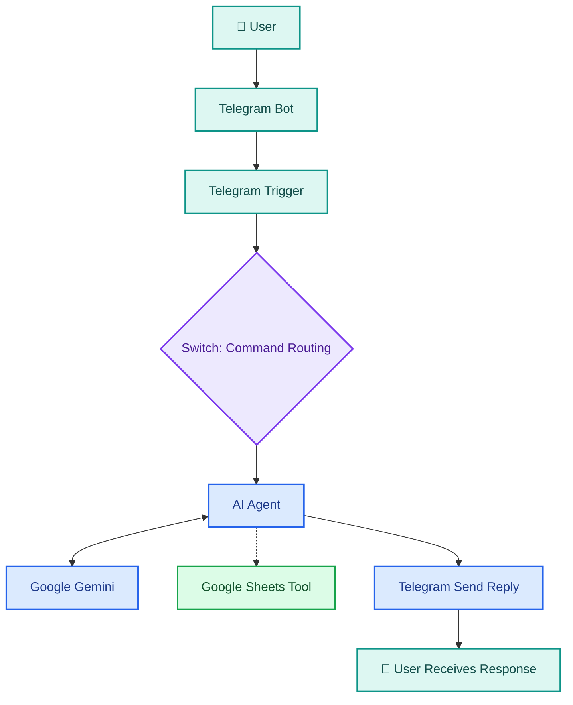

# ✦ LinguaCare | Multilingual AI Telegram Assistant

  <strong>Connect. Learn. Translate. Assist.</strong>
   
  مساعد ذكي متعدد اللغات يجمع بين الدعم، وتعلّم اللغات، والترجمة، والمساعدة في الكتابة ضمن تجربة محادثة واحدة.

  
  
  
  

  
  
  

---

## ✧ Project Overview

**LinguaCare** هو مشروع مساعد محادثة ذكي يعمل عبر Telegram، بُني باستخدام **n8n** لربط استقبال الرسائل وتوجيهها ومعالجتها، و**Google Gemini** لتوليد الاستجابات، مع تكامل مع Google Sheets لتسجيل بيانات المحادثات.

بدلًا من إنشاء روبوت منفصل لكل مهمة، يجمع المشروع مجموعة من الخدمات ضمن واجهة واحدة؛ إذ يستطيع المستخدم طلب الدعم، أو تعلّم مفردات وقواعد اللغة، أو ترجمة النصوص، أو الحصول على مساعدة في الكتابة، من خلال أوامر واضحة أو رسائل طبيعية.

يركّز المشروع على تطبيق مفاهيم **Agent & Decision Thinking** عمليًا: فهم مدخلات المستخدم، وتحديد المسار المناسب، واستخدام نموذج لغوي لإنتاج استجابة ملائمة، وتنظيم تدفّق العمل بين الأدوات المتصلة.

> **الفكرة الأساسية:** تحويل مجموعة من المهام الحوارية المتكررة إلى تجربة واحدة منظمة، قابلة للاختبار والتطوير والتوسّع.

## ✧ Quick Navigation

| القسم | المحتوى |
|---|---|
| [🎯 Problem & Motivation](#-problem--motivation) | المشكلة والسياق والحاجة إلى الحل |
| [💡 Proposed Solution](#-proposed-solution) | فكرة LinguaCare والخدمات |
| [🧠 System Architecture](#-system-architecture) | بنية النظام ومسار البيانات |
| [⚙️ Workflow Breakdown](#-workflow-breakdown) | دور كل مكوّن |
| [🤖 AI Agent Design](#-ai-agent-design) | منطق الاستجابة وحدود الوكيل |
| [🗂️ Conversation Logging](#️-conversation-logging) | تصميم سجل المحادثات |
| [🧪 Testing & Validation](#-testing--validation) | الاختبارات والنتائج |
| [⚠️ Limitations & Improvements](#️-limitations--improvements) | القيود والتحسينات |
| [🖼️ Screenshots](#️-screenshots) | لقطات المشروع |
| [🔗 Project Links](#-project-links) | الروابط |
| [👩‍💻 Author](#-author) | معلومات المطوّرة |

---

## 🎯 Problem & Motivation

### The Context

تتكرر في الاستخدام اليومي احتياجات بسيطة لكنها متنوعة: فهم قاعدة لغوية، وتعلّم مفردات جديدة، وترجمة جملة، وتحسين صياغة نص، أو الحصول على إجابة مرتبطة بخدمة معينة.

قد يضطر المستخدم إلى التنقّل بين أدوات مختلفة لتنفيذ هذه المهام، بينما تحتاج الجهة التي تبني المساعد إلى تنظيم الرسائل وتحديد كيفية التعامل معها، بدلًا من معالجة جميع الطلبات بالطريقة نفسها.

### The Problem

تتمثل المشكلة التي يعالجها المشروع في الحاجة إلى مساعد محادثة يستطيع التعامل مع أنواع مختلفة من الطلبات ضمن تدفّق عمل واحد، مع الحفاظ على وضوح التوجيه، وملاءمة الرد، وإمكانية توسيع النظام لاحقًا.

### Why It Matters

- **توحيد التجربة:** الوصول إلى خدمات متنوعة من خلال واجهة محادثة واحدة.
- **تنظيم المعالجة:** استخدام مسارات محددة للأوامر المعروفة.
- **تحسين التفاعل:** السماح للمستخدم بكتابة طلبه بصيغة طبيعية.
- **قابلية التوسّع:** إضافة خدمات أو تكاملات جديدة ضمن بنية تدفّق العمل.
- **قابلية المراجعة:** تصميم سجل محادثات يساعد على متابعة سلوك النظام بعد استكمال إعدادات التسجيل والتحقق منها.

---

## 💡 Proposed Solution

يقدّم LinguaCare مساعدًا متعدد الخدمات يعتمد على التكامل بين واجهة Telegram، وتدفّق العمل في n8n، ونموذج Google Gemini.

تبدأ التجربة باستقبال رسالة المستخدم، ثم يوجّه النظام الأوامر المعروفة إلى المسار المناسب، بينما يستطيع المساعد التعامل مع الرسائل العامة ومحاولة فهم المقصود منها ضمن التعليمات المتاحة له.

### Core Services

<table>
  <tr>
    <td width="50%">
      <h3>💬 Customer Support</h3>
      تقديم إجابات عن استفسارات NovaMart بالاعتماد على معلومات الدعم الموثوقة المتاحة للمساعد. يجب التحقق من مصدر سياسة المتجر قبل اعتبار إجابات السياسات معتمدة.
    </td>
    <td width="50%">
      <h3>📚 Language Learning</h3>
      شرح المفردات والقواعد، وتقديم الأمثلة، ومساعدة المستخدم على التدرّب على اللغة.
    </td>
  </tr>
  <tr>
    <td width="50%">
      <h3>🌐 Translation</h3>
      ترجمة النصوص بين اللغات مع مراعاة معنى النص وسياقه قدر الإمكان.
    </td>
    <td width="50%">
      <h3>✍️ Writing Assistance</h3>
      المساعدة في صياغة النصوص وتحسينها وتقديم اقتراحات كتابية مناسبة للطلب.
    </td>
  </tr>
  <tr>
    <td width="50%">
      <h3>🧭 Natural-Language Requests</h3>
      استقبال الرسائل غير المرتبطة بأمر محدد ومحاولة تحديد غرض المستخدم من محتواها.
    </td>
    <td width="50%">
      <h3>🗃️ Conversation Logging</h3>
      تكامل مخطّط مع Google Sheets لتسجيل بيانات المحادثات، مع ضرورة اكتمال تعيين الأعمدة والتحقق من صحة القيم المحفوظة.
    </td>
  </tr>
</table>

### Target Users

- المستخدمون الذين يريدون مساعدة سريعة في تعلّم اللغات.
- الأشخاص الذين يحتاجون إلى ترجمة نصوص قصيرة.
- المستخدمون الذين يبحثون عن مساعدة أولية في الكتابة.
- العملاء الذين لديهم استفسارات دعم ضمن نطاق المعلومات المتاحة.
- مطوّرو الأتمتة الذين يريدون دراسة مثال عملي لدمج Telegram وn8n ونموذج لغوي وأداة خارجية.

---

## 🧠 System Architecture

يعتمد النظام على بنية تدفّق عمل تبدأ من Telegram، وتمرّ عبر توجيه الرسائل، ثم تستخدم الوكيل الذكي لتوليد الاستجابة المناسبة وإرسالها إلى المستخدم.

### High-Level Workflow

> **ملاحظة معمارية:** يوضّح المخطط التصميم العام للتدفّق. الاتصال بأداة Google Sheets لا يعني تلقائيًا أن كل سجل يُحفظ بصورة صحيحة؛ يجب التحقق من تعيين الأعمدة والقيم الفعلية في كل عملية تسجيل.

### Architecture Components

| المكوّن | الدور |
|---|---|
| Telegram Bot | واجهة المحادثة التي يرسل المستخدم من خلالها الرسائل ويستقبل الردود. |
| Telegram Trigger | استقبال الرسائل الواردة وبدء تنفيذ تدفّق العمل. |
| Switch | توجيه الأوامر المعروفة إلى المسارات المحددة في سير العمل. |
| AI Agent | تنسيق معالجة الطلب وتطبيق التعليمات واستخدام الأدوات المتاحة. |
| Google Gemini | النموذج اللغوي المستخدم في توليد الاستجابات. |
| Google Sheets Tool | أداة مرتبطة بالوكيل ومخصّصة لتسجيل بيانات المحادثات عند اكتمال إعدادها. |
| Telegram Send Reply | إرسال الاستجابة الناتجة إلى محادثة المستخدم. |

---

## ⚙️ Workflow Breakdown

### 01 — Message Reception

يستقبل Telegram Trigger الرسالة الواردة من المستخدم، ويبدأ تنفيذ سير العمل بناءً على الحدث الذي استقبله.

### 02 — Command Routing

يفحص مكوّن Switch الأمر أو المسار الذي تتبعه الرسالة، بهدف توجيه الطلبات المعروفة إلى المعالجة المناسبة.

| الأمر | الغرض |
|---|---|
| `/support` | استفسارات الدعم المرتبطة بـ NovaMart |
| `/learn` | تعلّم اللغات والقواعد والمفردات |
| `/translate` | ترجمة النصوص |
| `/help` | عرض الأوامر المتاحة |
| رسالة عامة | محاولة فهم غرض المستخدم والاستجابة له |
| أمر غير معروف | إبلاغ المستخدم بأن الأمر غير معروف واقتراح `/help` |

### 03 — AI Processing

يتولى AI Agent معالجة الطلب وفق التعليمات المحددة، ويستعين بنموذج Google Gemini لتوليد رد ملائم لنوع المهمة.

تختلف جودة الاستجابة باختلاف وضوح الطلب، والمعلومات المقدمة للنموذج، والتعليمات التي تضبط سلوكه، ومدى توافر مصادر موثوقة عندما تكون الإجابة بحاجة إلى حقائق محددة.

### 04 — Tool Integration

يتضمن التصميم تكامل Google Sheets بوصفه أداة مرتبطة بالوكيل، بهدف تسجيل بيانات المحادثات. ويتطلب هذا التكامل تحديد الحقول المطلوبة والتأكد من انتقال كل قيمة إلى العمود الصحيح.

### 05 — Response Delivery

بعد تجهيز الاستجابة، يستخدم سير العمل Telegram Send Reply لإرسالها إلى المستخدم، لتكتمل دورة التفاعل الأساسية.

---

## 🤖 AI Agent Design

### Agent Responsibilities

صُمّم الوكيل للتعامل مع مجموعة من المهام الحوارية، مع محاولة مطابقة اللغة المستخدمة مع لغة المستخدم والمحافظة على ارتباط الإجابة بطلبه.

تشمل مسؤولياته:

- فهم التعليمات والأوامر الواردة.
- تقديم المساعدة اللغوية والأمثلة التعليمية.
- ترجمة النصوص وفق الطلب.
- المساعدة في كتابة النصوص وتحسين صياغتها.
- التعامل مع الاستفسارات العامة ضمن نطاق التعليمات.
- الاستفادة من سياق المحادثة المتاح عند الإجابة عن أسئلة المتابعة.
- استخدام الأدوات المتصلة به عندما تتطلب المهمة ذلك وتكون إعداداتها صالحة.

### Behavioral Principles

  
<strong>01 — Language Matching</strong>

  يحاول المساعد الرد بلغة المستخدم، مع استخدام اللغة المطلوبة صراحةً عندما يحدد المستخدم لغة مختلفة.

  
<strong>02 — Contextual Continuity</strong>

  يستطيع المساعد استخدام السياق المتاح في المحادثة لفهم الإشارات إلى رسائل سابقة، مثل طلب مثال للكلمة الثانية في قائمة سبق عرضها. ولا يعني ذلك إثبات وجود ذاكرة دائمة بين المحادثات المنفصلة.

  
<strong>03 — Grounded Support</strong>

  يجب أن تستند إجابات دعم NovaMart إلى أسئلة شائعة أو سياسات موثقة. إذا لم تتوفر معلومة موثوقة، ينبغي توضيح عدم توفرها بدل اختلاق سياسة أو وسيلة تواصل.

  
<strong>04 — Unknown Commands</strong>

  عند تلقي أمر غير معروف، ينبغي توضيح ذلك للمستخدم واقتراح الأمر `/help` للوصول إلى قائمة الأوامر المتاحة.

  
<strong>05 — Honest Capability Boundaries</strong>

  لا ينبغي للمساعد الادعاء بأنه يستطيع الوصول إلى حسابات العملاء أو حالة طلباتهم أو أنظمة داخلية ما لم تكن هناك تكاملات فعلية تمنحه هذه الصلاحيات.

### Reliability Considerations

النموذج اللغوي قادر على إنتاج إجابات سليمة لغويًا، لكن جودة الصياغة وحدها لا تضمن صحة المعلومات. لذلك يجب التمييز بين المهام التي يمكن تقييمها مباشرةً، مثل ترجمة جملة واضحة، والمهام التي تتطلب مصدرًا موثوقًا، مثل تفسير سياسة الإرجاع.

في هذا المشروع، تحتاج إجابات سياسات NovaMart إلى التحقق من قاعدة معرفة موثقة قبل اعتمادها بوصفها معلومات صحيحة.

---

## 🗂️ Conversation Logging

### Data Structure

يتضمن التصميم المقترح لسجل المحادثات ورقة Google Sheets باسم `Conversations` ضمن ملف `LinguaCare Conversation Log`.

| Field | Purpose |
|---|---|
| `Timestamp` | وقت تسجيل المحادثة |
| `Chat ID` | معرّف المحادثة في Telegram |
| `User Message` | رسالة المستخدم |
| `Command` | الأمر أو المسار المرتبط بالطلب |
| `Bot Reply` | الرد الذي أرسله المساعد |
| `Language` | لغة الرسالة أو الاستجابة عند توفرها |
| `Status` | حالة المعالجة أو نتيجة التنفيذ |

### Logging Validation

خلال اختبار التكامل، ظهرت إضافة صف جديد في جدول البيانات، لكن أعمدته لم تستقبل القيم المطلوبة. وهذا يعني أن عملية الإضافة وصلت إلى Google Sheets، بينما بقي تعيين الحقول بحاجة إلى إصلاح والتحقق منه.

لذلك، يُعد تسجيل المحادثات **جزئيًا من ناحية التحقق**، ولا ينبغي اعتبار السجل مكتملًا قبل التأكد من ظهور البيانات الصحيحة في كل عمود.

### Data Quality Checklist

- [ ] التأكد من اختيار ورقة `Conversations` الصحيحة.
- [ ] مطابقة أسماء الحقول مع عناوين الأعمدة.
- [ ] تعيين كل قيمة إلى العمود المناسب.
- [ ] اختبار حفظ رسالة المستخدم والرد والأمر.
- [ ] التأكد من ظهور القيم في الصف الجديد.
- [ ] التعامل مع فشل التسجيل برسالة أو حالة واضحة.
- [ ] تجنّب تسجيل معلومات حساسة لا يحتاجها المشروع.

---

## 🧰 Tools & Technologies

  
  
  
  
  
  

| Technology | Usage |
|---|---|
| **n8n** | بناء سير العمل وربط المكوّنات والخدمات. |
| **Telegram Bot API** | استقبال الرسائل وإرسال الردود عبر Telegram. |
| **Google Gemini** | توليد الاستجابات باستخدام نموذج لغوي. |
| **AI Agent** | تنظيم معالجة الطلبات والاستفادة من الأدوات المتاحة. |
| **Switch** | توجيه الأوامر إلى المسارات المناسبة. |
| **Google Sheets** | الوجهة المقترحة لتسجيل المحادثات. |
| **GitHub Markdown & Mermaid** | توثيق المشروع وعرض مخططه المعماري. |

---

## 🧪 Testing & Validation

اختُبرت مجموعة من السيناريوهات للتحقق من الأوامر الأساسية، وجودة الاستجابة، والتعامل مع السياق، وسلوك المساعد عند استقبال أوامر غير معروفة.

### Test Results Overview

| ID | Test Scenario | Result | Evaluation |
|---|---|---|---|
| T01 | `/help` | Pass | عرض الأوامر الأساسية بصورة صحيحة. |
| T02 | `/learn` | Pass | تقديم شرح لغوي وأمثلة وتمرين قصير. |
| T03 | `/translate` | Pass | ترجمة الجملة التجريبية بمعنى صحيح. |
| T04 | `/support` | Needs Verification | ظهرت سياسة إرجاع محددة، لكن مصدرها لم يُتحقق منه. |
| T05 | Natural-Language Request | Pass | فهم طلب عام للمساعدة في تحسين الإنجليزية. |
| T06 | Unknown Command | Pass | توضيح أن الأمر غير معروف واقتراح `/help`. |
| T07 | Contextual Follow-up | Pass | استخدام سياق الرسائل السابقة للإجابة عن متابعة. |
| T08 | Arabic Input | Pass | تقديم مفردات إنجليزية مع ترجمتها وأمثلة. |
| T09 | Google Sheets Logging | Partial | أُضيف صف، لكن الأعمدة بقيت فارغة. |

### Detailed Test Cases

  
<strong>T01 — Help Command</strong>

  **Input:** `/help`

  **Expected behavior:** عرض الأوامر الأساسية المتاحة للمستخدم.

  **Observed result:** عرض المساعد أوامر `/support` و`/learn` و`/translate` و`/help`.

  **Evaluation:** نجح الاختبار في التحقق من عرض قائمة الأوامر الأساسية.

  
<strong>T02 — Language Learning</strong>

  **Input:** `/learn`

  **Expected behavior:** تقديم مساعدة تعليمية مفهومة، تتضمن شرحًا وأمثلة مناسبة.

  **Observed result:** قدّم المساعد شرحًا لاستخدام `do` و`does`، مع مثالين وسؤال للتدريب.

  **Evaluation:** نجح السيناريو التجريبي في تقديم شرح وأمثلة واضحة.

  
<strong>T03 — Translation</strong>

  **Input:** `/translate` متبوعًا بالجملة: `Learning a new language opens doors to new opportunities.`

  **Expected behavior:** ترجمة الجملة إلى العربية مع الحفاظ على معناها.

  **Observed result:** «تعلم لغة جديدة يفتح أبواباً لفرص جديدة.»

  **Evaluation:** نجح الاختبار في نقل المعنى الأساسي للجملة.

  
<strong>T04 — Customer Support and Source Verification</strong>

  **Input:** `What is NovaMart's return policy?`

  **Expected behavior:** تقديم سياسة الإرجاع استنادًا إلى مصدر موثوق، أو توضيح أن المعلومات غير متاحة.

  **Observed result:** ذكر المساعد إمكانية إرجاع المنتجات غير المستخدمة ضمن عبوتها الأصلية خلال 14 يومًا، وذكر أن المنتجات المخفّضة غير قابلة للإرجاع.

  **Evaluation:** **تحتاج النتيجة إلى التحقق من المصدر.** لم يُثبت الاختبار أن هذه الشروط مأخوذة من سياسة رسمية موثقة؛ لذلك لا يمكن اعتمادها كحقيقة عن NovaMart.

  **Required improvement:** إضافة الأسئلة الشائعة أو سياسة الإرجاع المعتمدة إلى مصدر معرفة واضح، وضبط التعليمات لمنع تقديم شروط غير موثقة.

  
<strong>T05 — Natural-Language Request</strong>

  **Input:** `Hi! Can you help me improve my English?`

  **Expected behavior:** فهم الطلب العام واقتراح طرق عملية للمساعدة.

  **Observed result:** اقترح المساعد التدريب على المحادثة، والقواعد، والمفردات، وتصحيح النصوص.

  **Evaluation:** نجح الاختبار في تقديم خيارات تتناسب مع نية المستخدم.

  
<strong>T06 — Unknown Command</strong>

  **Input:** `/unknown`

  **Expected behavior:** عدم التعامل مع الأمر باعتباره أمرًا معروفًا، وإرشاد المستخدم إلى الأوامر المتاحة.

  **Observed result:** أوضح المساعد أنه لم يتعرف على الأمر، واقترح استخدام `/help`.

  **Evaluation:** نجح السيناريو التجريبي في التعامل مع الأمر غير المعروف.

  
<strong>T07 — Contextual Continuity</strong>

  **First input:** `/learn Teach me three English words about work.`

  **Follow-up:** `Give me an example sentence for the second word.`

  **Expected behavior:** ربط المتابعة بالقائمة التي عُرضت سابقًا.

  **Observed result:** عرض المساعد كلمات `Salary` و`Colleague` و`Deadline`، ثم قدّم مثالًا على الكلمة الثانية، `Colleague`.

  **Evaluation:** نجح الاختبار في استخدام سياق المحادثة المتاح. ولا يثبت هذا الاختبار وجود ذاكرة دائمة بين المحادثات المنفصلة.

  
<strong>T08 — Arabic Input</strong>

  **Input:** طلب باللغة العربية لتعلّم خمس كلمات إنجليزية مرتبطة بمقابلات العمل.

  **Expected behavior:** تقديم مفردات ملائمة مع ترجمتها أو شرحها باللغة المناسبة.

  **Observed result:** قدّم المساعد الكلمات `Experience` و`Strengths` و`Skills` و`Goal` و`Background`، مع ترجمات وأمثلة.

  **Evaluation:** نجح السيناريو التجريبي في الاستجابة لطلب عربي بمحتوى تعليمي باللغة الإنجليزية.

  
<strong>T09 — Google Sheets Logging</strong>

  **Input:** رسالة عربية تجريبية للتحقق من تسجيل المحادثة في Google Sheets.

  **Expected behavior:** إنشاء صف جديد يتضمن الحقول المعيّنة، مثل وقت التسجيل ورسالة المستخدم والرد.

  **Observed result:** ظهر صف جديد في الجدول، لكن القيم المطلوبة لم تظهر في الأعمدة.

  **Evaluation:** **نجاح جزئي.** ثبت وصول عملية الإضافة إلى الجدول، لكن لم يثبت اكتمال تسجيل البيانات.

  **Required improvement:** مراجعة إعدادات الأعمدة وتعيين القيم يدويًا، ثم إعادة الاختبار والتحقق من البيانات الفعلية.

### Validation Summary

تُظهر الاختبارات أن المسارات الحوارية الأساسية قدّمت نتائج جيدة في السيناريوهات التجريبية التي نُفذت. وفي المقابل، كشف التحقق عن نقطتين مهمتين قبل اعتماد النظام بصورة أكثر موثوقية:

1. **Grounding:** ضرورة ربط إجابات الدعم بمصدر موثوق يمنع اختلاق سياسات المتجر.
2. **Data Mapping:** ضرورة إصلاح تعيين بيانات Google Sheets والتأكد من ظهور القيم في الأعمدة الصحيحة.

التمييز بين النجاح الوظيفي والاكتمال التشغيلي جزء أساسي من تقييم الأنظمة المعتمدة على الذكاء الاصطناعي.

---

## ⚠️ Limitations & Improvements

### Current Limitations

- **Verified Knowledge:** لم يُثبت بعد أن إجابات سياسة NovaMart تستند إلى مصدر رسمي موثوق.
- **Logging Accuracy:** أُنشئ صف في Google Sheets دون تعبئة الحقول المطلوبة.
- **Context Boundaries:** نجاح المتابعة داخل المحادثة لا يثبت الاحتفاظ بالذاكرة بين جلسات منفصلة.
- **Language Model Reliability:** قد ينتج النموذج إجابات تبدو مقنعة رغم عدم توافر أدلة كافية عليها.
- **Operational Resilience:** تحتاج حالات فشل الأدوات والاتصالات إلى اختبارات مخصصة للتحقق من التعامل معها.

### Improvement Roadmap

| Priority | Improvement | Intended Outcome |
|---|---|---|
| P1 | إصلاح تعيين أعمدة Google Sheets | حفظ بيانات المحادثة بصورة صحيحة. |
| P1 | توثيق سياسات NovaMart وربطها بمصدر موثوق | تقليل الإجابات غير المدعومة. |
| P2 | اختبار حالات فشل الأدوات والاتصال | تحسين التعامل مع الأخطاء. |
| P2 | توحيد تنسيق السجلات وحالات التنفيذ | تسهيل مراجعة النتائج. |
| P3 | إضافة دعم أوسع للغات واختبارات الجودة | تحسين التجربة لمستخدمين متنوعين. |
| P3 | تقييم الاستجابات عبر مجموعة اختبارات متكررة | قياس الاتساق قبل التعديلات وبعدها. |

> الأولويات هنا مقترحة بناءً على الملاحظات المكتشفة أثناء الاختبار، وليست دليلًا على أن هذه التحسينات نُفذت بالفعل.

---

## 📘 Key Learnings

من خلال بناء LinguaCare واختباره، يبرز عدد من الدروس العملية:

- **Workflow Design:** أهمية فصل استقبال الرسائل عن توجيهها ومعالجتها وإرسال الردود.
- **Agent Instructions:** تؤثر التعليمات بوضوح في أسلوب المساعد وحدود إجاباته.
- **Context Management:** يجب اختبار أسئلة المتابعة بصورة مستقلة عن الأسئلة المنفردة.
- **Tool Integration:** نجاح الاتصال بالخدمة الخارجية لا يعني بالضرورة صحة البيانات التي تصل إليها.
- **Grounded Responses:** تحتاج الإجابات المرتبطة بالسياسات والحقائق إلى مصادر موثوقة، وليس إلى نموذج لغوي فقط.
- **Testing Discipline:** توثيق النتيجة الفعلية، بما فيها الإخفاقات الجزئية، أدق من وصف النظام بأنه يعمل بالكامل.

---

## 🔭 Future Enhancements

يمكن تطوير المشروع مستقبلًا من خلال:

- إضافة قاعدة معرفة موثقة لأسئلة الدعم والسياسات.
- تحسين تسجيل المحادثات مع معالجة أخطاء تعيين البيانات.
- إضافة اختبارات للحالات الحدّية والأوامر غير الصحيحة.
- تطوير تقييم منهجي لجودة الترجمة والمساعدة التعليمية.
- إضافة تقارير متابعة لعدد المحادثات وحالات التنفيذ، بعد التحقق من صحة السجلات.
- توسيع الخدمات مع الحفاظ على وضوح حدود كل وظيفة وصلاحياتها.

---

## 🖼️ Screenshots

## 🔗 Project Links

| Resource | Link |
|---|---|
| **Telegram Bot** | [Open LinguaCare Bot](https://t.me/LinguaCareSupport_bot) |
| **n8n Assistant** | [Open n8n Assistant](https://doaasalbatniji.app.n8n.cloud/assistant/02740157-165d-4239-8268-f3b239a11104) |
| **Google Sheets Log** | [Open Conversation Log](https://docs.google.com/spreadsheets/d/1xvlu9nCO0JJLL9RGXyToyXRRapnuY-LedOsPULhKm6I/edit?usp=sharing) |
| **GitHub Repository** | (أضيفي رابط مجلد المشروع على GitHub هنا) |

---

## 👩‍💻 Author

**Doaa Sami Al-Batniji**  
*Computer Engineer | Data, AI & Automation*

أعمل على بناء حلول عملية تجمع بين الذكاء الاصطناعي والأتمتة وتنظيم البيانات، مع التركيز على تصميم تدفّقات عمل واضحة، واختبار سلوك الأنظمة، وتوثيق النتائج والقيود بدقة.

- **GitHub:** [doaasami9](https://github.com/doaasami9)
- **LinkedIn:** (YOUR_LINKEDIN_URL)

---

  <strong>LinguaCare</strong>
   
  <em>Connect. Learn. Translate. Assist.</em>
    
  Built with AI, workflow automation, and a focus on practical conversational experiences.

