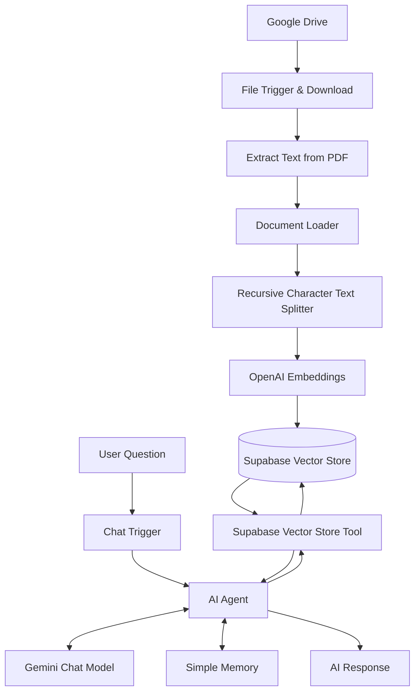
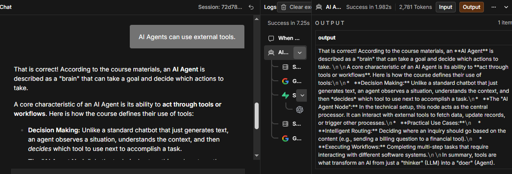

# 🔷 RAG with n8n
## Build a Knowledge Pipeline & RAG AI Agent

  <strong>From Raw Documents to Grounded, Context-Aware AI Responses</strong>

  
  
  
  
  

---

## 01. Project Overview

يقدّم هذا المشروع تطبيقًا عمليًا لمفهوم **Retrieval-Augmented Generation (RAG)** من خلال بناء مسار متكامل لإدخال المعرفة، ومعالجة المستندات، وتخزين تمثيلاتها المتجهية، ثم استرجاع المعلومات ذات الصلة لدعم إجابات وكيل ذكاء اصطناعي.

تم تنفيذ المشروع باستخدام **n8n** لربط المكونات وأتمتة العمليات، و**Supabase Vector Store** لتخزين المعرفة واسترجاعها، و**OpenAI Embeddings** لتحويل النصوص إلى تمثيلات رقمية، و**Gemini Chat Model** لتوليد الإجابات.

لا يقتصر التركيز على بناء سير عمل يعمل فحسب، بل يشمل أيضًا فهم العلاقة بين البيانات والاسترجاع والذاكرة والأدوات، والتحقق من سلوك النظام من خلال اختبارات عملية.

> **Core Principle:** Retrieve relevant knowledge, provide context to the AI Agent, and generate responses grounded in the available information.

## 02. Project Objectives & Outcomes

صُمّم المشروع لتطبيق مفاهيم بناء أنظمة الذكاء الاصطناعي المتصلة بمصادر المعرفة، مع التركيز على تكامل المكونات والتحقق من النتائج.

- بناء مسار آلي لمعالجة ملفات المعرفة وإعدادها للاسترجاع.
- استخراج النصوص من ملفات PDF وتجهيزها للتقسيم إلى مقاطع.
- تطبيق **Text Chunking** مع تحديد حجم المقطع والتداخل بين المقاطع.
- إنشاء **Embeddings** باستخدام OpenAI.
- تخزين التمثيلات المتجهية في Supabase.
- بناء AI Agent يستقبل الأسئلة ويستخدم قاعدة المعرفة أداةً للاسترجاع.
- دمج Gemini Chat Model وSimple Memory في مسار المحادثة.
- التمييز بين المعرفة المسترجعة والذاكرة الحوارية.
- اختبار استرجاع المعلومات والبحث الدلالي والتعامل مع المعلومات غير المتاحة واستمرارية سياق المحادثة.

## 03. Technology Stack

| Technology | Role in the Project |
|---|---|
| **n8n** | ربط المكونات وأتمتة مسارات العمل |
| **Google Drive** | مصدر ملفات المعرفة |
| **PDF Processing** | استخراج النصوص من الملفات |
| **Default Data Loader** | تحميل المستندات وتجهيزها لمعالجة المعرفة |
| **Recursive Character Text Splitter** | تقسيم النصوص إلى مقاطع متداخلة |
| **OpenAI Embeddings** | إنشاء التمثيلات الرقمية للنصوص |
| **Supabase Vector Store** | تخزين المعرفة المتجهية واسترجاعها |
| **AI Agent** | تنسيق خطوات الاستجابة واستخدام الأدوات |
| **Gemini Chat Model** | توليد الإجابات |
| **Simple Memory** | الاحتفاظ بسياق المحادثة وفق إعدادات الذاكرة |
| **Chat Trigger** | استقبال رسائل المستخدم وبدء مسار المحادثة |

## 04. RAG Architecture

يعتمد المشروع على فصل عملية إدخال المعرفة عن عملية استخدامها في المحادثة. يتيح هذا الفصل تجهيز البيانات وتخزينها أولًا، ثم استرجاع الأجزاء المناسبة عند طرح سؤال.

يوضح المخطط العلاقة المنطقية بين مرحلتي إدخال المعرفة واسترجاعها. أما التوصيلات الفعلية بين العقد، فتُعرض في صور سير العمل المرفقة في قسم لقطات الشاشة.

## 05. End-to-End Data Flow

يتكون النظام من مسارين متكاملين:

### A. Knowledge Ingestion

1. مراقبة مصدر الملفات في Google Drive وفق إعدادات الـ Trigger.
2. تحديد الملف المطلوب وتنزيله.
3. استخراج النص من ملف PDF.
4. تحميل المستندات وتجهيزها للمعالجة.
5. تقسيم النص إلى مقاطع باستخدام Recursive Character Text Splitter.
6. إنشاء Embeddings للمقاطع النصية.
7. تخزين المعرفة في Supabase Vector Store.

### B. Retrieval & Response

1. استقبال سؤال المستخدم عبر Chat Trigger.
2. تمرير السؤال إلى AI Agent.
3. استخدام Gemini Chat Model لتفسير السؤال وصياغة الإجابة.
4. الاستعانة بأداة Supabase Vector Store لاسترجاع المعلومات ذات الصلة.
5. الاستفادة من سياق المحادثة عبر Simple Memory.
6. استخدام المعلومات المسترجعة ضمن السياق المتاح لتوليد الإجابة.

## 06. Knowledge Ingestion Pipeline

يمثل مسار إدخال المعرفة المرحلة التي تتحول فيها الملفات إلى محتوى قابل للاسترجاع.

تتضمن هذه المرحلة التعامل مع الملفات، واستخراج النصوص، وتقسيمها، وإنشاء التمثيلات الرقمية، ثم تخزينها في قاعدة البيانات المتجهية.

### Pipeline Components

| Component | Responsibility |
|---|---|
| Google Drive Trigger | بدء المعالجة عند تحقق شرط تشغيل الـ Workflow |
| File Download | إتاحة الملف لخطوات المعالجة |
| Extract From File | استخراج المحتوى النصي |
| Default Data Loader | تحميل المستندات إلى مسار معالجة المعرفة |
| Recursive Character Text Splitter | تقسيم النص إلى مقاطع |
| OpenAI Embeddings | تحويل المقاطع إلى تمثيلات متجهية |
| Supabase Vector Store | تخزين المقاطع وتمثيلاتها للاسترجاع |

## 07. Document Processing & Chunking

تُعدّ طريقة تقسيم النصوص عاملًا مهمًا في جودة الاسترجاع؛ إذ تؤثر في مقدار السياق المتاح لكل مقطع وفي العلاقة بين الأجزاء المتجاورة من المستند.

استخدم المشروع عقدة **Recursive Character Text Splitter** بالإعدادات التالية:

| Setting | Implemented Value |
|---|---:|
| Chunk Size | `200` |
| Chunk Overlap | `20` |

### Why Chunking Matters

- **Context Preservation:** الحفاظ على قدر مناسب من السياق داخل كل مقطع.
- **Retrieval Granularity:** إتاحة استرجاع أجزاء محددة بدلًا من التعامل مع المستند كاملًا في كل مرة.
- **Overlap:** تقليل احتمال فقدان السياق الموجود عند حدود المقاطع المتجاورة.
- **Retrieval Relevance:** دعم البحث عن الأجزاء الأكثر ارتباطًا بالسؤال.

هذه القيم هي الإعدادات التي ظهرت في المشروع، وليست ادعاءً بأنها القيم المثلى لكل نوع من المستندات.

## 08. Embeddings & Vector Representation

استخدم المشروع **OpenAI Embeddings** لتحويل النصوص إلى تمثيلات رقمية يمكن استخدامها في البحث الدلالي.

بدلًا من الاعتماد على التطابق الحرفي بين كلمات السؤال والمستند، تتيح التمثيلات المتجهية مقارنة المعنى الدلالي للنصوص وفق آلية البحث والاسترجاع المستخدمة.

### Embedding Configuration

| Setting | Implemented Value |
|---|---:|
| Embedding Provider | OpenAI |
| Embedding Batch Size | `200` |

يحدد حجم الدفعة عدد العناصر التي تتم معالجتها في كل دفعة وفق إعدادات العقدة. ولا يعني هذا الرقم أن جميع عمليات التضمين تتم دفعة واحدة، أو أنه يمثل عدد المقاطع المخزنة في قاعدة البيانات.

## 09. Supabase Vector Database

يستخدم المشروع **Supabase Vector Store** لتخزين المعرفة بصيغة تدعم الاسترجاع الدلالي.

تتيح قاعدة البيانات المتجهية ربط المحتوى النصي بتمثيلاته الرقمية، ثم إتاحة هذه المعرفة لمسار الاسترجاع عند معالجة أسئلة المستخدمين.

### Database Responsibilities

- حفظ المعرفة المجهزة من المستندات.
- إتاحة المقاطع المخزنة لمسار البحث الدلالي.
- دعم استرجاع المعلومات من خلال أداة مرتبطة بالـ AI Agent.
- الفصل بين تخزين المعرفة طويلة الأجل وسياق المحادثة.

**Important Distinction:** وجود قاعدة بيانات متجهية لا يضمن وحده صحة الإجابة؛ إذ تعتمد النتيجة أيضًا على جودة المستندات، والتقسيم، والاسترجاع، وطريقة استخدام المعلومات المسترجعة في توليد الإجابة.

## 10. Retrieval Configuration

في مسار **RAG AI Agent**، استُخدمت عقدة Supabase Vector Store أداةً للبحث في قاعدة المعرفة.

### Retrieval Limit

| Setting | Implemented Value |
|---|---:|
| Retrieval Limit | `4` |

يحدد هذا الإعداد الحد الأقصى لعدد النتائج التي يمكن إرجاعها وفق إعدادات الاسترجاع الفعلية للعقدة.

ولا يعني استرجاع أربع نتائج بالضرورة أن النتائج الأربع متساوية في الصلة، أو أن الإجابة النهائية يجب أن تحتوي على أربع نقاط. تظل جودة النتائج مرتبطة بمحتوى قاعدة المعرفة وآلية البحث.

## 11. RAG AI Agent Workflow

يمثل هذا المسار طبقة التفاعل واتخاذ خطوات المعالجة اللازمة للإجابة عن أسئلة المستخدم.

يتلقى الوكيل السؤال، ويعمل مع نموذج المحادثة، ويستطيع الاستعانة بأداة استرجاع المعرفة والذاكرة الحوارية وفق التوصيلات والإعدادات المنفذة.

### Core Components

- **Chat Trigger:** استقبال الرسائل وبدء تنفيذ المسار.
- **AI Agent:** تنسيق الاستجابة واستخدام الأدوات المتاحة.
- **Gemini Chat Model:** دعم فهم السؤال وتوليد الإجابة.
- **Supabase Vector Store Tool:** استرجاع المعرفة ذات الصلة.
- **Simple Memory:** دعم الاحتفاظ بسياق المحادثة.

## 12. AI Agent & Tool Calling

من أهم مفاهيم المشروع التمييز بين نموذج لغوي يولّد النصوص ووكيل يستطيع استخدام الأدوات المتاحة له ضمن سير العمل.

يتيح ربط Supabase Vector Store بالـ AI Agent الاستعانة بمصدر معرفة خارجي عند الحاجة، بدلًا من الاعتماد على المعرفة المضمّنة في النموذج وحدها.

### The Agent Execution Model

1. **Understand:** تفسير السؤال وسياقه.
2. **Select:** اختيار الأداة المناسبة من الأدوات المتاحة، وفق منطق الوكيل.
3. **Retrieve:** طلب المعلومات من مصدر المعرفة عند الحاجة.
4. **Process:** استخدام النتائج ضمن سياق الاستجابة.
5. **Respond:** صياغة الإجابة للمستخدم.

هذه المراحل تصف النموذج المفاهيمي لاستخدام الأدوات؛ ولا تعني أن كل سؤال يجب أن يمر حتمًا بجميع الخطوات بالترتيب نفسه.

## 13. Simple Memory vs. Knowledge Base

على الرغم من إمكانية استخدام الذاكرة وقاعدة المعرفة معًا، فإن لكل منهما وظيفة مختلفة.

| Dimension | Simple Memory | Vector Knowledge Base |
|---|---|---|
| Primary Purpose | الاحتفاظ بسياق المحادثة | استرجاع معلومات من المستندات |
| Information Source | سياق التفاعل | الملفات المعالجة والمخزنة |
| Main Benefit | دعم استمرارية الحوار | دعم الإجابات المستندة إلى المعرفة |
| Typical Use | تذكّر سياق الرسائل السابقة ضمن إعدادات الذاكرة | العثور على معلومات ذات صلة بسؤال جديد |

**Key Insight:** الذاكرة الحوارية ليست بديلًا عن قاعدة المعرفة، وقاعدة المعرفة ليست بديلًا عن الذاكرة. يمكن أن تتكامل الوظيفتان ضمن النظام نفسه.

## 14. Grounded Answering

يهدف RAG إلى تحسين ارتباط الإجابات بالمعلومات المتاحة من خلال استرجاع سياق مناسب قبل توليد الرد.

في هذا المشروع، تم تصميم مسار الاستجابة للاستفادة من نتائج استرجاع المعرفة إلى جانب قدرات النموذج اللغوي.

تشمل المبادئ المهمة:

- ربط الإجابة بالمعلومات المسترجعة عندما تكون ذات صلة.
- التمييز بين المعلومات المتاحة والمعلومات غير الموجودة في مصدر المعرفة.
- عدم اعتبار الإجابة الواثقة دليلًا كافيًا على صحتها.
- التحقق من سلوك النظام باستخدام أسئلة ذات نتائج متوقعة ومعروفة.

وجود RAG يقلل الاعتماد على التوليد غير المرتبط بالمصدر، لكنه لا يلغي احتمال الخطأ أو الاستنتاج غير الدقيق بصورة مطلقة.

## 15. Testing & Validation Strategy

تم اختبار سلوك المشروع من خلال أربع حالات للتحقق من جوانب مختلفة من الاسترجاع والمحادثة.

| Test | Purpose | Result |
|---|---|---|
| Known Information | التحقق من الإجابة عن سؤال تتوفر معلوماته في قاعدة المعرفة | **PASS** |
| Semantic Search | التحقق من استرجاع المعلومات ذات الصلة الدلالية بالسؤال | **PASS** |
| Unknown Information | اختبار التعامل مع سؤال لا تتوفر إجابته في المعرفة المتاحة | **PASS** |
| Conversation Memory | التحقق من الاحتفاظ بسياق المحادثة واستخدامه | **PASS** |

  

توضح النتائج نجاح حالات الاختبار الأربع التي نُفذت ضمن نطاق المشروع. ولا تمثل هذه النتائج وحدها اختبارًا شاملًا للأداء أو الأمان أو جاهزية الإنتاج.

## 16. Test Interpretation

### Known Information

التحقق من قدرة النظام على الإجابة عن سؤال تتوفر معلوماته في مصدر المعرفة، بدلًا من الاكتفاء بإجابة عامة غير مرتبطة بالمحتوى.

### Semantic Search

التحقق من قدرة الاسترجاع على العثور على محتوى ذي صلة بمعنى السؤال، وليس فقط اعتمادًا على تطابق الكلمات حرفيًا.

### Unknown Information

اختبار كيفية تعامل النظام مع سؤال لا تتوفر له معلومات داعمة في المعرفة المتاحة. ويهدف هذا الاختبار إلى فحص حدود الإجابة والتمييز بين المعلومات المتوفرة وغير المتوفرة.

### Conversation Memory

التحقق من قدرة النظام على استخدام سياق المحادثة وفق إعدادات Simple Memory، بما يدعم استمرارية التفاعل بين الرسائل.

## 17. Additional AI Agent Knowledge Test

تتضمن لقطات المشروع أيضًا اختبارًا معرفيًا حول قدرة وكلاء الذكاء الاصطناعي على استخدام الأدوات الخارجية.

يتناول السؤال العبارة:

> AI Agents can use external tools.

والإجابة الصحيحة هي أن الوكلاء الذكيين يستطيعون استخدام الأدوات الخارجية المتاحة لهم ضمن التكوين والصلاحيات المحددة.

يدعم هذا المفهوم فهم الدور الذي تؤديه الأدوات في توسيع قدرات الوكيل، مثل استرجاع البيانات أو التفاعل مع أنظمة خارجية عبر سير عمل متصل.

**Note:** هذا اختبار معرفي إضافي حول مفهوم AI Agents، وليس واحدًا من اختبارات التحقق الأربعة المذكورة أعلاه.

## 18. Debugging & Failure Analysis

من المبادئ المهمة في بناء مسارات RAG أن ظهور إجابة غير صحيحة لا يعني بالضرورة أن المشكلة في النموذج اللغوي وحده.

يمكن أن تتأثر النتيجة بمراحل متعددة:

| Layer | Potential Issue to Investigate |
|---|---|
| File Processing | فشل تنزيل الملف أو استخراج النص |
| Chunking | تقسيم يضعف ترابط السياق أو يفصل المعلومات المهمة |
| Embeddings | عدم توافق إعدادات التضمين أو فشل إنشاء التمثيلات |
| Vector Storage | عدم إدخال المعرفة أو عدم إتاحتها للاسترجاع |
| Retrieval | استرجاع نتائج غير ملائمة للسؤال |
| Agent Configuration | عدم استخدام الأداة بالشكل المتوقع |
| Generation | صياغة إجابة تتجاوز المعلومات المتاحة |
| Memory | عدم الاحتفاظ بالسياق أو استعادته كما هو متوقع |

يمثل هذا الجدول إطارًا لتحليل الأعطال المحتملة، وليس قائمة بأعطال ثبت وقوعها في المشروع.

## 19. Reliability & Production Considerations

يركز التفكير الإنتاجي على ما يتجاوز نجاح تجربة واحدة، ليشمل استقرار النظام، وسلامة البيانات، والقدرة على اكتشاف المشكلات ومعالجتها.

### Reliability

- التحقق من نجاح مراحل معالجة الملفات قبل الاعتماد على نتائجها.
- التأكد من أن المعرفة المطلوبة موجودة في قاعدة البيانات.
- اختبار الاسترجاع باستخدام أسئلة متنوعة.
- مراقبة الأخطاء الناتجة عن فشل العقد أو الخدمات الخارجية.
- إعادة اختبار السلوك بعد أي تغيير في الإعدادات.

### Security

- عدم تضمين مفاتيح API أو بيانات الاعتماد في README أو لقطات الشاشة العامة.
- عدم نشر روابط تشغيل أو مشاركة تتيح الوصول إلى بيانات حساسة.
- مراجعة صلاحيات الوصول إلى الملفات وقاعدة البيانات.
- الاحتفاظ بأسرار الاتصال ضمن إعدادات آمنة، وعدم إضافتها إلى مستودع GitHub.

### Production Readiness

نجاح الاختبارات المحددة يثبت النتائج ضمن نطاقها، لكنه لا يكفي وحده لإثبات جاهزية الإنتاج. يتطلب ذلك اختبارات إضافية للأداء، والتعامل مع الأعطال، والصلاحيات، والخصوصية، وتكلفة التشغيل، ومراقبة النتائج.

## 20. Implemented Configuration Summary

يجمع الجدول التالي القيم التي تم التحقق منها في إعدادات المشروع:

| Configuration | Value |
|---|---|
| Chunk Size | `200` |
| Chunk Overlap | `20` |
| Embedding Batch Size | `200` |
| Retrieval Limit | `4` |
| Embedding Provider | OpenAI |
| Chat Model | Gemini |
| Vector Database | Supabase |
| Workflow Automation | n8n |
| Conversation Memory | Simple Memory |

## 21. Key Engineering Insights

يبرز المشروع عددًا من المبادئ المهمة في تصميم أنظمة الذكاء الاصطناعي المتصلة بالبيانات:

**1. Data Quality Comes First**

لا يمكن لمسار الاسترجاع أن يعوّض عن مستندات ناقصة أو نصوص لم تتم معالجتها بصورة صحيحة.

**2. Retrieval and Generation Are Different Stages**

استرجاع المعلومات عملية مختلفة عن توليد الإجابة، ولكل مرحلة أسبابها المحتملة للأخطاء.

**3. Tools Extend Agent Capabilities**

ربط الوكيل بأداة مناسبة يتيح له الاستفادة من مصادر بيانات ووظائف تتجاوز قدرات توليد النص وحدها.

**4. Memory Is Not the Knowledge Base**

الذاكرة الحوارية تدعم سياق التفاعل، بينما تتيح قاعدة المعرفة البحث في المحتوى المخزن.

**5. Validation Must Be Explicit**

تحديد حالات اختبار واضحة وتوثيق نتائجها يجعل سلوك النظام أسهل في الفهم والمراجعة.

**6. Reliability Requires More Than a Successful Run**

تشغيل الـ Workflow بنجاح خطوة مهمة، لكنه لا يغني عن فحص البيانات والأخطاء والصلاحيات والنتائج.

## 22. Future Improvements

تمثل العناصر التالية فرصًا للتحسين والتطوير اللاحق، وليست ادعاءً بأنها نُفذت ضمن النسخة الحالية.

- إضافة آلية واضحة لتوثيق مصادر المعلومات المسترجعة في الإجابات.
- اختبار استراتيجيات مختلفة لتقسيم المستندات ومقارنة جودة الاسترجاع.
- توسيع مجموعة الاختبارات لتشمل أسئلة ملتبسة ومستندات طويلة.
- إضافة تسجيل منظم للأخطاء ومراحل فشل المعالجة.
- تقييم جودة الاسترجاع باستخدام مجموعة أسئلة وإجابات مرجعية.
- قياس زمن الاستجابة وتكلفة الاستدعاءات الخارجية.
- تحسين التعامل مع المستندات المحدثة أو المحذوفة.
- مراجعة ضوابط الوصول وأمان البيانات قبل أي نشر إنتاجي.

## 23. Project Screenshots

توثّق الصور التالية البنية التقنية للمشروع، ومسارات إدخال المعرفة واسترجاعها، وبعض نتائج التحقق العملي.

### 01 — Knowledge Ingestion Pipeline

يوضّح مسار تجهيز ملفات المعرفة، واستخراج النصوص وتقسيمها، وإنشاء التضمينات الرقمية، ثم تخزينها في قاعدة البيانات المتجهية.

### 02 — RAG AI Agent Workflow

يعرض سير عمل الوكيل الذكي واستقبال الأسئلة واستخدام أداة استرجاع المعرفة ضمن مسار الإجابة.

### 03 — Supabase Vector Database

توثّق الصورة قاعدة البيانات المتجهية المستخدمة لتخزين المعرفة وإتاحتها للاسترجاع الدلالي.

### 04 — Knowledge Retrieval Test

توثّق اختبار التحقق من وجود المعلومة في المعرفة المتاحة.

### 05 — AI Agent Tools Knowledge Test

توثّق اختبارًا معرفيًا حول قدرة AI Agents على استخدام الأدوات الخارجية لتنفيذ المهام.

## 25. Author

  <strong>DOAA SAMI AL-BATNIJI</strong>
   
  Computer Engineer | Data, AI & Automation
    
  
  

---

  Unit 07 — Reliability & Production Thinking
   
  Guided Project | RAG with n8n

