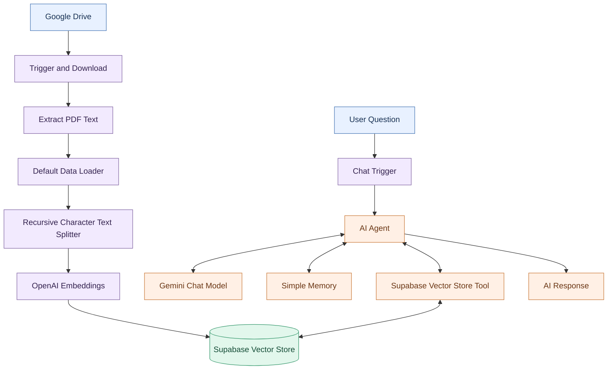

# 🔷 RAG with n8n
## Build a Knowledge Pipeline & RAG AI Agent

  <strong>From Raw Documents to Grounded, Context-Aware AI Responses</strong>

  
  
  
  
  

---

## 01. Project Overview

في هذا المشروع، بنينا مسار عمل متكاملًا لتطبيق **Retrieval-Augmented Generation (RAG)**، وربطنا معالجة المستندات بقاعدة معرفة متجهية ووكيل ذكاء اصطناعي قادر على الاستعانة بالمعلومات المسترجعة عند الإجابة عن أسئلة المستخدمين.

استخدمنا **n8n** لربط المكونات وتنفيذ خطوات المعالجة، و**Google Drive** مصدرًا للملفات، و**OpenAI Embeddings** لإنشاء التمثيلات الرقمية للنصوص، و**Supabase Vector Store** لتخزين المعرفة واسترجاعها. وفي مسار المحادثة، ربطنا **AI Agent** بـ **Gemini Chat Model** و**Simple Memory** وأداة استرجاع المعرفة.

لم يكن العمل مجرد توصيل عقد ببعضها؛ بل نفّذنا مسارين مترابطين: مسارًا يجهّز المستندات لتصبح قابلة للبحث، ومسارًا يستقبل الأسئلة ويسترجع المعلومات ذات الصلة لتوفير سياق يدعم الإجابة.

كما اختبرنا سلوك النظام في أربع حالات، شملت المعلومات المعروفة، والبحث الدلالي، والمعلومات غير المتاحة، وذاكرة المحادثة، ونجحت حالات الاختبار الأربع ضمن نطاق التحقق الذي أجريناه.

> **Core Principle:** Retrieve relevant knowledge, provide context to the AI Agent, and generate responses grounded in the available information.

## 02. Project Objectives & Outcomes

نفّذنا المشروع بهدف فهم وبناء دورة عمل RAG كاملة، بدءًا من تجهيز البيانات وصولًا إلى استرجاعها واستخدامها في الإجابة.

- بنينا مسارًا آليًا لمعالجة ملفات المعرفة الواردة من Google Drive.
- استخرجنا النصوص من ملفات PDF وجهّزناها للمعالجة.
- استخدمنا `Recursive Character Text Splitter` لتقسيم النصوص إلى مقاطع متداخلة.
- أنشأنا التمثيلات الرقمية باستخدام OpenAI Embeddings.
- ربطنا مخرجات المعالجة بـ Supabase Vector Store لتخزين المعرفة.
- بنينا مسار محادثة باستخدام Chat Trigger وAI Agent.
- ربطنا Gemini Chat Model لتوليد الإجابات.
- أتحنا للوكيل استخدام Supabase Vector Store أداةً لاسترجاع المعلومات.
- أضفنا Simple Memory لدعم سياق المحادثة وفق إعداداتها.
- نفّذنا أربع حالات اختبار للتحقق من سلوك الاسترجاع والمحادثة، وكانت نتائجها جميعًا ناجحة.

## 03. Technology Stack

| Technology | How We Used It |
|---|---|
| **n8n** | ربطنا المكونات ونفّذنا خطوات المعالجة والاستجابة ضمن مسارات عمل. |
| **Google Drive** | استخدمناه مصدرًا لملفات المعرفة. |
| **PDF Processing** | استخرجنا النصوص من ملفات PDF لتجهيزها للمعالجة. |
| **Default Data Loader** | استخدمناه لتحميل المستندات إلى مسار معالجة المعرفة. |
| **Recursive Character Text Splitter** | قسّمنا النصوص إلى مقاطع باستخدام إعدادات الحجم والتداخل المحددة. |
| **OpenAI Embeddings** | أنشأنا التمثيلات الرقمية للمقاطع النصية. |
| **Supabase Vector Store** | خزّنا المعرفة وأتحناها لمسار الاسترجاع. |
| **AI Agent** | ربطنا النموذج بأداة الاسترجاع والذاكرة ضمن مسار المحادثة. |
| **Gemini Chat Model** | استخدمناه في توليد الإجابات ضمن مسار الوكيل. |
| **Simple Memory** | استخدمناه لدعم الاحتفاظ بسياق المحادثة وفق إعداداته. |
| **Chat Trigger** | استخدمناه لاستقبال رسائل المستخدم وبدء تنفيذ مسار المحادثة. |

## 04. RAG Architecture

فصلنا النظام إلى مرحلتين أساسيتين: **إدخال المعرفة (Knowledge Ingestion)** و**استرجاع المعرفة وتوليد الإجابة (Retrieval & Response)**.

في المرحلة الأولى، جهّزنا المستندات وحوّلنا محتواها إلى مقاطع وتمثيلات متجهية خزّناها في Supabase. وفي المرحلة الثانية، ربطنا Chat Trigger بالـ AI Agent، وأتحنا له الاستعانة بأداة الاسترجاع والذاكرة عند معالجة السؤال.

يمثّل المخطط البنية المنطقية للمشروع، بينما تعرض لقطات الشاشة المرفقة شكل الـ Workflows الفعلي.

## 05. End-to-End Data Flow

نفّذنا مسارين متكاملين لتوصيل المستندات بمحادثة الذكاء الاصطناعي.

### A. Knowledge Ingestion

1. **Monitor:** ربطنا Google Drive Trigger بمصدر الملفات وفق إعداداته.
2. **Download:** أتحنا الملف المطلوب للخطوات التالية من خلال عقدة التنزيل.
3. **Extract:** استخرجنا النص من ملف PDF باستخدام Extract From File.
4. **Load:** جهّزنا المستندات للمعالجة باستخدام Default Data Loader.
5. **Split:** قسّمنا النص إلى مقاطع باستخدام Recursive Character Text Splitter.
6. **Embed:** أنشأنا التمثيلات الرقمية للمقاطع باستخدام OpenAI Embeddings.
7. **Store:** خزّنا المعرفة المعالجة في Supabase Vector Store.

### B. Retrieval & Response

1. **Receive:** استقبلنا سؤال المستخدم عبر Chat Trigger.
2. **Process:** مرّرنا التفاعل إلى AI Agent.
3. **Generate:** ربطنا Gemini Chat Model بمسار الوكيل لدعم فهم السؤال وصياغة الإجابة.
4. **Retrieve:** أتحنا للوكيل استخدام Supabase Vector Store Tool لاسترجاع المعرفة.
5. **Remember:** ربطنا Simple Memory لدعم سياق المحادثة.
6. **Respond:** استخدم الوكيل المكونات المتصلة به لإنتاج الرد وفق السؤال والسياق المتاح.

## 06. Knowledge Ingestion Pipeline

بنينا مسار إدخال المعرفة لتحويل الملفات إلى محتوى يمكن البحث فيه دلاليًا بدلًا من الاعتماد على قراءة المستندات يدويًا عند كل سؤال.

بدأ المسار من Google Drive، ثم مرّ بتنزيل الملف واستخراج النص وتحميل المستند وتقسيمه. بعد ذلك، أنشأنا Embeddings للمقاطع وخزّناها في Supabase Vector Store.

| Component | Role in Our Workflow |
|---|---|
| **Google Drive Trigger** | بدأ معالجة الملفات وفق شرط التشغيل الذي ضبطناه. |
| **File Download** | نزّل الملف المطلوب لتتمكن العقد التالية من معالجته. |
| **Extract From File** | استخرج النص من الملف. |
| **Default Data Loader** | حمّل المستندات إلى مسار معالجة المعرفة. |
| **Recursive Character Text Splitter** | جزّأ النص إلى مقاطع قابلة للمعالجة والاسترجاع. |
| **OpenAI Embeddings** | حوّل المقاطع إلى تمثيلات رقمية. |
| **Supabase Vector Store** | استقبل المعرفة المجهزة لتخزينها وإتاحتها للاسترجاع. |

توضح هذه الخطوات كيف ربطنا معالجة الملفات بالتخزين المتجهي، وهي الأساس الذي اعتمد عليه مسار الأسئلة والإجابات.

## 07. Document Processing & Chunking

استخدمنا عقدة **Recursive Character Text Splitter** لتقسيم النص إلى مقاطع أصغر قبل إنشاء Embeddings. ويساعد هذا الأسلوب في إتاحة أجزاء محددة من المستند للاسترجاع بدلًا من التعامل مع النص الكامل بوصفه وحدة واحدة.

### Implemented Configuration

| Setting | Value |
|---|---:|
| Chunk Size | `200` |
| Chunk Overlap | `20` |

### How These Settings Affect Processing

- **Chunk Size — 200:** ضبطنا حجم المقطع على القيمة 200 وفق إعداد العقدة في المشروع.
- **Chunk Overlap — 20:** ضبطنا التداخل على القيمة 20 للمحافظة على قدر من السياق المشترك بين المقاطع المتجاورة.
- **Context Preservation:** يساعد التداخل في تقليل فقدان السياق عند حدود المقاطع.
- **Retrieval Granularity:** يتيح التقسيم استرجاع أجزاء محددة من المستند بحسب صلتها بالسؤال.

تعكس هذه الأرقام إعداداتنا الفعلية، ولا تعني أنها الأفضل لكل نوع من المستندات أو جميع حالات الاستخدام.

## 08. Embeddings & Vector Representation

استخدمنا **OpenAI Embeddings** لتحويل المقاطع النصية إلى تمثيلات رقمية يمكن الاستفادة منها في البحث الدلالي.

بدلًا من الاقتصار على مقارنة الكلمات حرفيًا، تتيح التمثيلات المتجهية البحث عن محتوى يرتبط بمعنى السؤال وفق آلية الاسترجاع المستخدمة. وبذلك، أصبح لدينا تمثيل قابل للبحث للمقاطع التي جهّزناها من المستندات.

### Implemented Configuration

| Setting | Value |
|---|---:|
| Embedding Provider | OpenAI |
| Embedding Batch Size | `200` |

ضبطنا **Embedding Batch Size** على 200. وتحدد هذه القيمة حجم دفعة المعالجة وفق إعداد العقدة؛ ولا تعني أن قاعدة البيانات تحتوي على 200 مقطع فقط، أو أن جميع المقاطع تُعالج دفعة واحدة.

## 09. Supabase Vector Database

ربطنا مسار معالجة المعرفة بـ **Supabase Vector Store** لتخزين المعرفة بصيغة تدعم الاسترجاع الدلالي.

بعد تجهيز المقاطع وإنشاء Embeddings، أصبحت قاعدة البيانات المتجهية هي مصدر المعرفة الذي يستطيع مسار المحادثة الاستعلام عنه عبر أداة الاسترجاع.

### What We Implemented

- خزّنا المعرفة الناتجة عن معالجة المستندات في قاعدة البيانات المتجهية.
- ربطنا قاعدة المعرفة بمسار الاسترجاع المستخدم من AI Agent.
- أتحنا البحث في المحتوى المخزن بدلًا من الاعتماد على نص السؤال وحده.
- فصلنا وظيفة تخزين المعرفة عن وظيفة الاحتفاظ بسياق المحادثة.

**Important Distinction:** لا تضمن قاعدة البيانات المتجهية صحة الإجابة وحدها؛ إذ تتأثر النتيجة بجودة المستندات، وطريقة التقسيم، ومدى ملاءمة نتائج الاسترجاع، وكيفية استخدام النموذج للمعلومات المتاحة.

## 10. Retrieval Configuration

في مسار **RAG AI Agent**، استخدمنا عقدة Supabase Vector Store أداةً للبحث في قاعدة المعرفة. وضبطنا حد النتائج على القيمة التي ظهرت في إعدادات العقدة.

### Implemented Configuration

| Setting | Value |
|---|---:|
| Retrieval Limit | `4` |

يحدد هذا الإعداد الحد الأقصى لعدد النتائج التي يمكن إرجاعها وفق إعداد العقدة. ولا يعني استرجاع أربع نتائج أن جميعها متساوية في الصلة، أو أن الإجابة النهائية يجب أن تحتوي على أربع نقاط؛ إذ يعتمد ذلك على محتوى قاعدة المعرفة وآلية الاسترجاع والسياق المستخدم.

## 11. RAG AI Agent Workflow

بنينا مسار المحادثة حول **AI Agent** وربطناه بالنموذج اللغوي وأداة الاسترجاع والذاكرة.

استقبلنا رسائل المستخدم عبر Chat Trigger، ثم مرّرنا التفاعل إلى الوكيل. وربطنا Gemini Chat Model لتوليد الإجابات، وأتحنا Supabase Vector Store Tool لاسترجاع المعلومات، وربطنا Simple Memory لدعم سياق المحادثة.

| Component | Implemented Role |
|---|---|
| **Chat Trigger** | استقبال الرسائل وبدء مسار المحادثة. |
| **AI Agent** | تنسيق الاستجابة والاستفادة من الأدوات المتاحة ضمن التكوين. |
| **Gemini Chat Model** | دعم فهم السؤال وتوليد الإجابة. |
| **Supabase Vector Store Tool** | إتاحة استرجاع المعرفة ذات الصلة من قاعدة البيانات. |
| **Simple Memory** | دعم الاحتفاظ بسياق المحادثة وفق الإعدادات. |

أتاح هذا الربط الجمع بين توليد الإجابات والوصول إلى المعرفة المخزنة، بدلًا من بناء تجربة محادثة تعتمد على النموذج وحده.

## 12. AI Agent & Tool Calling

أحد المفاهيم التي طبقناها في المشروع هو الفرق بين نموذج لغوي يولّد النصوص ووكيل ذكي يستطيع الاستفادة من الأدوات الموصولة به.

ربطنا **Supabase Vector Store** بالـ AI Agent كأداة، ليتمكن مسار الوكيل من الوصول إلى مصدر معرفة خارجي عند الحاجة. وبذلك، لم يعد دور النظام مقتصرًا على صياغة النص؛ بل أصبح بإمكانه الاستفادة من نتائج استرجاع المعرفة ضمن عملية الإجابة.

### The Agent Execution Model

1. **Understand:** يفسر الوكيل السؤال والسياق المتاح.
2. **Select:** يحدد الأداة المناسبة وفق منطق الوكيل والأدوات الموصولة.
3. **Retrieve:** يستخدم أداة الاسترجاع عند الحاجة إلى معلومات من قاعدة المعرفة.
4. **Process:** يستفيد من النتائج ضمن سياق توليد الرد.
5. **Respond:** يصوغ الإجابة للمستخدم.

تمثل هذه المراحل نموذجًا مفاهيميًا لعمل الوكيل؛ ولا تعني أن كل سؤال يمر حتمًا بجميع المراحل بالترتيب نفسه.

## 13. Simple Memory vs. Knowledge Base

ربطنا الذاكرة وقاعدة المعرفة بوظيفتين مختلفتين. تساعد **Simple Memory** في الاحتفاظ بسياق المحادثة، بينما تتيح قاعدة المعرفة البحث في المستندات التي عالجناها وخزّناها.

| Dimension | Simple Memory | Vector Knowledge Base |
|---|---|---|
| **Primary Purpose** | الاحتفاظ بسياق المحادثة | استرجاع معلومات من المستندات |
| **Information Source** | سياق التفاعل | الملفات المعالجة والمخزنة |
| **Main Benefit** | دعم استمرارية الحوار | دعم الإجابات بالمعلومات المسترجعة |
| **Typical Use** | الاستفادة من سياق الرسائل السابقة وفق الإعدادات | العثور على معلومات مرتبطة بسؤال جديد |

**Key Insight:** الذاكرة الحوارية ليست بديلًا عن قاعدة المعرفة، وقاعدة المعرفة ليست بديلًا عن الذاكرة. دمجنا الوظيفتين في مسار المحادثة لأن لكل منهما دورًا مختلفًا.

## 14. Grounded Answering

صممنا مسار RAG للاستفادة من المعلومات المسترجعة عند توليد الإجابات، بحيث لا يعتمد الرد على صياغة النموذج وحدها.

في هذا التصميم، توفّر قاعدة المعرفة سياقًا يمكن للوكيل الاستفادة منه عند الإجابة عن سؤال مرتبط بالمستندات. ومع ذلك، فإن وجود الاسترجاع لا يضمن صحة كل إجابة بصورة مطلقة.

### Principles Applied in the Workflow

- استخدام المعرفة المسترجعة عندما تكون ذات صلة بالسؤال.
- التمييز بين المعلومات الموجودة في قاعدة المعرفة والمعلومات غير المتاحة فيها.
- عدم اعتبار الإجابة الواثقة دليلًا كافيًا على صحتها.
- اختبار النظام باستخدام أسئلة تتنوع في المعلومات المطلوبة.

ساعدتنا هذه المبادئ في فهم العلاقة بين الاسترجاع والتوليد، وفي تقييم سلوك النظام ضمن حالات الاختبار التي نفذناها.

## 15. Testing & Validation Results

نفّذنا أربع حالات اختبار للتحقق من جوانب مختلفة من سلوك النظام. **نجحت الاختبارات الأربعة ضمن نطاق التحقق الذي أجريناه.**

| Test Case | What We Verified | Result |
|---|---|---|
| **Known Information** | تحققنا من الإجابة عن سؤال تتوفر معلوماته في قاعدة المعرفة. | **PASS** |
| **Semantic Search** | تحققنا من استرجاع معلومات ذات صلة دلالية بالسؤال. | **PASS** |
| **Unknown Information** | اختبرنا تعامل النظام مع سؤال لا تتوفر إجابته في المعرفة المتاحة. | **PASS** |
| **Conversation Memory** | تحققنا من استخدام سياق المحادثة وفق إعدادات الذاكرة. | **PASS** |

  

تثبت هذه النتائج نجاح حالات الاختبار الأربع التي نفذناها، لكنها لا تعني أننا أجرينا اختبارًا شاملًا لكل جوانب الأداء والأمان والجاهزية للإنتاج.

## 16. Test Interpretation

### Known Information — PASS

اختبرنا سؤالًا تتوفر معلوماته في قاعدة المعرفة، وتحققنا من قدرة النظام على تقديم إجابة صحيحة ضمن حالة الاختبار.

### Semantic Search — PASS

اختبرنا الاسترجاع الدلالي للتحقق من قدرة النظام على العثور على معلومات مرتبطة بمعنى السؤال، بدلًا من الاعتماد على التطابق الحرفي وحده.

### Unknown Information — PASS

اختبرنا سؤالًا لا تتوفر إجابته في المعرفة المتاحة، للتحقق من تعامل النظام مع حدود المعلومات الموجودة في المصدر.

### Conversation Memory — PASS

اختبرنا استمرارية سياق المحادثة للتحقق من قدرة النظام على الاستفادة من الذاكرة وفق إعدادات Simple Memory.

تصف هذه النتائج حالات الاختبار التي نفذناها بالفعل، ولا تمثل ضمانًا مطلقًا لصحة جميع الإجابات أو نجاح كل حالة استخدام مستقبلية.

## 17. Additional AI Agent Knowledge Test

إلى جانب اختبارات التحقق الأربعة، وثّقنا اختبارًا معرفيًا إضافيًا حول قدرة وكلاء الذكاء الاصطناعي على استخدام الأدوات الخارجية.

كان السؤال:

> AI Agents can use external tools.

والإجابة الصحيحة هي أن **AI Agents can use external tools** عندما تكون الأدوات متاحة وموصولة ومهيأة بالصلاحيات المناسبة.

يوضح هذا المفهوم الفرق بين نموذج يولّد النصوص ووكيل يمكنه الاستعانة بأداة، مثل أداة استرجاع المعرفة التي ربطناها بمشروعنا.

هذا الاختبار المعرفي منفصل عن اختبارات التحقق الأربعة المذكورة في القسم السابق.

## 18. Debugging & Failure Analysis

أثناء تصميم مسارات RAG، من المهم معرفة أن الإجابة غير الدقيقة قد تنتج عن مراحل مختلفة من النظام، وليس بالضرورة عن النموذج اللغوي وحده.

استخدمنا هذا التقسيم لفهم أين يمكن فحص النظام عند ظهور مشكلة:

| Layer | What We Would Investigate |
|---|---|
| **File Processing** | التأكد من تنزيل الملف واستخراج النص المطلوب. |
| **Chunking** | فحص تقسيم النص وحدود المقاطع والسياق المتاح. |
| **Embeddings** | التحقق من نجاح إنشاء التمثيلات الرقمية وتوافق الإعدادات. |
| **Vector Storage** | التأكد من إدخال المعرفة وإتاحتها للاسترجاع. |
| **Retrieval** | مراجعة مدى صلة النتائج المسترجعة بالسؤال. |
| **Agent Configuration** | التحقق من توصيل الأدوات وإعدادات استخدامها. |
| **Generation** | فحص مدى ارتباط الإجابة بالمعلومات المتاحة. |
| **Memory** | التحقق من الاحتفاظ بالسياق واستعادته وفق الإعدادات. |

يمثل هذا القسم إطارًا لتحليل الأعطال المحتملة، وليس ادعاءً بأن جميع هذه الأعطال وقعت أثناء التنفيذ.

## 19. Reliability & Production Considerations

ركزنا في هذه الوحدة على أهمية النظر إلى موثوقية النظام بوصفها أكثر من مجرد نجاح تشغيل الـ Workflow. فالنظام المتصل بالمعرفة يحتاج إلى معالجة بيانات صحيحة، واسترجاع مناسب، وإعدادات آمنة، واختبارات واضحة.

### Reliability

من الخطوات المهمة التي ينبغي مراعاتها عند توسيع النظام:

- التحقق من نجاح مراحل معالجة الملفات.
- التأكد من وجود المعرفة المطلوبة في قاعدة البيانات.
- اختبار الاسترجاع باستخدام أسئلة متنوعة.
- متابعة الأخطاء الناتجة عن فشل العقد أو الخدمات الخارجية.
- إعادة تنفيذ الاختبارات بعد تعديل الإعدادات.

### Security

حافظنا على قرار عدم نشر رابط مشاركة مباشر للـ Workflow، لأن إعداداته تتضمن بيانات اتصال حساسة.

وتشمل ممارسات الأمان المهمة:

- عدم نشر مفاتيح API أو بيانات الاعتماد في README أو الصور.
- عدم تضمين أسرار الاتصال في مستودع GitHub.
- مراجعة صلاحيات الوصول إلى الملفات وقاعدة البيانات.
- عدم مشاركة روابط تتيح الوصول إلى بيانات حساسة دون مراجعة الصلاحيات.

### Production Readiness

نجاح الاختبارات الأربعة يثبت النتائج ضمن نطاقها المحدد، لكنه لا يثبت وحده جاهزية النظام للإنتاج. ويتطلب التقييم الإنتاجي اختبارات إضافية للأداء، والتعامل مع الأعطال، والخصوصية، والصلاحيات، والتكلفة، ومراقبة النتائج.

## 20. Implemented Configuration Summary

يوثّق الجدول التالي الإعدادات التي تحققنا منها في المشروع:

| Configuration | Implemented Value |
|---|---|
| Chunk Size | `200` |
| Chunk Overlap | `20` |
| Embedding Batch Size | `200` |
| Retrieval Limit | `4` |
| Embedding Provider | OpenAI |
| Chat Model | Gemini |
| Vector Database | Supabase |
| Workflow Automation | n8n |
| Conversation Memory | Simple Memory |

تعكس هذه القيم الإعدادات التي تحققنا منها أثناء التنفيذ، ولا تُعرض بوصفها توصيات عامة لكل مشروع RAG.

## 21. Key Engineering Insights

### 1. Data Quality Comes First

تبدأ جودة الاسترجاع من جودة البيانات. فإذا لم يُستخرج النص بصورة صحيحة أو لم تُخزّن المعرفة المطلوبة، فلن يستطيع مسار الاسترجاع الاعتماد عليها كما ينبغي.

### 2. Retrieval and Generation Are Different Stages

استرجاع المعلومات وتوليد الإجابة مرحلتان مختلفتان. نجاح إحداهما لا يضمن نجاح الأخرى، ولذلك اختبرنا سلوك النظام من خلال حالات متنوعة.

### 3. Tools Extend Agent Capabilities

أظهر ربط Supabase Vector Store بالـ AI Agent كيف يمكن للأدوات توسيع قدرات الوكيل وإتاحة الوصول إلى مصدر معرفة خارجي.

### 4. Memory Is Not the Knowledge Base

تدعم الذاكرة سياق المحادثة، بينما تتيح قاعدة المعرفة البحث في المستندات. فهم هذا الفرق ضروري لبناء نظام يجمع بين الاسترجاع واستمرارية الحوار.

### 5. Validation Must Be Explicit

وثّقنا أربع حالات اختبار ونتائجها بدلًا من الاكتفاء بالقول إن النظام يعمل. يجعل ذلك نطاق التحقق أوضح وأسهل للمراجعة.

### 6. Reliability Requires More Than a Successful Run

لا يكفي أن ينتهي الـ Workflow دون خطأ؛ بل يجب النظر أيضًا إلى جودة البيانات، وصلة النتائج المسترجعة، وصحة الإجابات، وأمان إعدادات الاتصال.

## 22. Future Improvements

بعد إنجاز النسخة الحالية، يمكن تطوير المشروع مستقبلًا من خلال التحسينات التالية. وهي مقترحات لاحقة وليست وظائف ندّعي تنفيذها في هذه النسخة:

- إضافة آلية واضحة لإظهار مصادر المعلومات المسترجعة مع الإجابات.
- مقارنة استراتيجيات مختلفة لتقسيم المستندات وتقييم أثرها على جودة الاسترجاع.
- توسيع مجموعة الاختبارات لتشمل أسئلة ملتبسة ومستندات طويلة.
- إضافة تسجيل منظم للأخطاء ومراحل فشل المعالجة.
- تقييم جودة الاسترجاع باستخدام مجموعة أسئلة وإجابات مرجعية.
- قياس زمن الاستجابة وتكلفة الاستدعاءات الخارجية.
- تحسين التعامل مع المستندات المحدثة أو المحذوفة.
- إجراء مراجعة أوسع لضوابط الوصول والأمان قبل الاستخدام الإنتاجي.

## 23. Project Screenshots

تُظهر الصور التالية ما وثّقناه من تنفيذ المشروع: مسار إدخال المعرفة، ومسار الوكيل الذكي، وقاعدة البيانات المتجهية، واختبار وجود المعلومة، والاختبار المعرفي الخاص باستخدام الأدوات الخارجية.

### 01 — Knowledge Ingestion Pipeline

يوضح مسار تجهيز الملفات واستخراج النصوص وتقسيمها وإنشاء التمثيلات الرقمية وتخزين المعرفة.

### 02 — RAG AI Agent Workflow

يعرض مسار المحادثة الذي ربطناه بالوكيل الذكي ونموذج المحادثة وأداة استرجاع المعرفة.

### 03 — Supabase Vector Database

توثّق الصورة قاعدة البيانات المتجهية المستخدمة لتخزين المعرفة وإتاحتها لمسار الاسترجاع.

### 04 — Knowledge Retrieval Test

توثّق الصورة اختبار التحقق من وجود المعلومة في المعرفة المتاحة.

### 05 — AI Agent Tools Knowledge Test

توثّق الصورة اختبارًا معرفيًا حول قدرة وكلاء الذكاء الاصطناعي على استخدام الأدوات الخارجية.

## 25. Author

  <strong>DOAA SAMI AL-BATNIJI</strong>
   
  Computer Engineer | Data, AI & Automation
    
  
  

---

  <strong>Unit 07 — Reliability & Production Thinking</strong>
   
  Guided Project | RAG with n8n

